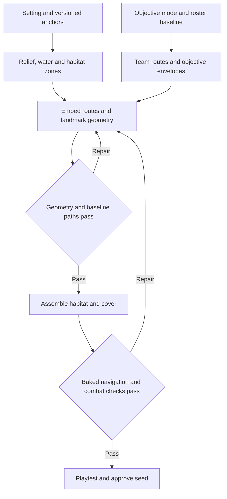

# The environmental vocabulary of wild Pokémon worlds

## Executive synthesis

A useful minimum is a set of **eight geometric generator kernels**, a compact set of authored shape families, and a grammar that handles water, habitat distribution, built landmarks and traversal as separate systems. The research groups the documented physical forms into **35 reusable archetypes and overlays**. The specification catalogs **87 records**, including **24 atomic shape families and 20 parametric formation families**. The other records describe composites, placement patterns, modifiers and gameplay geometry. Several atomic families share a generator or modeled seed. The catalogue count measures the breadth of the specification.

1. **Use structural tests to decide what earns a family.** A desert boulder and a snow-covered boulder share geometry. A natural arch creates a traversable opening and possibly an upper deck, which a scaled boulder cannot provide. Snow can be a cover layer. A fractured ice field requires solid support, crevasse geometry and a movement profile. Shoal Cave shares the cave shell with other caverns and adds a tidal access graph. Reflection Cave uses the cave shell and reflective faces. Its reflections would need extra visibility rules if they affect combat. [SRC-H06](https://bulbapedia.bulbagarden.net/wiki/Shoal_Cave) · [SRC-C05](https://bulbapedia.bulbagarden.net/wiki/Reflection_Cave) · [SRC-A08](https://bulbapedia.bulbagarden.net/wiki/Avalugg%27s_Legacy)
2. **Compose landform, ecology and landmarks independently.** Area Zero is a crater with shelves, cascades and caves. Its Underdepths add a gradient of structural crystal growth and crystal-blocked branches. Hisui’s Grandtree Arena uses woodland geometry, a shallow arena depression and an oversized focal tree. Johto’s Ilex Forest uses a woodland host and a shrine relationship. The parent geometries can support a wide range of recognizable combinations. [SRC-V07](https://bulbapedia.bulbagarden.net/wiki/Area_Zero) · [SRC-V08](https://bulbapedia.bulbagarden.net/wiki/Area_Zero_Underdepths) · [SRC-A10](https://bulbapedia.bulbagarden.net/wiki/Grandtree_Arena) · [SRC-J01](https://bulbapedia.bulbagarden.net/wiki/Ilex_Forest)
3. **Use a hybrid generator for competitive maps.** Choose environmental anchors and a mode-specific topology together. Embed walkable corridors into relief and solids, then verify the resulting navigation, projectile visibility and contest positions. A river network, a cave network and a team approach graph may overlap spatially and each has different rules. Research on procedural hydrology and mission/space generation supports this division. Blizzard’s documented map revisions illustrate the importance of testing cover, flank openings and sightline geometry after embedding. [SRC-M01](https://cs.purdue.edu/homes/bbenes/papers/Genevaux13ToG.pdf) · [SRC-M03](https://pcgworkshop.com/archive/dormans2010adventures.pdf) · [SRC-M09](https://news.blizzard.com/en-us/article/23785339/uniting-gameplay-and-style-behind-overwatch-2-s-complex-map-design) · [SRC-M10](https://news.blizzard.com/en-us/article/24215719/weekly-recall-flashpoint-map-reworks)
4. **Guarantee a playable baseline for every roster member.** For each relevant match state, both teams must be able to reach, contest and retreat from essential areas using the agreed baseline profile. Swimming, flying, climbing, burrowing and environmental resistances can add tactical edges. Two paths that converge under the same gate or uncontestable firing position count as one effective approach. Competitive certification requires geometry checks and human playtests.
5. **Treat exceptional physics as named extensions.** Floating islands need closed solids and support/landing semantics. Room remapping needs public adjacency and state tests. Altered gravity needs local frames for movement, aim, knockback and visibility. An underwater habitat needs a universal underwater profile or an explicitly adapted grounded play footprint. These are the main limits on a general-purpose generator. [SRC-S06](https://bulbapedia.bulbagarden.net/wiki/Distortion_World) · [SRC-S07](https://bulbapedia.bulbagarden.net/wiki/Turnback_Cave) · [SRC-X31](https://bulbapedia.bulbagarden.net/wiki/Sparkling_Skylands) · [SRC-P17](https://www.nintendo.com/us/whatsnew/pokemon-pokopia-expansion-pass-paid-dlc-keep-the-cozy-life-going-with-a-brand-new-underwater-area/)

The companion **Pokemon_World_Design_Matrices.xlsx** contains the full component catalogue, 35-by-87 composition matrix, gameplay matrix, production rules, named-location audit and source register. Stable IDs connect both files.

## Research boundary and evidence

**Research cutoff** November 12, 2026, Toronto. Coverage includes Generations I–IX, remakes that change structural features, both released Legends titles and their applicable updates or DLC, Galar and Paldea expansions, and selected spin-offs with distinctive habitat geometry. The release check includes the 2026 *Legends: Z-A* bundle, *Pokopia* and its released *Bubbly Basin* expansion. *Pokémon Champions* is a battle-focused release. *Winds* and *Waves* are scheduled for 2027 and *Pokopia*’s *Dazzling Decorations* was announced for December 9, 2026. [SRC-P14](https://legends.pokemon.com/en-ca/news/mega-dimension-launch) · [SRC-P15](https://legends.pokemon.com/en-us/news) · [SRC-P16](https://press.pokemon.com/en-CA/Create-Your-Own-Pokemon-Paradise-with-Pokemon-Pokopia-Available-Now) · [SRC-P17](https://www.nintendo.com/us/whatsnew/pokemon-pokopia-expansion-pass-paid-dlc-keep-the-cozy-life-going-with-a-brand-new-underwater-area/) · [SRC-P18](https://press.pokemon.com/en/Items/Schedule/Video-Game?types=2) · [SRC-P19](https://windswaves.pokemon.com/en-us/) · [SRC-P21](https://press.pokemon.com/en-CA/Pokemon-Champions-Launches-April-8-on-Nintendo-Switch) · [SRC-P22](https://www.pokemon.com/us/news/pokemon-pokopia-expansion-pass-part-2-dazzling-decorations-available-december-9) · [SRC-P23](https://press.pokemon.com/en-CA/Launch-Date-and-New-Details-Revealed-for-Pokemon-Pokopia-Expansion-Pas)

The unit of study is a **location and version with a structural signature**. The evidence pass used official region and gameplay material where available, then location descriptions, in-game maps and encounter documentation published in established game references. A name, regional map or concept illustration can establish the presence and broad relationship of a place. A location map or documented traversal sequence can also establish connections, tiers, entrances and barriers. Older tiles give adjacency and floor ordering with uncertain physical dimensions. Modern third-person games and the rail courses of *New Pokémon Snap* provide clearer form and viewpoint evidence. A rail path or quest traversal has different clearance and direction assumptions from competitive locomotion. This was a document- and map-based sample. Exact world meshes, source dimensions, game physics and every named route were outside the audit. [SRC-P01](https://www.pokemon.com/us/news/adventure-from-kanto-to-paldea-with-the-pokemon-center-s-region-map-posters) · [SRC-P02](https://legends.arceus.pokemon.com/en-au/story/) · [SRC-P03](https://legends.arceus.pokemon.com/en-us/gameplay/) · [SRC-P11](https://newpokemonsnap.pokemon.com/en-ca/explore/) · [SRC-X01](https://www.serebii.net/newpokemonsnap/lentalregion.shtml) · [SRC-K01](https://bulbapedia.bulbagarden.net/wiki/Viridian_Forest) · [SRC-H10](https://bulbapedia.bulbagarden.net/wiki/Sky_Pillar)

| Evidence label | Meaning in this specification |
|---|---|
| **Observed** | A source establishes a feature, connection, encounter, event or physical form for the specified title/version. In-world explanations stay identified as lore where the source presents them that way. |
| **Inferred** | Multiple observations support a reusable form or arrangement. Geometry equivalence, generator inputs and physical interpretations can still be abstractions. |
| **Proposed** | Original rules, measurements, parameter values, recipes, match adaptations or architecture. Catalogue entries labeled “Observed form” anchor their geometry in a source. Their generation methods and shooter uses remain proposals. |

**Habitat scope.** Settlements, active facilities, commercial districts, stadiums and arenas defined by human activity are excluded. A protected graveyard, ruined tower, reclaimed wreck or abandoned retail shell can qualify by its wild encounter footprint. Managed habitats contribute their habitat interiors, such as Great Marsh, Hideaways and the Terarium. A shrine or one-off legendary encounter can provide a canonical form without implying a resident population. Abyssal Ruins is a submerged tomb form reference. Lumiose’s Wild Zones supply contained habitat fragments. Hyperspace supplies a transition and fragmented geometry reference. Pokémon GO’s real-world map and competitive battle arenas provide limited canonical world geometry for this task. [SRC-S03](https://bulbapedia.bulbagarden.net/wiki/Great_Marsh) · [SRC-P04](https://diamondpearl.pokemon.com/en-us/trainersguide/grandunderground/) · [SRC-V13](https://bulbapedia.bulbagarden.net/wiki/Terarium) · [SRC-U08](https://bulbapedia.bulbagarden.net/wiki/Abyssal_Ruins) · [SRC-P13](https://legends.pokemon.com/en-us/news/adventure) · [SRC-Z01](https://www.serebii.net/legendsz-a/wildzones.shtml) · [SRC-P14](https://legends.pokemon.com/en-ca/news/mega-dimension-launch) · [SRC-Z04](https://bulbapedia.bulbagarden.net/wiki/Hyperspace_Lumiose)

**Selection and validation method.** Sample each generation’s woodland, relief, water, caves and unusual spaces. Record the source-supported adjacency, vertical order, support, medium, landmark and version. Merge rows with equivalent structural affordances. Split a family only when a change alters support, traversable volume, repeated sockets, visibility or a unique landmark silhouette. Test each recipe on paper against the family list, the matrix and the named-location audit. “Core recipe” means the specification can represent the documented structural relationships. No generator output, collision bake or match has been tested as part of this research.

**Abbreviations.** RBY is *Red/Blue/Yellow*. GSC is *Gold/Silver/Crystal*. RSE is *Ruby/Sapphire/Emerald*. DPPt is *Diamond/Pearl/Platinum*. BW and B2W2 are the two Unova pairs. XY is *X/Y*. SM and USUM are the Alola pairs. SwSh and SV are *Sword/Shield* and *Scarlet/Violet*. FRLG, HGSS, ORAS and BDSP identify the four main remake pairs.

## Contents

- [A. Environment taxonomy](#a-wild-pokémon-environment-taxonomy)
- [B. Reusable 3D components](#b-master-reusable-3d-component-catalogue)
- [C. Composition matrix](#c-environmental-composition-matrix)
- [D. Composition grammar](#d-procedural-environmental-composition-grammar)
- [E. Gameplay functions](#e-gameplay-function-matrix)
- [F. Universal playability](#f-universal-pokémon-playability-rules)
- [G. Coverage audit](#g-coverage-and-completeness-audit)
- [H. Generation architecture](#h-high-level-procedural-generation-architecture)
- [I. Asset priorities](#i-practical-asset-library-prioritization)
- [Worked generation examples](#worked-procedural-generation-examples)
- [Sources](#source-index)

## A. Wild Pokémon environment taxonomy

### Surface vegetation

| Archetype | Defining structure | Variants and combinations | Observed anchors | Generation challenge |
| --- | --- | --- | --- | --- |
| **T01 Open grassland, meadow and scrub mosaic** | Continuous walkable relief and low vegetation broken by cover islands, with open ground dominating sightlines. **Essential.** Ground with tuft patches and a continuous open matrix. | Flower bands, grazing lawns, ponds, scattered trees, rocky rises. Pairs with T02, T07, T12 and T13. | Sinnoh’s Floaroma Meadow in DPPt and Hisui’s Floaro Gardens in Legends: Arceus. Galar’s Wild Area combines open and wooded ground. [SRC-S11](https://bulbapedia.bulbagarden.net/wiki/Floaroma_Meadow) · [SRC-A18](https://bulbapedia.bulbagarden.net/wiki/Floaro_Gardens) · [SRC-P06](https://swordshield.pokemon.com/en-ca/gameplay/wild-area/) · [SRC-G01](https://bulbapedia.bulbagarden.net/wiki/Wild_Area) | Compare T02, where contiguous tall vegetation defines rooms. Keep directional cover and legible route bands in exposed ground. |
| **T02 Temperate woodland, thicket and mountain forest** | Tree stands form a canopy over a usable ground layer. Density gradients alternate passages, groves and gaps. **Essential.** Rooted trees, forest-floor patches and stand-to-gap arrangement. | Conifer habit, steep benches, fallen trunks, cliff forest, oversized fungi and moss. Pairs with T01, T07, T25 and T26. | Viridian Forest (RBY, Kanto), Eterna Forest (DPPt, Sinnoh), Pinwheel Forest (BW, Unova), Tagtree Thicket (SV, Paldea) and Glimwood Tangle (SwSh, Galar). [SRC-K01](https://bulbapedia.bulbagarden.net/wiki/Viridian_Forest) · [SRC-S01](https://bulbapedia.bulbagarden.net/wiki/Eterna_Forest) · [SRC-U01](https://bulbapedia.bulbagarden.net/wiki/Pinwheel_Forest) · [SRC-V04](https://bulbapedia.bulbagarden.net/wiki/Tagtree_Thicket) · [SRC-G03](https://bulbapedia.bulbagarden.net/wiki/Glimwood_Tangle) | Dense path separation distinguishes forest from scattered shade. A giant fungal canopy changes volume only if the caps create tangible overhead geometry. |
| **T03 Multilayer humid forest and jungle** | Canopy, understory and attached plants occupy several strata. Roots, trunks and buttresses affect routes through a wet relief field. **Essential.** Tree stands, dense ground layer and explicit vertical habitat layers. | Lianas, buttresses, fallen trunk crossings, isolated dry terraces, cascades and cave mouths. Pairs with T12, T15 and T25. | Alola’s Lush Jungle (SM/USUM) and Lental’s Founja Jungle (New Pokémon Snap). Founja has a waterfall-side alternate route. [SRC-L02](https://bulbapedia.bulbagarden.net/wiki/Lush_Jungle) · [SRC-X03](https://bulbapedia.bulbagarden.net/wiki/Founja_Jungle) | Canopy layering and wet-edge dependencies distinguish it from T02. Ground circulation stays readable under the projected canopy. |
| **T04 Wooded swamp and wet thicket** | A canopy sits over shallow or waterlogged low ground with banks, root mounds or raised dry patches. **Essential.** Low relief, wet basin, wet-adapted stands and a dry tread network. | Muddy pools, root buttresses, hummocks, logs and seasonal saturation. Pairs with T02, T12 and T14. | Kalos Route 14 (XY) and the wetland mosaic of Hisui’s Crimson Mirelands (Legends: Arceus), including Holm of Trials as a regional reference. [SRC-C04](https://bulbapedia.bulbagarden.net/wiki/Kalos_Route_14) · [SRC-A02](https://bulbapedia.bulbagarden.net/wiki/Crimson_Mirelands) · [SRC-A12](https://bulbapedia.bulbagarden.net/wiki/Holm_of_Trials) | T14 can be largely open. Here trees and saturated ground both shape the route network. Place stable entrances above the wet footprint. |

### Surface relief

| Archetype | Defining structure | Variants and combinations | Observed anchors | Generation challenge |
| --- | --- | --- | --- | --- |
| **T05 Sand desert, dune field and interdune basin** | Wind-organized sand relief alternates exposed crests, lee slopes and sheltered low areas. **Essential.** Dry relief, dune profiles and protected travel saddles or interdune routes. | Exposed bedrock, cacti, buried masonry and localized sand traps. Pairs with T06, T27 and T28. | Desert Resort (BW/B2W2, Unova), Asado Desert (SV, Paldea), Potbottom Desert (SwSh DLC, Galar) and the maze of Haina Desert (SM/USUM, Alola). Dune organization is a proposed synthesis of sandy references. [SRC-U04](https://bulbapedia.bulbagarden.net/wiki/Desert_Resort) · [SRC-V01](https://bulbapedia.bulbagarden.net/wiki/Asado_Desert) · [SRC-G06](https://bulbapedia.bulbagarden.net/wiki/Potbottom_Desert) · [SRC-L04](https://bulbapedia.bulbagarden.net/wiki/Haina_Desert) · [SRC-M19](https://www.nps.gov/subjects/geology/aeolian-landforms.htm) | T06 is controlled by bedrock. Keep steep slip faces optional and put distinctive barriers at meaningful scale. |
| **T06 Arid badlands, stony flats and eroded escarpment** | Bedrock ledges, rock clusters or a cliff system dominate movement across sparsely planted ground. **Essential.** Dry relief plus exposed lithic breaks or outcrops. | Talus, gullies, rock towers, sand pockets and a sheltered spring. Pairs with T05, T08 and T11. | Kalos Route 9’s rocky Rhyhorn passage (XY), Reversal Mountain’s exterior (B2W2, Unova) and Galar’s Dusty Bowl (SwSh). [SRC-C02](https://bulbapedia.bulbagarden.net/wiki/Kalos_Route_9) · [SRC-U06](https://bulbapedia.bulbagarden.net/wiki/Reversal_Mountain) · [SRC-G01](https://bulbapedia.bulbagarden.net/wiki/Wild_Area) | A few dune patches remain a substrate choice. Repeated parallel cliff walls can erase flanks unless there are saddles or crosscuts. |
| **T07 Rocky mountain, ridge, pass and alpine slope** | A connected slope–bench–ridge system climbs through exposed and sheltered elevations. **Essential.** Relief, linked climbable benches and rock breaks. | Snowpack, treeline, scree, cliff-foot caves, summit ruins, subalpine ponds. Pairs with T02, T08, T10 and T28. | Mt. Silver (GSC/HGSS, Johto–Kanto border), Mt. Coronet (DPPt, Sinnoh), Glaseado Mountain (SV, Paldea), Route 17 (XY, Kalos) and Mount Lanakila (SM/USUM, Alola). [SRC-J05](https://bulbapedia.bulbagarden.net/wiki/Mt._Silver) · [SRC-S04](https://bulbapedia.bulbagarden.net/wiki/Mount_Coronet) · [SRC-V03](https://bulbapedia.bulbagarden.net/wiki/Glaseado_Mountain) · [SRC-C03](https://bulbapedia.bulbagarden.net/wiki/Kalos_Route_17) · [SRC-L10](https://bulbapedia.bulbagarden.net/wiki/Mount_Lanakila) | A snowy surface keeps this terrain grammar. Connected ice geometry and crevasses make T10 a structural change. |
| **T08 Canyon, gorge, ravine and natural pass** | Two flanks confine a deep linear gap. Rim, wall ledges and floor can carry distinct connected routes. **Essential.** Carved corridor, steep flanks and longitudinal floor or rim routes. | Side gulches, waterfalls, bridges, caves, arches and riverbeds. Pairs with T06, T07, T12 and T28. | Vast Poni Canyon (SM/USUM, Alola), Grande Vallée Way or Route 19 (XY, Kalos) and Fellhorn Gorge (SV DLC, Kitakami). [SRC-L05](https://bulbapedia.bulbagarden.net/wiki/Vast_Poni_Canyon) · [SRC-C06](https://bulbapedia.bulbagarden.net/wiki/Kalos_Route_19) · [SRC-V15](https://bulbapedia.bulbagarden.net/wiki/Fellhorn_Gorge) | A mountain pass can be a saddle without a deep channel. Check that rim and floor do not repeatedly meet at the same defended choke. |
| **T09 Enclosed depression, crater and sink basin** | A rim encloses an inward-facing catchment with descending shelves or a floor chamber. **Essential.** Bowl or rim, descending connections and a low floor. | Waterfalls, internal woodland, pond, sink drains, caves and minerals. Pairs with T12, T13, T20, T23 and T35. | Giant Chasm (BW/B2W2, Unova), Area Zero (SV, Paldea) and Sendoff Spring (DPPt, Sinnoh). Giant Chasm’s meteor origin is presented as lore. [SRC-U07](https://bulbapedia.bulbagarden.net/wiki/Giant_Chasm) · [SRC-V07](https://bulbapedia.bulbagarden.net/wiki/Area_Zero) · [SRC-S08](https://bulbapedia.bulbagarden.net/wiki/Sendoff_Spring) | Compare T08’s longitudinal relief. Keep separate rim-to-floor access or split the crater into sectors with playable links. |
| **T10 Structural ice, crevassed field and ice-floe coast** | Ice is solid landform or discrete route substrate. Crevasses, thick ramps, cliffs or floes organize space. **Essential.** Ice-bearing solid surfaces or pieces with explicit connectivity and safe edges. | Snowdrifts, buried cave links, ice columns, frozen lake skins and breakable sheets. Pairs with T07, T13, T16 and T22. | Avalugg’s Legacy (Legends: Arceus, Hisui), Frigid Sea (SwSh DLC, Galar) and Shiver Snowfields (New Pokémon Snap, Lental). [SRC-A08](https://bulbapedia.bulbagarden.net/wiki/Avalugg%27s_Legacy) · [SRC-G09](https://bulbapedia.bulbagarden.net/wiki/Frigid_Sea) · [SRC-X07](https://bulbapedia.bulbagarden.net/wiki/Shiver_Snowfields) | Snow coating is a modifier. Frozen lake, fractured mass and floating pack need different support and hazard profiles. A flowing-glacier simulation is optional and beyond this specification. |
| **T11 Volcanic cone, caldera and geothermal field** | A volcanic relief field has coherent crater, exposed rock and either a volcanic deposit or hot activity. Thermal areas can also sit on nonvolcanic-looking surface relief. **Essential.** Relief and one of crater/vent, lava exposure, ash-linked source or hot-water outlets. | Ash apron, cooled lava, fumaroles, hot pools, scoria slopes and lava cavities. Pairs with T07, T09, T15 and T21. | Mt. Chimney and ash on Route 113 (RSE, Hoenn), Wela Volcano Park (SM/USUM, Alola), Firespit Island (Legends: Arceus, Hisui) and Snowfall Hot Spring as a small thermal patch. [SRC-H01](https://bulbapedia.bulbagarden.net/wiki/Mt._Chimney) · [SRC-H03](https://bulbapedia.bulbagarden.net/wiki/Hoenn_Route_113) · [SRC-L03](https://bulbapedia.bulbagarden.net/wiki/Wela_Volcano_Park) · [SRC-A06](https://bulbapedia.bulbagarden.net/wiki/Firespit_Island) · [SRC-A17](https://bulbapedia.bulbagarden.net/wiki/Snowfall_Hot_Spring) | An ash-covered ordinary route is a linked modifier. Active vents and accessible hot landforms need coherent source zones and safe route reserves. |

### Fresh water

| Archetype | Defining structure | Variants and combinations | Observed anchors | Generation challenge |
| --- | --- | --- | --- | --- |
| **T12 River corridor, stepped pools and waterfall valley** | A directed drainage network orders banks, terraces, drops, plunge pools and outflow. **Essential.** Channel and bank relief with a connected hydrological source and outlet or closed sink. | Floodplain, fords, gorges, step pools, bridges, cave bypass and riverside woods. Pairs with T03, T08, T13 and T14. | Route 119 (RSE/ORAS, Hoenn), Brooklet Hill (SM/USUM, Alola, Wishiwashi in SM trial) and Mightywide River (New Pokémon Snap, Lental). [SRC-H05](https://bulbapedia.bulbagarden.net/wiki/Hoenn_Route_119) · [SRC-L01](https://bulbapedia.bulbagarden.net/wiki/Brooklet_Hill) · [SRC-P12](https://newpokemonsnap.pokemon.com/en-gb/free-update/) · [SRC-X33](https://www.serebii.net/newpokemonsnap/locations/mightywideriver.shtml) | Compare T13’s still-water basin. Align every cascade lip and receiving basin and reserve dry tactical crossings. |
| **T13 Lake, pond, spring basin and inland islands** | A still-water basin creates a continuous shoreline, a standing water plane and optional interior islands. **Essential.** Basin, water body and at least one stable shore band. | Riparian patches, feeder stream, outlet, skerries, cave on shore and ice lid. Pairs with T09, T10, T12 and T14. | Casseroya Lake (SV, Paldea), Lake of Rage (GSC/HGSS, Johto) and Lake Acuity (DPPt or Legends: Arceus). Dondozo is associated with Casseroya Lake. [SRC-V02](https://bulbapedia.bulbagarden.net/wiki/Casseroya_Lake) · [SRC-V19](https://bulbapedia.bulbagarden.net/wiki/Dondozo_(Pok%C3%A9mon)) · [SRC-J06](https://bulbapedia.bulbagarden.net/wiki/Lake_of_Rage) · [SRC-S15](https://bulbapedia.bulbagarden.net/wiki/Template%3ASinnoh) · [SRC-A15](https://bulbapedia.bulbagarden.net/wiki/Lake_Acuity) | Lakes may have inflows or closed basins. Preserve dry rotational options when water splits paths and reserve more than one usable landing. |
| **T14 Open marsh, mire, mudflat and seasonally flooded meadow** | Waterlogged low relief, pools and emergent vegetation organize hummock-to-hummock travel with limited canopy. **Essential.** Shallow wet basins, substrate bands, emergent clumps and dry treads. | Deadwood, pools, mud friction, reeds and grass. Pairs with T04, T12, T13 and T15 via estuary edges. | Great Marsh (DPPt, Sinnoh), Scarlet Bog (Legends: Arceus, Hisui) and Soothing Wetlands (SwSh DLC, Galar). Great Marsh includes wild Croagunk in supported versions. [SRC-S03](https://bulbapedia.bulbagarden.net/wiki/Great_Marsh) · [SRC-A11](https://bulbapedia.bulbagarden.net/wiki/Scarlet_Bog) · [SRC-G15](https://bulbapedia.bulbagarden.net/wiki/Soothing_Wetlands) | Localized mud and pool shape change movement more than a wet material. Test actual capsule clearance across linked dry islands. |

### Coast and sea

| Archetype | Defining structure | Variants and combinations | Observed anchors | Generation challenge |
| --- | --- | --- | --- | --- |
| **T15 Depositional beach, barrier and lagoon shore** | A broad low shore or sheltered embayment has land–intertidal–water bands. Land can partly enclose a lagoon. **Essential.** Continuous shore profile, tidal margin and a navigable dry band. | Spits, backshore dunes, river mouths, salt-tolerant growth, reef and skerries. Pairs with T03, T12, T16 and T17. | Hano Beach and Poni Wilds (SM/USUM, Alola), Loop Lagoon (SwSh DLC, Galar) and Cobalt Coastlands (Legends: Arceus, Hisui). [SRC-L22](https://bulbapedia.bulbagarden.net/wiki/Alola) · [SRC-L20](https://bulbapedia.bulbagarden.net/wiki/Poni_Wilds) · [SRC-G05](https://bulbapedia.bulbagarden.net/wiki/Loop_Lagoon) · [SRC-A03](https://bulbapedia.bulbagarden.net/wiki/Cobalt_Coastlands) | T16’s coast is dominated by relief and rock edges. Tide-state checks apply when the intertidal band becomes playable. |
| **T16 Rocky shore, sea cliff, headland and sea stack** | Relief rises immediately from sea level, with notches or separate high and low corridors. **Essential.** Rock face, coastal cut and a stable ledge or dry upper route. | Stacks, sea arches, pockets of beach, sea caves, blowhole-like outlets and storm benches. Pairs with T08, T15 and T18. | Kalos Route 8 (XY) has upper cliff and lower coastal paths. Poni Breaker Coast (SM/USUM, Alola) and Cobalt Coastlands (Legends: Arceus) offer further shore references. [SRC-C01](https://bulbapedia.bulbagarden.net/wiki/Kalos_Route_8) · [SRC-L21](https://bulbapedia.bulbagarden.net/wiki/Poni_Breaker_Coast) · [SRC-A03](https://bulbapedia.bulbagarden.net/wiki/Cobalt_Coastlands) | A continuous cliff is a map barrier. Put optional sea openings below stable paths and guard cliff-top firing dominance. |
| **T17 Reef shelf, kelp bed and underwater drop-off** | Submerged terrain has meaningful bathymetry, habitat clusters, optional vertical voids and a shared water volume. **Essential.** Submerged shelf or bowl with clusters and a coherent submerged zone. | Reef heads, blue hole, seagrass, underwater cave, submerged artifacts or visible dry shelf. Pairs with T15, T18 and T29. | Lental Seafloor and Maricopia Reef (New Pokémon Snap) and Hoenn’s Dive routes (RSE/ORAS). Lental has a Lugia side route in the underwater course. [SRC-X02](https://bulbapedia.bulbagarden.net/wiki/Lental_Seafloor) · [SRC-X09](https://bulbapedia.bulbagarden.net/wiki/Maricopia_Reef) · [SRC-H08](https://bulbapedia.bulbagarden.net/wiki/Underwater) | Water volume alone does not define bathymetry. Grounded combat needs a dry spine or a true universal submerged locomotion profile. |

### Subsurface

| Archetype | Defining structure | Variants and combinations | Observed anchors | Generation challenge |
| --- | --- | --- | --- | --- |
| **T18 Littoral, wet and tidal cave** | Floodable chambers or passages connect to exterior water through defined levels, currents or entry throats. **Essential.** Cavity and passages, water interface and at least one aquatic connection. | Ice chamber, saltwater pool, currents, route switching, dry high gallery. Pairs with T16, T17, T19 and T22. | Shoal Cave (RSE/ORAS, Hoenn), Seafoam Islands (RBY and remakes, Kanto), Whirl Islands (GSC/HGSS, Johto, Lugia) and Seaward Cave (SM/USUM, Alola). [SRC-H06](https://bulbapedia.bulbagarden.net/wiki/Shoal_Cave) · [SRC-K03](https://bulbapedia.bulbagarden.net/wiki/Seafoam_Islands) · [SRC-J02](https://bulbapedia.bulbagarden.net/wiki/Whirl_Islands) · [SRC-L19](https://bulbapedia.bulbagarden.net/wiki/Seaward_Cave) | T19 can contain a puddle. Here connected water changes access, current direction, entrances or route availability. |
| **T19 Bedrock passage cave and chamber network** | A roof encloses a linked walkable network with chambers and widening/narrowing cross-sections. **Essential.** Entrance, enclosed tunnel and one or more chambers. | Scallops, boulders, speleothems, pools and side niches. Pairs with T07, T18, T20 and T23. | Mt. Moon and Cerulean Cave (RBY, Kanto), Wellspring Cave (BW, Unova), and Reflection Cave (XY, Kalos). [SRC-K02](https://bulbapedia.bulbagarden.net/wiki/Mt._Moon) · [SRC-K04](https://bulbapedia.bulbagarden.net/wiki/Cerulean_Cave) · [SRC-U02](https://bulbapedia.bulbagarden.net/wiki/Wellspring_Cave) · [SRC-C05](https://bulbapedia.bulbagarden.net/wiki/Reflection_Cave) | A cave can use several elevation levels without T20’s persistent vertical interlock. Reflectivity is a surface variant until it changes visibility or play. |
| **T20 Multilevel cavern, sink and subterranean ecosystem** | Connected volumes overlap in plan, with stacked ledges, shafts and traversable links. **Essential.** Solid/void representation, vertically overlapping rooms and at least two connected elevation layers. | Surface sink, skylights, streams, internal shelf ecosystems, giant columns, chambers under the surface graph. Pairs with T09, T18, T22 and T23. | Mt. Coronet (DPPt, Sinnoh), Brawlers’ Cave (SwSh DLC, Galar), Dalizapa Passage (SV, Paldea) and Outaway Cave (New Pokémon Snap). Karst is an optional modeling analogy. [SRC-S04](https://bulbapedia.bulbagarden.net/wiki/Mount_Coronet) · [SRC-G04](https://bulbapedia.bulbagarden.net/wiki/Brawlers%27_Cave) · [SRC-V05](https://bulbapedia.bulbagarden.net/wiki/Dalizapa_Passage) · [SRC-X05](https://bulbapedia.bulbagarden.net/wiki/Outaway_Cave) | Separate vertical navigation layers and model their clearance. T19 can be built with simpler chamber–tunnel sections. |
| **T21 Volcanic cave, hot gallery and lava-tube profile** | A covered chamber network is organized around a thermal floor, elongated lava-like conduit or hot-water system. **Essential.** Roofed cavity and a heat source, lava corridor or geothermal water feature. | Cooled crust, skylights, pressure vents, basalt shelves and steep breaks. Pairs with T11 and T19. | Fiery Path (RSE, Hoenn) supplies a hot passage reference, Reversal Mountain (White 2, Unova) a magma cave, and Fireflow Volcano (New Pokémon Snap) a modern volcanic profile. [SRC-H02](https://bulbapedia.bulbagarden.net/wiki/Fiery_Path) · [SRC-U06](https://bulbapedia.bulbagarden.net/wiki/Reversal_Mountain) · [SRC-X08](https://bulbapedia.bulbagarden.net/wiki/Fireflow_Volcano) | Lava-tube formation is a proposed physical option. Water-filled Black 2 Reversal Mountain has a different hazard profile using the same shell family. |
| **T22 Ice cave, frozen hollow and brittle ice corridor** | Ice makes traversable surfaces, columns or obstruction inside an enclosed network. **Essential.** Cavity, tunnel, ice surfaces and a defined movement/contact profile. | Icicles, brittle roof or floor, icefall, non-slip rim, frozen pool and multiple exits. Pairs with T10, T18 and T19. | Ice Path (GSC/HGSS, Johto), Icefall Cave (FRLG, Sevii), Frost Cavern (XY, Kalos) and Icepeak Cavern (Legends: Arceus, Hisui). [SRC-J04](https://bulbapedia.bulbagarden.net/wiki/Ice_Path) · [SRC-K07](https://bulbapedia.bulbagarden.net/wiki/Icefall_Cave) · [SRC-C07](https://bulbapedia.bulbagarden.net/wiki/Frost_Cavern) · [SRC-A09](https://bulbapedia.bulbagarden.net/wiki/Icepeak_Cavern) | An icy shader preserves T19’s routes. Physical frozen floors, fractures or volumes change the traversal contract. |
| **T23 Crystal, mineral and magnetic cavern** | Clusters are large enough to shape occlusion, accessible cavities, routes or encounter landmarks. **Essential.** Cavern and structural-size mineral masses with sockets and clearance. | Mineral blades, floating stone, crystalline walls and blocked branches. Pairs with T19, T20, T33 and T35. | Chargestone Cave (BW/B2W2, Unova), Chargestone Cavern and Area Zero Underdepths (SV DLC), and Outaway Cave (New Pokémon Snap). [SRC-U03](https://bulbapedia.bulbagarden.net/wiki/Chargestone_Cave) · [SRC-V14](https://bulbapedia.bulbagarden.net/wiki/Chargestone_Cavern) · [SRC-V08](https://bulbapedia.bulbagarden.net/wiki/Area_Zero_Underdepths) · [SRC-X05](https://bulbapedia.bulbagarden.net/wiki/Outaway_Cave) | The material is optional on rock assets until mass distribution changes space. Floating or gated masses are a behavior layer. |
| **T24 Excavated, mine-like and biogenic galleries** | Voids follow intentional, repeated bores, galleries or shafts with consistent portals. Excavation agent is a recipe attribute. **Essential.** Tunnel shape with repeatable junctions and a portal or entrance grammar. | Tool marks, posts, stairs, service voids, side habitat chambers, variable branching from excavator size. Pairs with T19, T20 and T34. | Diglett’s Cave (RBY, Kanto, attributed to Diglett and Dugtrio), Terminus Cave (XY, Kalos, former mine), and BDSP Grand Underground. Active industrial areas stay outside the scope. [SRC-K09](https://bulbapedia.bulbagarden.net/wiki/Diglett%27s_Cave) · [SRC-C09](https://bulbapedia.bulbagarden.net/wiki/Terminus_Cave) · [SRC-P04](https://diamondpearl.pokemon.com/en-us/trainersguide/grandunderground/) | Straightness, repeated dimensions and cut geometry mark T24. The same sweep generator as T19 uses distinct placement and cross-section rules. |

### Habitat landmark overlay

| Archetype | Defining structure | Variants and combinations | Observed anchors | Generation challenge |
| --- | --- | --- | --- | --- |
| **T25 Sacred grove and giant-tree arena** | A natural stand frames a focal tree, shrine, or both in a meaningful threshold–clearing sequence. **Essential.** Focal tree or shrine and an open or enclosed grove around it. | Buttress arcades, rings, plinths, raised roots, sheltered approaches. Pairs with T02, T03, T13 and T30. | Ilex Forest (GSC/HGSS, Johto, Celebi shrine), Grandtree Arena (Legends: Arceus, Hisui, noble Kleavor), and Dyna Tree Hill (SwSh DLC, Galar). [SRC-J01](https://bulbapedia.bulbagarden.net/wiki/Ilex_Forest) · [SRC-A10](https://bulbapedia.bulbagarden.net/wiki/Grandtree_Arena) · [SRC-G08](https://bulbapedia.bulbagarden.net/wiki/Dyna_Tree_Hill) | A shrine alone is T28. Grove geometry needs protected roots, usable cover gaps and focal sightlines from more than one entrance. |
| **T26 Open graveyard, memorial hill and exterior necropolis** | Grave markers create recognizable groups on a walkable hillside or enclosure among wild habitat edges. **Essential.** Open burial plots, spaced markers and a route spine with openings. | Boundary walls, steps, crypt portal, mature trees, overgrown corner. Pairs with T02, T07, T25 and T27. | Old Cemetery (SwSh DLC, Galar), Memorial Hill (SM/USUM, Alola) and Mt. Pyre’s outdoor memorial complex in Hoenn. Old Cemetery and Memorial Hill have Ghost-type encounters. [SRC-G07](https://bulbapedia.bulbagarden.net/wiki/Old_Cemetery) · [SRC-L07](https://bulbapedia.bulbagarden.net/wiki/Memorial_Hill) · [SRC-L08](https://www.serebii.net/pokearth/alola/memorialhill.shtml) · [SRC-H09](https://bulbapedia.bulbagarden.net/wiki/Mt._Pyre) | Unlike a tomb, most movement takes place outdoors. Preserve burial plot spacing and test that rows cannot create a firing grid with one dominant end. |
| **T27 Enclosed tomb, funerary tower and buried labyrinth** | Built volumes with chambers, grave rooms or stacked floors follow a repeated masonry plan. **Essential.** Built enclosure and linked rooms or floors with ritual/burial geometry. | Crypt, inscribed blocks, quicksand drops, submerged approach, narrow turn rooms and broken stair cores. Pairs with T05, T18, T26 and T28. | Pokémon Tower (RBY, Kanto), Mt. Pyre (RSE/ORAS, Hoenn), Relic Castle (BW/B2W2, Unova), and Abyssal Ruins (BW/B2W2) as a form reference with no ordinary wild encounters documented in its chambers. [SRC-K05](https://bulbapedia.bulbagarden.net/wiki/Pok%C3%A9mon_Tower) · [SRC-H09](https://bulbapedia.bulbagarden.net/wiki/Mt._Pyre) · [SRC-U05](https://bulbapedia.bulbagarden.net/wiki/Relic_Castle) · [SRC-U08](https://bulbapedia.bulbagarden.net/wiki/Abyssal_Ruins) | T28 foregrounds a threshold and focal outdoor platform. Dungeon gating and floor changes need return routes and accessible objective variants. |
| **T28 Ruin field, shrine terrace and legendary sanctuary** | Deliberately positioned remains, a ritual axis or a ring organize a threshold and a focal precinct. **Essential.** Foundation or carved shelf, meaningful arrangement and a focal ruin or monument. | Pillars, altar, open court, approach stair, cave passage, regional symbols or broken canopy. Pairs with T07, T08, T19, T25 and T33. | Ruins of Alph (GSC/HGSS, Johto, Unown), Spear Pillar (DPPt, Sinnoh), Temple of Sinnoh (Legends: Arceus), Altar of the Sunne (SM/USUM, Alola) and Crown Shrine (SwSh DLC, Galar). [SRC-J03](https://bulbapedia.bulbagarden.net/wiki/Ruins_of_Alph) · [SRC-S05](https://bulbapedia.bulbagarden.net/wiki/Spear_Pillar) · [SRC-A07](https://bulbapedia.bulbagarden.net/wiki/Temple_of_Sinnoh) · [SRC-L06](https://bulbapedia.bulbagarden.net/wiki/Altar_of_the_Sunne) · [SRC-G10](https://bulbapedia.bulbagarden.net/wiki/Crown_Shrine) | The same masonry can form a tomb. A sanctuary privileges a landmark axis and occupied threshold. Exact silhouette and relief sometimes need authored geometry. |
| **T29 Derelict shell, wreck and reclaimed settlement fragment** | A dormant human-made enclosure serves as habitat after structural loss, flooding or ecological colonization. **Essential.** Partial enclosure, openings and viable habitat access. | Broken floors, hull compartments, collapsed facade, debris fans and root ingress. Pairs with T16–T18, T24 and T35. | Kanto Pokémon Mansion (RBY), Old Chateau (DPPt, Sinnoh), Alola’s Thrifty Megamart (Abandoned Site, Mimikyu), Hoenn’s Abandoned Ship and Sea Mauville, and Ultra Ruin. [SRC-K06](https://bulbapedia.bulbagarden.net/wiki/Pok%C3%A9mon_Mansion_%28Kanto%29) · [SRC-S02](https://bulbapedia.bulbagarden.net/wiki/Old_Chateau) · [SRC-L09](https://bulbapedia.bulbagarden.net/wiki/Thrifty_Megamart_%28Abandoned_Site%29) · [SRC-H13](https://bulbapedia.bulbagarden.net/wiki/Abandoned_Ship) · [SRC-H14](https://bulbapedia.bulbagarden.net/wiki/Sea_Mauville) · [SRC-L16](https://bulbapedia.bulbagarden.net/wiki/Ultra_Ruin) | Reuse cut/fill and opening rules. A listing hull or tilted platform is an extension where structure and floor connections become distinctive. |
| **T30 Pokémon-made or maintained microhabitat** | Animal construction or occupation organizes an observable substrate feature, entrance network or resource patch. **Essential.** Host substrate and a localized construction/occupation relationship. | Dig galleries, root niches, occupied roosts, feeding patches and managed habitat recipes. Pairs with T03, T13, T17, T24, T25 and T34. | Diglett’s Cave explicitly credits its excavators. Honeycalm Island (SwSh DLC) supports a Vespiquen encounter at its central tree, and Pokopia explicitly connects habitat creation to Pokémon moves. [SRC-K09](https://bulbapedia.bulbagarden.net/wiki/Diglett%27s_Cave) · [SRC-G11](https://bulbapedia.bulbagarden.net/wiki/Honeycalm_Island) · [SRC-P16](https://press.pokemon.com/en-CA/Create-Your-Own-Pokemon-Paradise-with-Pokemon-Pokopia-Available-Now) | An encounter at a landmark alone proves occupation only. Model visible traces with existing components. Add a nest form when documented geometry or mechanics justify it. |

### Exceptional topology overlay

| Archetype | Defining structure | Variants and combinations | Observed anchors | Generation challenge |
| --- | --- | --- | --- | --- |
| **T31 Floating landmasses and aerial structures** | Detached, solid islands or structures hang over open space and require explicit connections. **Essential.** Detached volumes, stable landings and a structural suspension rule. | Rock bridges, engineered decks, cloud-supported towers, separated landings, visible anchor stones. Pairs with T07, T25, T28 and T35. | Sparkling Skylands (Pokopia) has floating islands and a land link. Sky Tower (Mystery Dungeon Rescue Team) is a sky dungeon. Ranger: Guardian Signs has an ancient Sky Fortress. [SRC-X31](https://bulbapedia.bulbagarden.net/wiki/Sparkling_Skylands) · [SRC-X12](https://bulbapedia.bulbagarden.net/wiki/Sky_Tower) · [SRC-X24](https://bulbapedia.bulbagarden.net/wiki/Pokemon_Ranger%3A_Locus_of_Light) | One continuous heightfield cannot encode this form. Apply rigid support and ensure grounded routes across the void. |
| **T32 Multi-frame gravity and traversable inverted terrain** | Walkable surfaces occupy distinct orientation frames with explicit crossings between them. **Essential.** Oriented support surfaces, stable transitions and state-specific camera and collision behavior. | Floating platforms, lateral walls, inverted waterfall paths, articulated scenery. Pairs with T20, T31 and T33. | Platinum’s Distortion World (Sinnoh, Giratina) includes altered orientation and unusual waterfall traversal. [SRC-S06](https://bulbapedia.bulbagarden.net/wiki/Distortion_World) | Floating rocks alone are T31 or T23. Walkable vertical planes require an independent navigation and combat frame. Standard-gravity foreground is an adaptation. |
| **T33 Portal, state-shift and dislocated habitats** | Traversable adjacency, geography or ecology is keyed to an explicit transition or state field. **Essential.** Stable rooms, an entry/exit mechanism and declared state or scene adjacency. | Reused room sets, alternate seasons, battle seams, exposed void edges and mirrored fragments. Pairs with T02, T20, T28, T31 and T35. | Turnback Cave (DPPt), Elsewhere Forest (New Pokémon Snap), Ultra Space (USUM), Hisui’s space-time distortions and Hyperspace Lumiose (Legends: Z-A DLC), including a Hyperspace Sky Pillar. These references use different transition mechanisms. [SRC-S07](https://bulbapedia.bulbagarden.net/wiki/Turnback_Cave) · [SRC-X04](https://bulbapedia.bulbagarden.net/wiki/Elsewhere_Forest) · [SRC-P05](https://press.pokemon.com/en/BEYOND-THE-ULTRA-WORMHOLES-MORE-NEW-DETAILS-REVEALED-FOR-POKEMON-54395) · [SRC-A16](https://bulbapedia.bulbagarden.net/wiki/Space-time_distortion) · [SRC-P14](https://legends.pokemon.com/en-ca/news/mega-dimension-launch) · [SRC-Z04](https://bulbapedia.bulbagarden.net/wiki/Hyperspace_Lumiose) · [SRC-Z06](https://bulbapedia.bulbagarden.net/wiki/Hyperspace_Sky_Pillar) · [SRC-U14](https://bulbapedia.bulbagarden.net/wiki/Lost_Forest) | A weather change stays a modifier when it leaves topology and combat unchanged. Portals and remapped adjacency require state-complete validation. |

### Exceptional habitat overlay

| Archetype | Defining structure | Variants and combinations | Observed anchors | Generation challenge |
| --- | --- | --- | --- | --- |
| **T34 Curated, enclosed and restored habitat mosaics** | Wild habitat patches occupy engineered boundaries or player/Pokémon-restored land. The underlying physical zones retain their own archetypes. **Essential.** Compartment or restoration mask plus independently viable habitat patches and interfaces. | Dome, inter-zone caves, shaped shore, constructed habitat clusters, habitat chemistry or power infrastructure. Pairs with T01–T24, T29 and T30. | HGSS Johto Safari Zone’s rearrangeable areas, BDSP Hideaways, The Indigo Disk’s Terarium, and Pokopia’s Withered Wasteland/Bubbly Basin. [SRC-J09](https://bulbapedia.bulbagarden.net/wiki/Johto_Safari_Zone) · [SRC-P04](https://diamondpearl.pokemon.com/en-us/trainersguide/grandunderground/) · [SRC-V13](https://bulbapedia.bulbagarden.net/wiki/Terarium) · [SRC-P16](https://press.pokemon.com/en-CA/Create-Your-Own-Pokemon-Paradise-with-Pokemon-Pokopia-Available-Now) · [SRC-X28](https://bulbapedia.bulbagarden.net/wiki/Withered_Wasteland) · [SRC-P17](https://www.nintendo.com/us/whatsnew/pokemon-pokopia-expansion-pass-paid-dlc-keep-the-cozy-life-going-with-a-brand-new-underwater-area/) | Use the habitat footprint of active parks/school facilities. Engines of the surrounding active settlement fall outside scope. Forced adjacent climates need a divider or documented fictional support. |
| **T35 Alien analog habitats and landmark-scale anomalies** | A familiar structural substrate combines with one or more persistently unusual shape, support or biological profiles. **Essential.** Base archetype and a physically legible anomaly with bounded influence. | Ribbon or cable-like formations, spiral trees, alien geothermal outlets, faceted cave walls and ruins of an abandoned world. Pairs with T11, T19, T23, T29, T31 and T33. | USUM Ultra Jungle (Buzzwole), Ultra Plant (Xurkitree), Ultra Crater (Celesteela), Ultra Forest (Kartana), Ultra Desert (Pheromosa), Ultra Ruin (Guzzlord), and Ultra Deep Sea (Nihilego). [SRC-P05](https://press.pokemon.com/en/BEYOND-THE-ULTRA-WORMHOLES-MORE-NEW-DETAILS-REVEALED-FOR-POKEMON-54395) · [SRC-L11](https://bulbapedia.bulbagarden.net/wiki/Ultra_Deep_Sea) · [SRC-L12](https://bulbapedia.bulbagarden.net/wiki/Ultra_Forest) · [SRC-L13](https://bulbapedia.bulbagarden.net/wiki/Ultra_Plant) · [SRC-L14](https://bulbapedia.bulbagarden.net/wiki/Ultra_Crater) · [SRC-L15](https://bulbapedia.bulbagarden.net/wiki/Ultra_Jungle) · [SRC-L16](https://bulbapedia.bulbagarden.net/wiki/Ultra_Ruin) · [SRC-L17](https://bulbapedia.bulbagarden.net/wiki/Ultra_Desert) | Alien provenance alone adds no geometry. Use shaped growth, floating solids or authored motifs when a physical signature demands them. Verify the medium before assigning swimming. |

### Classification axes and recipe identity

The taxonomy starts with physical support and landform. It applies habitat overlays and behavior only after the structural profile has been selected.

| Axis | Values used by a recipe | What changes when the axis changes |
|---|---|---|
| Spatial support | Continuous relief, roofed volume, submerged volume, discrete aerial solids, oriented surfaces | The geometry representation, collision and navigation model |
| Landform | Ridge, basin, longitudinal incision, coast, depositional field, cavern and built compartment | Cross-sections, height relations and useful placement sites |
| Medium and water regime | Dry, saturated, freshwater, intertidal, marine, ice, thermal, bounded fictional medium | Water levels, downstream routing, support, traction and hazard tests |
| Ecology | Open, woodland, layered humid, emergent wetland, marine, mineral-associated, curated or alien | Placement strata, suitability fields and distribution of cover |
| Landmark and habitat function | Shelter, feeder/roost, territory, burial precinct, sanctuary, abandoned shell, managed compartment | Focal silhouette, travel order, threshold and resource sockets |
| Connectivity and state | Continuous, stacked, linked islands, portal, gated, tide-dependent, locally reoriented | Route graph, return policy, public state and required validation |
| Climate and exposure | Temperature, season, wind, moisture, snowpack, ash, fog | Habitat masks and surface profiles. Geometry changes only when physical support or space changes. |

**Inferred.** “Island” is a boundary and connectivity configuration. The same island can combine beach on the leeward side, a rocky headland, a forested interior and a volcanic summit. An archipelago adds multiple landmasses and a crossing policy. “Haunted” is an encounter, visibility or behavior overlay. A graveyard contributes headstones, paths and boundaries regardless of who inhabits it. “Alpine” often modifies a ridge’s ecology. Traversable thick ice and crevasses add their own support geometry. “Crystal” usually starts as a material or crystal growth profile. Large clusters can alter route geometry or enable gates. [SRC-A03](https://bulbapedia.bulbagarden.net/wiki/Cobalt_Coastlands) · [SRC-A06](https://bulbapedia.bulbagarden.net/wiki/Firespit_Island) · [SRC-G07](https://bulbapedia.bulbagarden.net/wiki/Old_Cemetery) · [SRC-A08](https://bulbapedia.bulbagarden.net/wiki/Avalugg%27s_Legacy) · [SRC-V08](https://bulbapedia.bulbagarden.net/wiki/Area_Zero_Underdepths)

The host landform and its overlays can cross category boundaries. Example: **T07 ridge + T20 multilevel cavern + T28 summit sanctuary + T10 structural ice in a high sector**. The ridge determines the walkable surface. The cave volume determines clearance and overlap. The sanctuary specifies the focal sequence. The ice profile changes support and traction. Assign the same shared bedrock components to all four where appropriate.

**Version and encounter metadata.** Store geographic scope, edition, observed route direction, encounter type, Pokémon association and form evidence with each anchor. Brooklet Hill’s Wishiwashi trial applies to *Sun/Moon*. Sky Pillar’s cracked-floor traversal varies by version. A magical encounter, a named legendary or a lore statement should never be used by itself to infer a new cave, climate or physics rule. [SRC-L01](https://bulbapedia.bulbagarden.net/wiki/Brooklet_Hill) · [SRC-H10](https://bulbapedia.bulbagarden.net/wiki/Sky_Pillar) · [SRC-U07](https://bulbapedia.bulbagarden.net/wiki/Giant_Chasm)

## B. Master reusable 3D component catalogue

Each ID represents a family or contract. For every component, the **Components** tab provides its physical shape, variants, generation/reuse method, dependencies, gameplay effect, canonical support and evidence status. The index below exposes the full vocabulary by category. Class F records behavior derived from geometry. A bridge can be C14 and supply F01 and F05 from the same structure.

### A Atomic

| ID and component | Form and variation | Generation and reuse | Geometry or gameplay consequence | Evidence and references |
| --- | --- | --- | --- | --- |
| **A01 Loose rock and boulder** | Free-standing solid lithic mass with embed volume and walkable-face mask. Aspect ratio, lithology profile, faceting, embed depth and size bands for clutter, cover and climbable mass. | Modeled seed set with procedural deformation. Shared mesh and parametric reuse. | Body cover, corner peek, footing or clutter depending on collision size band. | Inferred. Viridian Forest and exposed rock around Vast Poni Canyon and Firespit Island. [SRC-K01](https://bulbapedia.bulbagarden.net/wiki/Viridian_Forest) · [SRC-L05](https://bulbapedia.bulbagarden.net/wiki/Vast_Poni_Canyon) · [SRC-A06](https://bulbapedia.bulbagarden.net/wiki/Firespit_Island) |
| **A02 Slab, shale and masonry rubble fragment** | Flattened or angular detached block, sized relative to a readable edge. Thickness, break angle, chipped faces, piled vs flat. | Modeled seeds or fractured parent. Shared geometry. | Low cover, small tread or non-blocking debris. Sparse collision in piles. | Inferred. Spear Pillar and Celestica Ruins. [SRC-S05](https://bulbapedia.bulbagarden.net/wiki/Spear_Pillar) · [SRC-A13](https://bulbapedia.bulbagarden.net/wiki/Celestica_Ruins) |
| **A03 Stone spire and detached natural pillar** | Tall solid isolated from a wall, with optional crown and taper. Height-to-width, undercut, columns, crown area and grouping. | Procedural tapered profile with modeled surface detail. Parametric reuse. | High occluder and lane separator. A reachable crown is a different traversal variant. | Inferred. Vast Poni Canyon and Outaway Cave as rocky-form references. [SRC-L05](https://bulbapedia.bulbagarden.net/wiki/Vast_Poni_Canyon) · [SRC-X05](https://bulbapedia.bulbagarden.net/wiki/Outaway_Cave) |
| **A04 Speleothem, pendant and icicle** | Tapered deposit rooted at a cave floor or roof. Joined variants close the gap. Taper, fluting, thickness, spacing, floor/roof attachment and length. | Procedural profile. Share generator for calcite and ice, with separate contact/occlusion semantics. | Tall floor groups break shots, ceiling groups restrict vertical access, merged columns split routes. | Observed form. Outaway Cave stalagmites and Hisui’s ice-cave formations. [SRC-X05](https://bulbapedia.bulbagarden.net/wiki/Outaway_Cave) · [SRC-A09](https://bulbapedia.bulbagarden.net/wiki/Icepeak_Cavern) |
| **A05 Crystal and mineral blade** | Faceted single prism or rosette unit with a solid bounding shape. Crystal habit, facets, growth vector, junction size and scale. Reflectivity is a modifier. | Procedural faceted generator with authored silhouettes for named crystals. Parametric reuse. | Prisms form angular cover, gated volume or ceiling obstacles when structurally sized. | Observed form. Chargestone Cave, Area Zero Underdepths and Outaway Cave. [SRC-U03](https://bulbapedia.bulbagarden.net/wiki/Chargestone_Cave) · [SRC-V08](https://bulbapedia.bulbagarden.net/wiki/Area_Zero_Underdepths) · [SRC-X05](https://bulbapedia.bulbagarden.net/wiki/Outaway_Cave) |
| **A06 Tree trunk, branching crown and snag** | Rooted woody trunk with configurable scaffold, crown and optional dead upper section. Trunk taper, branching order, crown height and spread, deciduous/conifer/palm habits, dead snag. | Hybrid modeled trunks and parametric skeleton/crown. Shared family, several silhouette profiles. | Trunk collision and hard cover. Crown may change visibility or access through a separate proxy. | Inferred. Viridian Forest, Ilex Forest, Lush Jungle and Tagtree Thicket. [SRC-K01](https://bulbapedia.bulbagarden.net/wiki/Viridian_Forest) · [SRC-J01](https://bulbapedia.bulbagarden.net/wiki/Ilex_Forest) · [SRC-L02](https://bulbapedia.bulbagarden.net/wiki/Lush_Jungle) · [SRC-V04](https://bulbapedia.bulbagarden.net/wiki/Tagtree_Thicket) |
| **A07 Root, buttress and root tangle** | Radial or directional structural ribs joining trunk to substrate, or exposed root webs. Spread, branching, root height, exposed length and attachment angles. | Swept branches or sculpted seed, from same woody scaffold as A06. Parametric reuse. | Raised dry treads, low cover, walkable bridge if supported and properly profiled. | Proposed profile. Giant-tree geometry in Grandtree Arena is the inspiration for exaggerated roots. [SRC-A10](https://bulbapedia.bulbagarden.net/wiki/Grandtree_Arena) |
| **A08 Fallen trunk, stump and hollow wood** | Cut or broken woody trunk segment, reused from tree scaffold, optionally with traversable hollow. Axis, diameter, fracture end, hollow bore and rotation. | Tree-derived sweep or modeled ends. Geometry reuse with a hollow profile. | Low cover or crossing with sockets. A tunnel-sized hollow changes topology. | Inferred. Crown Shrine’s large stump is a landmark reference. Fallen traversable logs are a proposed use. [SRC-G10](https://bulbapedia.bulbagarden.net/wiki/Crown_Shrine) |
| **A09 Vine, creeper and hanging growth** | Flexible rope-like or branching form attached to cliff, roof, canopy or wall. Anchor count, drape, sag, span and foliage density. | Procedural spline plus modeled leaf clusters. Parametric reuse. | Soft visual cover. A load-bearing climb requires a separately verified ability edge. | Inferred. Founja Jungle and Lush Jungle as canopy and growth references. [SRC-X03](https://bulbapedia.bulbagarden.net/wiki/Founja_Jungle) · [SRC-L02](https://bulbapedia.bulbagarden.net/wiki/Lush_Jungle) |
| **A10 Shrub, fern, cactus and brush clump** | Clustered vegetation with grounded footprint and repeatable silhouette. Height, radial spread, leaf profile, succulent column vs branching brush and density. | Modeled shape seeds and scatter. Shared generation wrapper with distinct seed silhouettes. | Usually concealment only. Solid variants need deliberate collision and sightline policy. | Inferred. Haina Desert and Founja Jungle are substrate and layering references. [SRC-L04](https://bulbapedia.bulbagarden.net/wiki/Haina_Desert) · [SRC-X03](https://bulbapedia.bulbagarden.net/wiki/Founja_Jungle) |
| **A11 Tuft, reed, flower and low ground plant** | Bladed or stemmed rooted clusters at ground or shallow wet substrate. Stems per clump, height, tuft diameter, hydrology tolerance and patch variation. | Procedural cards or meshes with modeled heads. Shared geometry by stem profile. | Low concealment and surface cues. Use thin collision only if the rules require it. | Observed form. Floaroma Meadow, Scarlet Bog, Great Marsh and Pokopia grass habitats. [SRC-S11](https://bulbapedia.bulbagarden.net/wiki/Floaroma_Meadow) · [SRC-A11](https://bulbapedia.bulbagarden.net/wiki/Scarlet_Bog) · [SRC-S03](https://bulbapedia.bulbagarden.net/wiki/Great_Marsh) · [SRC-P24](https://pokemon-pokopia.com/habitats) |
| **A12 Fungus stem, cap and shelf** | Stalked or attached cap with possible structural underside. Cap width, thickness, concavity, attach surface and giant support profile. | Modeled or procedural lathe with attachment variants. Parametric reuse. | Small cap is set dressing. Overhead cap or platform changes vertical access and overhead cover. | Observed form. Glimwood Tangle’s prominent mushrooms. [SRC-G03](https://bulbapedia.bulbagarden.net/wiki/Glimwood_Tangle) |
| **A13 Reef skeleton, branching aquatic plant and seagrass** | Bent or branching reef growth with stalks, plates or massive heads at a stable bed. Branching, fan spread, colony footprint, height and attachment density. | Modeled coral seed forms, procedural assembly and shared plant scaffold for seagrass. | Can break submerged shots or screen an exit. Massive heads use solid proxy separate from fronds. | Observed form. Lental Seafloor, Maricopia Reef and Hoenn’s submerged routes. [SRC-X02](https://bulbapedia.bulbagarden.net/wiki/Lental_Seafloor) · [SRC-X09](https://bulbapedia.bulbagarden.net/wiki/Maricopia_Reef) · [SRC-H08](https://bulbapedia.bulbagarden.net/wiki/Underwater) |
| **A14 Grave marker and stele** | Base-socketed upright slab, headstone or inscribed post. Height, width, lean, bevel, breaks, inscription and burial spacing. | Modeled seed or extruded profile. Shared slab geometry with distinct placement grammar. | Repeatable small cover. Rows can create firing alleys and low openings. | Observed form. Old Cemetery, Memorial Hill, Mt. Pyre and Pokémon Tower. [SRC-G07](https://bulbapedia.bulbagarden.net/wiki/Old_Cemetery) · [SRC-L07](https://bulbapedia.bulbagarden.net/wiki/Memorial_Hill) · [SRC-H09](https://bulbapedia.bulbagarden.net/wiki/Mt._Pyre) · [SRC-K05](https://bulbapedia.bulbagarden.net/wiki/Pok%C3%A9mon_Tower) |
| **A15 Dressed pier, column and lintel** | Architectural vertical support or horizontal span with controlled cross-section. Base/shaft/capital profile, width, spacing, span and collapse state. | Procedural sections with modeled trim. Parametric and composite reuse. | Hard occluder, doorway, partial cover and elevation-support semantics. | Observed form. Spear Pillar, Altar of the Sunne and Ruins of Remembrance. [SRC-S05](https://bulbapedia.bulbagarden.net/wiki/Spear_Pillar) · [SRC-L06](https://bulbapedia.bulbagarden.net/wiki/Altar_of_the_Sunne) · [SRC-X06](https://bulbapedia.bulbagarden.net/wiki/Ruins_of_Remembrance) |
| **A16 Wall, foundation block and parapet segment** | Solid built panel with optional apertures, corner and foundation sockets. Thickness, stack bond, batter, wall hole, window, rubble break and height. | Modular modeled/procedural segments. Shared geometry with B13 joins. | Separates routes and creates cover or a firing slit. Low parapets alter exposure and fall risk. | Observed form. Temple of Sinnoh, Celestica Ruins and Old Chateau. [SRC-A07](https://bulbapedia.bulbagarden.net/wiki/Temple_of_Sinnoh) · [SRC-A13](https://bulbapedia.bulbagarden.net/wiki/Celestica_Ruins) · [SRC-S02](https://bulbapedia.bulbagarden.net/wiki/Old_Chateau) |
| **A17 Deck, floor plate and beam** | Thin or thick load-bearing sheet or long support with edge joins. Span, slope, panel size, deck holes, beam profile and grip. | Parametric decks with modeled beam variants. Shared by bridges, floors and docks. | Walkable layer over void, water or another route. Gaps use explicit clearance and fall policy. | Inferred. Vast Poni Canyon crossings and old ship decks as references. [SRC-L05](https://bulbapedia.bulbagarden.net/wiki/Vast_Poni_Canyon) · [SRC-H13](https://bulbapedia.bulbagarden.net/wiki/Abandoned_Ship) |
| **A18 Altar, plinth and focal platform block** | Deliberately raised solid platform or pedestal with visible orientation. Footprint, riser height, radial vs axial profile, offering top and partial collapse. | Parametric stack using A16 profile, with modeled trim as needed. | Objective focus, elevation and sightline reveal. Plinth collision can obstruct contest volume. | Observed form. Altar of the Sunne, Crown Shrine and Ilex shrine context. [SRC-L06](https://bulbapedia.bulbagarden.net/wiki/Altar_of_the_Sunne) · [SRC-G10](https://bulbapedia.bulbagarden.net/wiki/Crown_Shrine) · [SRC-J01](https://bulbapedia.bulbagarden.net/wiki/Ilex_Forest) |
| **A19 Carved relief, effigy and regional crest** | Freestanding or mounted recognizable silhouette with an optional relief face. Glyph, figure, frieze, pose and thickness. Canon-specific silhouettes are authored. | Modeled when identity matters. Unique motif on shared mounting and proxy. | Landmark and occasional cover. High relief can catch projectiles if marked solid. | Observed form. Ruins of Remembrance statues, Sealed Chamber inscriptions and Altar symbols. [SRC-X06](https://bulbapedia.bulbagarden.net/wiki/Ruins_of_Remembrance) · [SRC-H11](https://bulbapedia.bulbagarden.net/wiki/Sealed_Chamber) · [SRC-L06](https://bulbapedia.bulbagarden.net/wiki/Altar_of_the_Sunne) |
| **A20 Gate slab, door leaf and obstruction block** | Plug or hinged/sliding leaf with an explicit open and closed shape. Width, stroke, state, travel direction, rubble/breakable replacement and breach rules. | Modeled surface on shared parametric closure. Reuse physical and state contract. | Visibility or access gating, destructible cover or removable route block. | Proposed profile. Abyssal Ruins pillars and Underdepths crystal-blocked routes are observed inspirations. [SRC-U08](https://bulbapedia.bulbagarden.net/wiki/Abyssal_Ruins) · [SRC-V08](https://bulbapedia.bulbagarden.net/wiki/Area_Zero_Underdepths) |
| **A21 Hull rib, bulkhead panel and metal frame** | Curved rib and compartment panel with marine or derelict structural joints. Curvature, listing angle, tears, frame pitch and corrosion loss. | Hybrid modeled ribs and swept hull profile. Extension for distinctive wrecks. | Hard cover and angled interiors. Tilt can change movement and visibility. | Observed form. Abandoned Ship and Sea Mauville in Hoenn. [SRC-H13](https://bulbapedia.bulbagarden.net/wiki/Abandoned_Ship) · [SRC-H14](https://bulbapedia.bulbagarden.net/wiki/Sea_Mauville) |
| **A22 Exotic growth and iconic branching solid** | A recognizable solid with spiral, cable, blade or organism-like branches outside ordinary tree profiles. Twist, branch topology, bending, silhouette and sockets. Split by required collision signature. | Hybrid swept skeleton with authored profile presets. Unique form only when a named silhouette needs it. | Nonstandard hard cover, overhead shell, or vertical landmark. | Inferred. Spiral trees of Ultra Jungle and plant-like or mineral anomalies of Ultra Space. [SRC-L13](https://bulbapedia.bulbagarden.net/wiki/Ultra_Plant) · [SRC-L14](https://bulbapedia.bulbagarden.net/wiki/Ultra_Crater) · [SRC-L15](https://bulbapedia.bulbagarden.net/wiki/Ultra_Jungle) |
| **A23 Ice block, floe shard and fractured slab** | Thick ice solid, floating piece or fractured land-ice chunk. Thickness, freeboard, fracture polygon, mass, taper and tilt. | Procedural extrusion, with material-specific movement profile and optional support anchors. | Platform, boundary or cover. Drifting variants require state-aware clearance. | Observed form. Frigid Sea and Avalugg’s Legacy. [SRC-G09](https://bulbapedia.bulbagarden.net/wiki/Frigid_Sea) · [SRC-A08](https://bulbapedia.bulbagarden.net/wiki/Avalugg%27s_Legacy) |
| **A24 Nest cup, burrow rim and habitat trace** | Small host-attached recess, rim or collected material that signals occupation. Diameter, throat, lip and material mixture. Reuse roots, sediment and rubble for most traces. | Assembled from existing pieces or procedurally cut. Dedicated mesh only for distinctive form. | Navigation cue or optional crawl/ability socket. Tiny entrances are decorative for the baseline. | Proposed profile. Diglett’s Cave and Pokopia show habitat formation. A specific nest shape is a project extrapolation. [SRC-K09](https://bulbapedia.bulbagarden.net/wiki/Diglett%27s_Cave) · [SRC-P16](https://press.pokemon.com/en-CA/Create-Your-Own-Pokemon-Paradise-with-Pokemon-Pokopia-Available-Now) |

### B Parametric

| ID and component | Form and variation | Generation and reuse | Geometry or gameplay consequence | Evidence and references |
| --- | --- | --- | --- | --- |
| **B01 Ground patch and rolling relief field** | Connected single-valued terrain surface with explicit joins. Mean grade, amplitude, wavelength, curvature, edge continuity and roughness. | Procedural heightfield or patch. Parametric reuse. | Primary footprint, cover shaping, route lengths and travel grade. | Inferred. Floaroma Meadow, Hisui fieldlands and Galar Wild Area. [SRC-S11](https://bulbapedia.bulbagarden.net/wiki/Floaroma_Meadow) · [SRC-A01](https://bulbapedia.bulbagarden.net/wiki/Obsidian_Fieldlands) · [SRC-P06](https://swordshield.pokemon.com/en-ca/gameplay/wild-area/) |
| **B02 Ridge, peak, saddle and spur** | Raised elongated or pointed ground separated by passes. Relief, ridge path, saddle width and altitude, spur spacing and side grade. | Procedural profiles blended into B01. | Elevated rotations and peak positions. Saddles concentrate approach without requiring a wall gate. | Inferred. Mt. Coronet, Mt. Silver and Glaseado Mountain. [SRC-S04](https://bulbapedia.bulbagarden.net/wiki/Mount_Coronet) · [SRC-J05](https://bulbapedia.bulbagarden.net/wiki/Mt._Silver) · [SRC-V03](https://bulbapedia.bulbagarden.net/wiki/Glaseado_Mountain) |
| **B03 Basin, crater, cirque and depression** | Closed or breached concavity with rim, floor and mapped catchment. Diameter, eccentricity, rim height, inward grade, floor offset and breach shape. | Procedural carve and rim generation. | Ring routes, descent funnels and sheltered objectives. Rims may dominate the floor. | Observed form. Giant Chasm, Great Crater/Area Zero and Sendoff Spring. [SRC-U07](https://bulbapedia.bulbagarden.net/wiki/Giant_Chasm) · [SRC-V07](https://bulbapedia.bulbagarden.net/wiki/Area_Zero) · [SRC-S08](https://bulbapedia.bulbagarden.net/wiki/Sendoff_Spring) |
| **B04 Valley, gorge, channel incision and ravine** | Linear terrain cut with parameterized longitudinal grade and left/right section. Planform, bed width, rim width, wall angle, tributaries and side cuts. | Procedural sweep/carve. Shared for dry gorge and channels with B07 profile. | Separates teams across rims, supports longitudinal fights and lower flanks. | Inferred. Vast Poni Canyon, Fellhorn Gorge and Kalos Route 19. [SRC-L05](https://bulbapedia.bulbagarden.net/wiki/Vast_Poni_Canyon) · [SRC-V15](https://bulbapedia.bulbagarden.net/wiki/Fellhorn_Gorge) · [SRC-C06](https://bulbapedia.bulbagarden.net/wiki/Kalos_Route_19) |
| **B05 Cliff, scarp, ledge and overhang** | Steep or overhanging boundary with multiple heights at one horizontal location if undercut. Height, batter, ledge depth and spacing, broken ends, undercut and talus base. | Hybrid sectional mesh or volumetric carve. Shared profiles with rock and ice. | Vertical separation, ranged angles and potential one-way drops. Returns need slopes or bypasses. | Observed form. Kalos Route 8 and Firespit Island. [SRC-C01](https://bulbapedia.bulbagarden.net/wiki/Kalos_Route_8) · [SRC-A06](https://bulbapedia.bulbagarden.net/wiki/Firespit_Island) |
| **B06 Dune, bank and drift field** | Asymmetric or smooth depositional ridges repeated along a vector field. Crest height, wavelength, prevailing direction, slip face and interdune width. | Procedural crest profiles and field synthesis. Share kernels across snow and sand with different shape rules. | Soft cover and alternation between exposed ridge and screened low route. | Proposed profile. Desert Resort and Asado Desert motivate sand profiles. Wind-aligned generation is proposed. [SRC-U04](https://bulbapedia.bulbagarden.net/wiki/Desert_Resort) · [SRC-V01](https://bulbapedia.bulbagarden.net/wiki/Asado_Desert) |
| **B07 Channel bed, banks, ford and drainage cross-section** | Recessed flowing-water carrier, inset dry terraces and submerged bed. Width/depth downstream, curvature, bankfull extent, grade, ford depth and exits. | Procedural spline sections driven by directed drainage graph. | Water boundary and optional crossings. Ford eligibility depends on depth and current. | Observed form. Hoenn Route 119 and Brooklet Hill. [SRC-H05](https://bulbapedia.bulbagarden.net/wiki/Hoenn_Route_119) · [SRC-L01](https://bulbapedia.bulbagarden.net/wiki/Brooklet_Hill) |
| **B08 Standing-water bed and shore band** | Bowl bathymetry with a shoreline derived from a water-level intersection. Depth contours, shelf width, standing level, islands, pool footprint and safe exits. | Procedural contour/raster or mesh profile. Shares basin kernel with B03. | Dry shore controls rotations. Depth and exits determine safe, wade and swim edges. | Inferred. Casseroya Lake, Lake of Rage and Crystal Pool. [SRC-V02](https://bulbapedia.bulbagarden.net/wiki/Casseroya_Lake) · [SRC-J06](https://bulbapedia.bulbagarden.net/wiki/Lake_of_Rage) · [SRC-V11](https://bulbapedia.bulbagarden.net/wiki/Crystal_Pool) |
| **B09 Chamber and vault solid subtraction** | Volumetric cavity with closed roof, sides and supported floor. Span, ceiling height, floor shelves, vault contour, openings, rock thickness and roof type. | Procedural volumetric or sectional shell. Parametric reuse. | Defines enclosure and vertical combat clearance. Tall vault allows overhead routes and fire. | Inferred. Mt. Moon, Outaway Cave and Area Zero Underdepths. [SRC-K02](https://bulbapedia.bulbagarden.net/wiki/Mt._Moon) · [SRC-X05](https://bulbapedia.bulbagarden.net/wiki/Outaway_Cave) · [SRC-V08](https://bulbapedia.bulbagarden.net/wiki/Area_Zero_Underdepths) |
| **B10 Tunnel, shaft and gallery sweep** | An extruded or swept void with optional slope, elbows, joints and section changes. Length, turn radius, horizontal/vertical axis, width, headroom and cross-section profile. | Procedural centerline sweep or volume blend. Parametric reuse. | Conceals flanks, constrains team traffic and supports stacked paths. Shafts may be optional. | Observed form. Diglett’s Cave, Mt. Coronet and Icepeak Cavern. [SRC-K09](https://bulbapedia.bulbagarden.net/wiki/Diglett%27s_Cave) · [SRC-S04](https://bulbapedia.bulbagarden.net/wiki/Mount_Coronet) · [SRC-A09](https://bulbapedia.bulbagarden.net/wiki/Icepeak_Cavern) |
| **B11 Bench, terrace, ramp and switchback** | Connected traversable tread with seams to grade, step or retaining surface. Grade, crossfall, effective width, step riser, landing interval and slope-to-length tradeoff. | Procedural patch/ribbon. Shared between natural ground, carved stair and built fills. | Baseline vertical access, staging and turns that break line of sight. | Inferred. Altar approach stairs and Kalos cliff routes motivate natural/built variants. [SRC-L06](https://bulbapedia.bulbagarden.net/wiki/Altar_of_the_Sunne) · [SRC-C01](https://bulbapedia.bulbagarden.net/wiki/Kalos_Route_8) |
| **B12 Mouth, doorway, skylight and breach cut** | A bounded opening with a verified depth and matched passages on either side. Aperture, sill, edge shape, orientation, wall thickness, headroom and landing depth. | Procedural cut, plus authored trim where needed. | Choke, cave reveal, sightline window or overhead aperture. Opening class dictates collision. | Inferred. Seafloor Cavern, Turnback Cave and Old Chateau. [SRC-H07](https://bulbapedia.bulbagarden.net/wiki/Seafloor_Cavern) · [SRC-S07](https://bulbapedia.bulbagarden.net/wiki/Turnback_Cave) · [SRC-S02](https://bulbapedia.bulbagarden.net/wiki/Old_Chateau) |
| **B13 Architectural bay and wall opening layout** | Regular plane or grid of supports, floors and gaps with stable coordinates. Bay pitch, floor spacing, opening ratio, sightline axes and break offsets. | Procedural bay segmentation from A15/A16/A17 modules. | Repeated room circulation, apertures, elevated windows and destructible partitions. | Inferred. Ruins of Alph, Sky Pillar and the buried Relic Castle. [SRC-J03](https://bulbapedia.bulbagarden.net/wiki/Ruins_of_Alph) · [SRC-H10](https://bulbapedia.bulbagarden.net/wiki/Sky_Pillar) · [SRC-U05](https://bulbapedia.bulbagarden.net/wiki/Relic_Castle) |
| **B14 Natural arch, rock bridge and supported overpass** | Solid span creating independently usable underpass and upper tread when wide enough. Span length, opening cross-section, bearing width, thickness, crown slope and guard edges. | Procedural arch surface or joined volume, with supports and mesh shaping. | Route grade separation, underpass cover and optional top flank. | Observed form. Galar’s Stony Wilderness documents an arch. Walkable upper and lower profiles are proposed. [SRC-G18](https://www.gamerguides.com/pokemon-sword-and-shield/guide/the-wild-area/stony-wilderness/overview/) · [SRC-L05](https://bulbapedia.bulbagarden.net/wiki/Vast_Poni_Canyon) · [SRC-C01](https://bulbapedia.bulbagarden.net/wiki/Kalos_Route_8) |
| **B15 Coastal profile, reef shelf and sea notch** | Land–sea cross-section or bathymetric break preserving continuous shoreline. Wave-exposure profile, tidal range, beach slope, rock notch, shelf drop, lagoon inlet and freeboard. | Procedural shoreline and submerged profile blending. | Segregates high and low routes. Allows shoreline turning and aquatic side access. | Inferred. Kalos Route 8, Cobalt Coastlands and Maricopia Reef. [SRC-C01](https://bulbapedia.bulbagarden.net/wiki/Kalos_Route_8) · [SRC-A03](https://bulbapedia.bulbagarden.net/wiki/Cobalt_Coastlands) · [SRC-X09](https://bulbapedia.bulbagarden.net/wiki/Maricopia_Reef) |
| **B16 Ice sheet, crevasse and frozen mass** | A continuous ice skin, deep fracture or massive glacial solid with support surface. Ice thickness, crack width, depth, inclination, shore bond and retained cover. | Procedural volumetric carve and extrusion. Parametric reuse with distinct substrate behavior. | Slippery routes, pit boundaries and ramps. Safe shore route survives all relevant states. | Inferred. Avalugg’s Legacy, Icepeak Cavern and Icefall Cave. [SRC-A08](https://bulbapedia.bulbagarden.net/wiki/Avalugg%27s_Legacy) · [SRC-A09](https://bulbapedia.bulbagarden.net/wiki/Icepeak_Cavern) · [SRC-K07](https://bulbapedia.bulbagarden.net/wiki/Icefall_Cave) |
| **B17 Detached solid, floating shelf and oriented terrain chunk** | Closed terrain volume with independent support transform or frame. Size, taper, frame, anchor positions, clearance, underside profile and collision skin. | Procedural closed solids with authored silhouette constraints. Extension to single surface worlds. | Platforms, separated routes, occlusion and fall/recovery edges. | Observed form. Sparkling Skylands and Distortion World. [SRC-X31](https://bulbapedia.bulbagarden.net/wiki/Sparkling_Skylands) · [SRC-S06](https://bulbapedia.bulbagarden.net/wiki/Distortion_World) |
| **B18 Curved hull and listing wreck shell** | Curved shell containing tilted decks and compartments with registered breach cuts. Hull section, roll/pitch, deck spacing, breach ratio and flood plane. | Hybrid swept hull, modular bulkheads and authored silhouettes. Structural extension. | Tilt changes navigation and firing elevation. Flooded side rooms create optional routes. | Inferred. Abandoned Ship and Sea Mauville. [SRC-H13](https://bulbapedia.bulbagarden.net/wiki/Abandoned_Ship) · [SRC-H14](https://bulbapedia.bulbagarden.net/wiki/Sea_Mauville) |
| **B19 Thermal vent, fissure and outlet geometry** | Point throat or elongated break in a solid feeding vapor, water or lava domain. Throat width, discharge cone, vent spacing, crust thickness and exclusion radius. | Procedural cut and rim. Can reuse channel primitives for linear fissures. | Telegraphed burst volume, potential concealment or lane diversion. | Observed form. Ultra Crater geysers and Snowfall Hot Spring motivate vent and pool profiles. [SRC-L14](https://bulbapedia.bulbagarden.net/wiki/Ultra_Crater) · [SRC-A17](https://bulbapedia.bulbagarden.net/wiki/Snowfall_Hot_Spring) |
| **B20 Containment dome, pressure shell and habitat partition** | Large engineered enclosure or terrain divider defining independent compartments. Span, vault clearance, partition permeability, service opening and drainage. | Procedural shell with structural bay detail. Extension only when a dome/pressure wall is visible and relevant. | Clear limits for aerial routes and habitat changes. Door placements can concentrate movement. | Proposed profile. Terarium’s artificial dome and Pokopia’s submerged Bubbly Basin motivate compartment options. [SRC-V13](https://bulbapedia.bulbagarden.net/wiki/Terarium) · [SRC-P17](https://www.nintendo.com/us/whatsnew/pokemon-pokopia-expansion-pass-paid-dlc-keep-the-cozy-life-going-with-a-brand-new-underwater-area/) |

### C Composite

| ID and component | Form and variation | Generation and reuse | Geometry or gameplay consequence | Evidence and references |
| --- | --- | --- | --- | --- |
| **C01 Rock outcrop, tor and talus apron** | Wall face or embedded spine with detached fragments sorted below it. Block size distribution, exposed spine height, apron spread and wall-facing alignment. | Assembled from the cliff and lithic families. | Reliable collision silhouettes give staged cover and break rim-to-floor sightlines. | Inferred. Rocky slope and cliff references in Kalos and Hisui. [SRC-C01](https://bulbapedia.bulbagarden.net/wiki/Kalos_Route_8) · [SRC-A06](https://bulbapedia.bulbagarden.net/wiki/Firespit_Island) |
| **C02 Grove, understory patch and treefall crossing** | Stand with one or more canopy gaps, edge layers and downed woody elements. Stand spacing, gap shape, root exposure, shade bands and fallen span. | Assembled from tree and ground families with field placement. | Alternates open combat rooms and covered links. Root and log treads support flanks. | Inferred. Viridian Forest, Lush Jungle and Grandtree Arena motivate common and focal stands. [SRC-K01](https://bulbapedia.bulbagarden.net/wiki/Viridian_Forest) · [SRC-L02](https://bulbapedia.bulbagarden.net/wiki/Lush_Jungle) · [SRC-A10](https://bulbapedia.bulbagarden.net/wiki/Grandtree_Arena) |
| **C03 Watershed, tributaries and stepped waterfall chain** | Flow network with paired lips, falls, plunge basins and continuous downstream bed. Catchment hierarchy, confluences, step height, plunge footprint, flood width and flow state. | Assembled from spline beds, basins and fluid volumes. | Creates crossed lanes, noisy transitions and vertical barriers. Dry bridges preserve access. | Inferred. Hoenn Route 119 and Brooklet Hill. [SRC-H05](https://bulbapedia.bulbagarden.net/wiki/Hoenn_Route_119) · [SRC-L01](https://bulbapedia.bulbagarden.net/wiki/Brooklet_Hill) |
| **C04 Marsh pool, dry hummock and reed mosaic** | Interleaved saturated pockets and passable raised patches connected at relevant depth. Water coverage, dry tread widths, emergent belt and pool-size distribution. | Assembled from relief, basin and vegetation pieces. | Concealment with constrained dry connections. Multiple exits prevent a mud funnel. | Inferred. Great Marsh, Scarlet Bog and Soothing Wetlands. [SRC-S03](https://bulbapedia.bulbagarden.net/wiki/Great_Marsh) · [SRC-A11](https://bulbapedia.bulbagarden.net/wiki/Scarlet_Bog) · [SRC-G15](https://bulbapedia.bulbagarden.net/wiki/Soothing_Wetlands) |
| **C05 Lagoon inlet, tidepool shelf and reef edge** | Linked sea–shore boundary with sheltered water and optional exchange points. Inlet count, wave exposure, tide range, tidal shelf step and reef placement. | Assembled from shore and basin generators. | Coastal dry flanks and visible water access. State affects crossings and hiding spots. | Inferred. Loop Lagoon, Poni Breaker Coast and Maricopia Reef. [SRC-G05](https://bulbapedia.bulbagarden.net/wiki/Loop_Lagoon) · [SRC-L21](https://bulbapedia.bulbagarden.net/wiki/Poni_Breaker_Coast) · [SRC-X09](https://bulbapedia.bulbagarden.net/wiki/Maricopia_Reef) |
| **C06 Cavern network, dry bypass and sink links** | Subterranean rooms and galleries connected into a graph with optional surface junctions. Degree, cycles, chamber volume bands, route split, shafts and surface coupling. | Assembled from parametric voids and apertures. | Separates exposure and movement paths. Loops allow rotations after clearing a mouth. | Inferred. Mt. Coronet, Outaway Cave and Icepeak Cavern. [SRC-S04](https://bulbapedia.bulbagarden.net/wiki/Mount_Coronet) · [SRC-X05](https://bulbapedia.bulbagarden.net/wiki/Outaway_Cave) · [SRC-A09](https://bulbapedia.bulbagarden.net/wiki/Icepeak_Cavern) |
| **C07 Thermal or volcanic complex** | Volcanic landform, heated flow or steam system with connected vents, slopes and cooling zones. Source domains, vent clustering, heated pools, crust and ash footprint. | Assembled from terrain and outlet generators with a state profile. | Geometric partitions and time-bounded hazards. Keeps baseline access outside the union of lethal volumes. | Inferred. Mt. Chimney, Firespit Island and Ultra Crater. [SRC-H01](https://bulbapedia.bulbagarden.net/wiki/Mt._Chimney) · [SRC-A06](https://bulbapedia.bulbagarden.net/wiki/Firespit_Island) · [SRC-L14](https://bulbapedia.bulbagarden.net/wiki/Ultra_Crater) |
| **C08 Frozen lake margin and glacier passage** | Joined ice mass or sheet with route sockets at margins, fractures and stable entrances. Edge continuity, crevasse group, sheet state, ramps and shore return routes. | Assembled ice profile using generic carve and shore kernels. | Varied traction, optional shortcuts, hard ice cover and return ramps. | Inferred. Avalugg’s Legacy, Frigid Sea and Icefall Cave. [SRC-A08](https://bulbapedia.bulbagarden.net/wiki/Avalugg%27s_Legacy) · [SRC-G09](https://bulbapedia.bulbagarden.net/wiki/Frigid_Sea) · [SRC-K07](https://bulbapedia.bulbagarden.net/wiki/Icefall_Cave) |
| **C09 Crystal bed, obstructing growth and suspended mineral cluster** | Multiple growth anchors producing a navigable arrangement of shards, roofs or barriers. Spacing, scale by depth, orientation, gap width and fixed/movable state. | Assembled from A05 with rooted or suspended supports. | Hard sightline breaks and optional alternate branches. Large shapes need simple readable proxies. | Inferred. Area Zero Underdepths and Chargestone Cave. [SRC-V08](https://bulbapedia.bulbagarden.net/wiki/Area_Zero_Underdepths) · [SRC-U03](https://bulbapedia.bulbagarden.net/wiki/Chargestone_Cave) |
| **C10 Cemetery precinct and crypt entrance** | Grave plots, path spine, perimeter gaps and optional underground entrance. Plot pitch, row curvature, height offset, boundary gaps and mature-tree count. | Assembled from masonry, ground and flora modules. | Angled approaches, low cover and occasional occluding memorial. Crypt may provide flank. | Inferred. Old Cemetery, Memorial Hill and Mt. Pyre. [SRC-G07](https://bulbapedia.bulbagarden.net/wiki/Old_Cemetery) · [SRC-L07](https://bulbapedia.bulbagarden.net/wiki/Memorial_Hill) · [SRC-H09](https://bulbapedia.bulbagarden.net/wiki/Mt._Pyre) |
| **C11 Shrine, temple terrace and sacred approach** | Sequence of threshold, flanking structure and focal platform integrated into host terrain. Axis or ring, approach width, terrace rise, column rhythm, bearing and collapse zones. | Assembled from stone and ground kits with named landmark motifs. | Distinct focal space with multiple entry heights and staged cover. | Inferred. Ilex shrine, Temple of Sinnoh, Altar of the Sunne and Crown Shrine. [SRC-J01](https://bulbapedia.bulbagarden.net/wiki/Ilex_Forest) · [SRC-A07](https://bulbapedia.bulbagarden.net/wiki/Temple_of_Sinnoh) · [SRC-L06](https://bulbapedia.bulbagarden.net/wiki/Altar_of_the_Sunne) · [SRC-G10](https://bulbapedia.bulbagarden.net/wiki/Crown_Shrine) |
| **C12 Tomb, funerary tower and buried chambers** | Repeated masonry compartments with connected floors and ritual/burial features. Floor count, central/edge circulation, room scale, breaches and burial layout. | Assembled using bay, cavity and socket families. | Produces room-to-room engagements and stack flanks. Secondary access counters stair lock. | Inferred. Pokémon Tower, Relic Castle, Abyssal Ruins and Sky Pillar as tower form. [SRC-K05](https://bulbapedia.bulbagarden.net/wiki/Pok%C3%A9mon_Tower) · [SRC-U05](https://bulbapedia.bulbagarden.net/wiki/Relic_Castle) · [SRC-U08](https://bulbapedia.bulbagarden.net/wiki/Abyssal_Ruins) · [SRC-H10](https://bulbapedia.bulbagarden.net/wiki/Sky_Pillar) |
| **C13 Ruined building, reclaimed complex and wreck interior** | Partially intact bays and roof sections with collapse paths and colonization. Intact bay ratio, debris direction, breached adjacency, flood plane and root growth. | Assembled with erosion of structural bays, optional hull subsystem. | Off-axis rotation, interrupted visibility and vertical line breaks through damaged floors. | Inferred. Old Chateau, Ultra Ruin, Pokémon Mansion and Abandoned Ship. [SRC-S02](https://bulbapedia.bulbagarden.net/wiki/Old_Chateau) · [SRC-L16](https://bulbapedia.bulbagarden.net/wiki/Ultra_Ruin) · [SRC-K06](https://bulbapedia.bulbagarden.net/wiki/Pok%C3%A9mon_Mansion_%28Kanto%29) · [SRC-H13](https://bulbapedia.bulbagarden.net/wiki/Abandoned_Ship) |
| **C14 Bridge, causeway and elevated crossing** | Continuous supported link with approach landings and clearance below. Deck width, slope, parapets, span, count, headroom and load/proxy classes. | Assembled from built deck, natural span, fill, ice or trunk profiles. | Connects separated approaches and may create a second combat layer underneath. | Inferred. Vast Poni Canyon, Kitakami Crystal Pool and Sparkling Skylands. [SRC-L05](https://bulbapedia.bulbagarden.net/wiki/Vast_Poni_Canyon) · [SRC-V11](https://bulbapedia.bulbagarden.net/wiki/Crystal_Pool) · [SRC-X31](https://bulbapedia.bulbagarden.net/wiki/Sparkling_Skylands) |
| **C15 Giant-tree, monolith or creature-scale focal arena** | Large landmark occupying measurable volume in a clearing, with coherent approach and edge cover. Core footprint, annulus width, root exposure, split arcs and sightline markers. | Assembled from scaled supported solids with authored silhouette profile if needed. | Central occlusion divides crossfire. Split peripheral paths avoid one-ring dominance. | Inferred. Grandtree Arena and Dyna Tree Hill. The monolith version is a proposed reuse. [SRC-A10](https://bulbapedia.bulbagarden.net/wiki/Grandtree_Arena) · [SRC-G08](https://bulbapedia.bulbagarden.net/wiki/Dyna_Tree_Hill) |
| **C16 Aerial island chain and suspended landmark group** | Separate solid platforms linked by supported crossings, causeways or bounded transitions. Island count, spacing, height, void clearance, attachment and fallback recovery. | Assembled from B17 solids and connections with a suspended-volume constraint. | Void forces explicit exits and landing zones. Supports counter-flanks across separated islands. | Inferred. Sparkling Skylands and Sky Tower as distinct aerial references. [SRC-X31](https://bulbapedia.bulbagarden.net/wiki/Sparkling_Skylands) · [SRC-X12](https://bulbapedia.bulbagarden.net/wiki/Sky_Tower) |
| **C17 Habitat compartment and engineered biome cluster** | Separated zones with local environmental rules and movement through selected openings. Zone count, divider openness, habitat footprint and transition width. | Assembled from per-zone recipes, dividers, optional enclosure and connectors. | Can assign distinct combat geometries by zone while sharing route contract. | Inferred. Johto Safari Zone, BDSP Hideaways and the Terarium. [SRC-J09](https://bulbapedia.bulbagarden.net/wiki/Johto_Safari_Zone) · [SRC-P04](https://diamondpearl.pokemon.com/en-us/trainersguide/grandunderground/) · [SRC-V13](https://bulbapedia.bulbagarden.net/wiki/Terarium) |
| **C18 Portal threshold and dislocated room set** | Discrete locations connected by declared transitions, possibly across state or coordinate frames. Anchor pose, destination, capacity, transition timing, return links and route disclosure. | Assembled from authored or generated rooms plus explicit transition edges. | Unexpected adjacency and possible campable exits. Stable walkable route and safe landing preserve access. | Proposed profile. Turnback Cave, Hyperspace Lumiose and Ultra Space motivate different variants. [SRC-S07](https://bulbapedia.bulbagarden.net/wiki/Turnback_Cave) · [SRC-P14](https://legends.pokemon.com/en-ca/news/mega-dimension-launch) · [SRC-Z04](https://bulbapedia.bulbagarden.net/wiki/Hyperspace_Lumiose) · [SRC-L18](https://bulbapedia.bulbagarden.net/wiki/Ultra_Space_Wilds) |

### D Spatial pattern

| ID and component | Form and variation | Generation and reuse | Geometry or gameplay consequence | Evidence and references |
| --- | --- | --- | --- | --- |
| **D01 Relief adjacency and support field** | Continuous fields and sampled lines that join ridge, slope, foot and basin units. Curvature, boundary taper, relief budget and support thickness. | Procedural field conditioning. | Preserves plausible geometry while reserving playable slope bands. | Proposed rule. Area Zero and Mt. Coronet; hydrology-based terrain research. [SRC-V07](https://bulbapedia.bulbagarden.net/wiki/Area_Zero) · [SRC-S04](https://bulbapedia.bulbagarden.net/wiki/Mount_Coronet) · [SRC-M01](https://cs.purdue.edu/homes/bbenes/papers/Genevaux13ToG.pdf) |
| **D02 Directed drainage and water-level graph** | Catchments linked by flow direction, outlets, pools and external water boundaries. Grade, outlet invert, reservoir level, tidal datum and watershed size. | Directed network with terrain conditioning and fluid interfaces. | Predictable crossings and dry-route validation per state. | Inferred. Hoenn Route 119, Brooklet Hill and Shoal Cave. [SRC-H05](https://bulbapedia.bulbagarden.net/wiki/Hoenn_Route_119) · [SRC-L01](https://bulbapedia.bulbagarden.net/wiki/Brooklet_Hill) · [SRC-H06](https://bulbapedia.bulbagarden.net/wiki/Shoal_Cave) |
| **D03 Vegetation strata, patch edges and clearings** | Height/soil/slope/moisture masks with correlated stands and deliberate gaps. Competition radii, cluster weights, wet/low-light tolerances and canopy coverage. | Density fields, clustered sampling, exclusion and thinning. | Makes concealment and cover legible. Reserves movement and firing corridors. | Proposed rule. Viridian Forest, Lush Jungle and plant-ecosystem research. [SRC-K01](https://bulbapedia.bulbagarden.net/wiki/Viridian_Forest) · [SRC-L02](https://bulbapedia.bulbagarden.net/wiki/Lush_Jungle) · [SRC-M02](https://www.graphics.stanford.edu/papers/ecosys/) |
| **D04 Outcrop, debris and mineral clustering** | Aligned groups attached to parent outcrops, cavities or growth seams. Source distance, density falloff, alignment, size grades and clearance. | Field-conditioned point process with attachment/proxy checks. | Prevents clutter saturation and sets cover-scale continuity. | Proposed rule. Area Zero Underdepths and Celestica Ruins. [SRC-V08](https://bulbapedia.bulbagarden.net/wiki/Area_Zero_Underdepths) · [SRC-A13](https://bulbapedia.bulbagarden.net/wiki/Celestica_Ruins) |
| **D05 Shore, shore ice and wetness zonation** | Nested or branching habitat bands derived from water state and local grade. Flood frequency, freeboard, tide, wetness, substrate tolerance and state classes. | Water-level intersection and habitat suitability fields. | Produces dry, wade and optional aquatic route envelopes. | Proposed rule. Shoal Cave, Great Marsh and NOAA intertidal zonation. [SRC-H06](https://bulbapedia.bulbagarden.net/wiki/Shoal_Cave) · [SRC-S03](https://bulbapedia.bulbagarden.net/wiki/Great_Marsh) · [SRC-M15](https://oceanservice.noaa.gov/facts/intertidal-zone.html) |
| **D06 Room, passage and shaft graph** | Typed nodes and directed edges with physical envelope and entrance sockets. Degree, loop frequency, depth, entry spacing and shaft clearance. | Graph layout then volumetric embedding. | Controls independent approaches, rotation and dead ends. | Proposed rule. Turnback Cave, Outaway Cave and constructive dungeon research. [SRC-S07](https://bulbapedia.bulbagarden.net/wiki/Turnback_Cave) · [SRC-X05](https://bulbapedia.bulbagarden.net/wiki/Outaway_Cave) · [SRC-M06](https://www.um.edu.mt/library/oar/handle/123456789/102205) |
| **D07 Landmark axis, enclosure ring and ruins sequence** | Oriented spatial ordering of thresholds, focal sites and contextual secondary features. Axis tolerance, plot rows, ring angle, reveal distance and asymmetric openings. | Production rules with locked anchors and controlled offsets. | Legibility, alternate approaches and sightline gating around key sites. | Proposed rule. Spear Pillar, Grandtree Arena and Old Cemetery. [SRC-S05](https://bulbapedia.bulbagarden.net/wiki/Spear_Pillar) · [SRC-A10](https://bulbapedia.bulbagarden.net/wiki/Grandtree_Arena) · [SRC-G07](https://bulbapedia.bulbagarden.net/wiki/Old_Cemetery) |
| **D08 Zone adjacency, overlap and portal seams** | Connections carry footprint, height, access and medium metadata across a border or discrete link. Number of seams, overlap width, layer offset, return direction and medium transition. | Graph plus spatial constraint assignment. | Controls when groups meet, rotate and cross media or frames. | Proposed rule. Terarium, Sparkling Skylands and Hyperspace Lumiose. [SRC-V13](https://bulbapedia.bulbagarden.net/wiki/Terarium) · [SRC-X31](https://bulbapedia.bulbagarden.net/wiki/Sparkling_Skylands) · [SRC-P14](https://legends.pokemon.com/en-ca/news/mega-dimension-launch) |
| **D09 Habitat resource and occupation sockets** | Marked places couple a host substrate to shelter, water, route or species interaction. Host class, footprint, attraction radius, resource relation, occupancy and disturbance. | Constraint-based semantic placement. | Signals local identity, with no compulsory ability-linked interaction on baseline routes. | Proposed rule. Pokopia habitat construction and Diglett’s Cave. [SRC-P16](https://press.pokemon.com/en-CA/Create-Your-Own-Pokemon-Paradise-with-Pokemon-Pokopia-Available-Now) · [SRC-K09](https://bulbapedia.bulbagarden.net/wiki/Diglett%27s_Cave) |

### E Modifier

| ID and component | Form and variation | Generation and reuse | Geometry or gameplay consequence | Evidence and references |
| --- | --- | --- | --- | --- |
| **E01 Fluid, water level and current volume** | Water fill with declared surface, depth, flow field and changing state if any. Depth bands, tide level, current vector, wetted bounds and phase. | Semantic field. Instantiates visible fluid and interaction volumes on host geometry. | Wading or swim requirements, exit drift and displacement. Keeps hazards distinct from visible water. | Inferred. Shoal Cave and Seafoam Islands. [SRC-H06](https://bulbapedia.bulbagarden.net/wiki/Shoal_Cave) · [SRC-K03](https://bulbapedia.bulbagarden.net/wiki/Seafoam_Islands) |
| **E02 Snow cover, ice contact and frost state** | Surface cover field and movement/fracture profiles. Structural ice uses B16/A23. Thickness, friction, compactness, melt state and occupied collision height. | Modifier for thin layers. Structural profiles delegate to B16. | Thin snow can affect readability. Slip and break mechanics modify usable edges. | Inferred. Ice Path, Icefall Cave and Avalugg’s Legacy. [SRC-J04](https://bulbapedia.bulbagarden.net/wiki/Ice_Path) · [SRC-K07](https://bulbapedia.bulbagarden.net/wiki/Icefall_Cave) · [SRC-A08](https://bulbapedia.bulbagarden.net/wiki/Avalugg%27s_Legacy) |
| **E03 Heat, magma, steam and ash field** | Terrain-bound contact, burst or atmospheric influence volume. Temperature/heat tier, exposure time, source coupling, burst window and opacity. | Semantic field coupled to thermal surfaces or vent volumes. | Hazard, timed denial and optional concealment. Cold crust and safe walkable area need different collision labels. | Inferred. Mt. Chimney, Route 113 and Ultra Crater. [SRC-H01](https://bulbapedia.bulbagarden.net/wiki/Mt._Chimney) · [SRC-H03](https://bulbapedia.bulbagarden.net/wiki/Hoenn_Route_113) · [SRC-L14](https://bulbapedia.bulbagarden.net/wiki/Ultra_Crater) |
| **E04 Substrate, saturation, sediment and traction** | Surface and depth field for mud, dry sand, scree, soil and moss. Depth, grip, sink threshold, angle of repose and erosion support. | Material and movement metadata applied to B01/B06/B08. | Traversability and predictable movement cost. Quicksand drops require F07/B12. | Inferred. Great Marsh and Relic Castle. [SRC-S03](https://bulbapedia.bulbagarden.net/wiki/Great_Marsh) · [SRC-U05](https://bulbapedia.bulbagarden.net/wiki/Relic_Castle) |
| **E05 Weather, visibility and seasonal cover** | Weather and cover fields constrained by visibility and signaling rules. Fog opacity and distance, density, wetness, wind and state-change range. | Visual layer with explicit opt-in gameplay variables. | May change visual contacts and concealment. Collision and shot policies stay explicit. | Inferred. Galar Wild Area weather and Lental’s foggy forest. [SRC-P06](https://swordshield.pokemon.com/en-ca/gameplay/wild-area/) · [SRC-X04](https://bulbapedia.bulbagarden.net/wiki/Elsewhere_Forest) |
| **E06 Fictional field and topology state** | Local domain flags for support, gravity, magnetism, spatial transitions and encounter windows. Influence radius, frame, triggers, phase, predictability and rollback state. | Bounded rule profiles and transition contract. | Potentially changes adjacency, support or access. Contest-critical routes need stable treatment. | Proposed rule. Distortion World, Chargestone Cave and Hisui distortions. [SRC-S06](https://bulbapedia.bulbagarden.net/wiki/Distortion_World) · [SRC-U03](https://bulbapedia.bulbagarden.net/wiki/Chargestone_Cave) · [SRC-A16](https://bulbapedia.bulbagarden.net/wiki/Space-time_distortion) |
| **E07 Ecology, succession and Pokémon occupation** | Suitability masks for food, nesting, shade, substrate and disturbance. Occupancy tags, activity phase, patch succession and interaction eligibility. | Field and metadata on existing geometry. | Optional interactions and recognizable microhabitats. Wildlife collision is separately bounded. | Proposed rule. Pokopia habitat recipes and Grandtree Arena territory. [SRC-P16](https://press.pokemon.com/en-CA/Create-Your-Own-Pokemon-Paradise-with-Pokemon-Pokopia-Available-Now) · [SRC-A10](https://bulbapedia.bulbagarden.net/wiki/Grandtree_Arena) |

### F Interactive

| ID and component | Form and variation | Generation and reuse | Geometry or gameplay consequence | Evidence and references |
| --- | --- | --- | --- | --- |
| **F01 Baseline tread, ramp and clearance envelope** | Walkable corridor with verified width, headroom, support and slope. Roster capsule bounds, swept turn radius, step and grade budgets. | Derived from final geometry. Reuse B11/A17 surfaces. | Primary access and rotation. Can span built or natural surfaces. | Proposed rule. Kalos cliff paths motivate role. Envelope is a project contract. [SRC-C01](https://bulbapedia.bulbagarden.net/wiki/Kalos_Route_8) · [SRC-M07](https://escholarship.org/uc/item/1m25b5j5) |
| **F02 Hard cover, concealment and ballistic aperture** | Collision proxy with explicit movement, projectile and visibility behavior. Peek edge, height relative to eyes/muzzles, depth, gap and per-channel solidity. | Derived from catalogued solids and vegetation volumes. | Creates cover, soft concealment or firing slit. Avoid ambiguous small gaps. | Proposed rule. Blizzard describes cover changes and FPS studies classify cover patterns. [SRC-M07](https://escholarship.org/uc/item/1m25b5j5) · [SRC-M09](https://news.blizzard.com/en-us/article/23785339/uniting-gameplay-and-style-behind-overwatch-2-s-complex-map-design) |
| **F03 Ledge drop, fall return and mantle link** | Directed transition between stable takeoff and landing volumes. Height, approach width, landing clearance, recovery cost and fall damage policy. | Derived from B05/B11 with edge tags and validated landing. | Creates one-way tempo gain. Grounded return prevents a trap. | Proposed rule. Kalos cliff route is a geometric reference. [SRC-C01](https://bulbapedia.bulbagarden.net/wiki/Kalos_Route_8) · [SRC-M07](https://escholarship.org/uc/item/1m25b5j5) |
| **F04 Climb, glide, swim and burrow route socket** | Capability-specific link between usable junctions. Capability flags, cooldown, breath, exposure, takeoff/landing, and return cost. | Derived from host geometry plus capability graph overlay. | Optional flank or safer rotation. Must expose meaningful counterplay. | Proposed rule. Hisui demonstrates distinct travel capabilities. Shooter semantics are proposed. [SRC-P03](https://legends.arceus.pokemon.com/en-us/gameplay/) |
| **F05 Crossing, choke and paired bypass sockets** | Approach apertures with independent crossings, landing and engagement cones. Clear width, upstream split, rejoin location, bottleneck capacity and angle separation. | Derived from bridges, portals and terrain in the navigation graph. | Creates controlled compression and directional counter-routes. | Proposed rule. Vast Poni Canyon provides cross-layer geometry. Blizzard documents flank and choke design. [SRC-L05](https://bulbapedia.bulbagarden.net/wiki/Vast_Poni_Canyon) · [SRC-M09](https://news.blizzard.com/en-us/article/23785339/uniting-gameplay-and-style-behind-overwatch-2-s-complex-map-design) · [SRC-M10](https://news.blizzard.com/en-us/article/24215719/weekly-recall-flashpoint-map-reworks) |
| **F06 Objective, staging and spawn envelope** | Accessible contest volume and related entry, retreat and spawn protection spaces. Contest floor, height band, capacity, approach distance, timing and protection volume. | Derived from topology and fitted into stable geometry. | Enables contested entry, disengagement and reinforcements. Prevents cover from occupying the objective. | Proposed rule. Overwatch 2 mode and landmark design references. [SRC-M09](https://news.blizzard.com/en-us/article/23785339/uniting-gameplay-and-style-behind-overwatch-2-s-complex-map-design) · [SRC-M10](https://news.blizzard.com/en-us/article/24215719/weekly-recall-flashpoint-map-reworks) · [SRC-M18](https://ieee-cog.org/2019/papers/paper_59.pdf) |
| **F07 Gate, collapse and temporary route edge** | Discrete obstruction or opening state with explicit transitions and recovery. State, trigger, warn time, duration, respawn and closed-shape collision. | Bound to A20 or B12/E06. Validate every reachable topology state. | Optional timing or map interaction. Essential routes persist under reachable closures. | Proposed rule. Relic Castle, Sky Pillar and Area Zero Underdepths. [SRC-U05](https://bulbapedia.bulbagarden.net/wiki/Relic_Castle) · [SRC-H10](https://bulbapedia.bulbagarden.net/wiki/Sky_Pillar) · [SRC-V08](https://bulbapedia.bulbagarden.net/wiki/Area_Zero_Underdepths) |
| **F08 Hazard footprint, exposure and safe exit** | A volume or tread effect with contact timing and defined safe landing. Intensity, exposure duration, duty cycle, drag, damage and guard offsets. | Derived from E01–E05 and verified over geometry. | Route trade-off and pressure. Keep mandatory play away from lethal or immunity-only edges. | Proposed rule. Seafoam currents, ice floors and Firespit Island motivate hazards. [SRC-K03](https://bulbapedia.bulbagarden.net/wiki/Seafoam_Islands) · [SRC-K07](https://bulbapedia.bulbagarden.net/wiki/Icefall_Cave) · [SRC-A06](https://bulbapedia.bulbagarden.net/wiki/Firespit_Island) |
| **F09 Portal landing, gravity seam and suspension connector** | Transfer volumes or frame links with explicit support at entry and exit. Exit heading, capacity, transform, sightline relationship, camera and reset behavior. | Optional behavioral extension over existing doors, decks or floating solids. | Provides unusual adjacency. Prevent spawn-like exit traps and preserve orientation clarity. | Proposed rule. Distortion World, Hyperspace Lumiose and Sparkling Skylands. [SRC-S06](https://bulbapedia.bulbagarden.net/wiki/Distortion_World) · [SRC-P14](https://legends.pokemon.com/en-ca/news/mega-dimension-launch) · [SRC-X31](https://bulbapedia.bulbagarden.net/wiki/Sparkling_Skylands) |

### Eight geometric generator kernels

These are generator boundaries. Families can reuse one kernel with different composition and interaction profiles. A creek and a lava channel share a sweep kernel and have distinct medium and safety contracts.

| Kernel | Inputs and useful outputs | Main catalogue consumers |
|---|---|---|
| 1. Relief patches and terrain conditioning | Datum, elevation samples, slope targets, curvature and boundaries. Emits continuous surface, slope/suitability fields and join sockets. | B01–B03, B06, B11 |
| 2. Swept cross-sections and sectional lofts | Centerline, profile, orientation and width/height functions. Emits beds, ridges, walls, curved shells and route cross-sections. | B02, B04–B07, B10, B11, B15, B18, B19 |
| 3. Volume carving and solid unions | Host solid, carve volumes, clearance and structural masks. Emits cave voids, rock separation, apertures, crevasses, overhangs and arch openings. | B05, B09, B10, B12, B14, B16 |
| 4. Water and medium intersection | Bed, level, source/outlet graph and state. Emits shore bands, submerged volume, current/thermal regions and edge changes. | B07, B08, B15, E01, E03 |
| 5. Profiled solids and fracture | Seed shape or cross-section, cut planes, embed depth, support and collision band. Emits lithic masses, ice, crystals, rubble, piers and detached solid land. | A01–A05, A14–A16, A18, A23, B16, B17 |
| 6. Branching forms and attachment | Root and branch skeleton, taper, attachment surfaces, growth direction and host masks. Emits woody or aquatic elements and usable contact labels. | A06–A13, A22, A24 |
| 7. Socketed structural assembly | Bays, openings, spans, deck modules, foundations and break patterns. Emits joined enclosure and spans, with support/collision relationships. | A15–A21, B13, B14, B18, B20, C10–C17 |
| 8. Spatial embedding and field-conditioned placement | Graph, environment fields, local anchors, required reservations and count/coverage bands. Emits placed structures, instances and candidate path envelopes. | D01–D09, C01–C18 and F01–F09 as derived uses |

### What earns dedicated geometry

| Decision | Use when | Examples and resulting cost |
|---|---|---|
| Shared mesh | Surface and affordance class remain equivalent. Update collision if scale crosses a class threshold. | Cold/warm boulders, reused grave slabs, rubble from the same fractured parent. |
| Parametric family | A profile expresses the required silhouette and topology at multiple scales. | Cliff ledge depth, dune crest, ford cross-section, tunnel radius, ice thickness or root branching. |
| Composite | The identity comes from relative placement, support or sequence. | Waterfall lip plus fall and plunge pool, necropolis plots, gorge crossings, cliff-cut temple. |
| Authored seed on a shared interface | A recognizable physical silhouette or motif dominates the place and ordinary profiles cannot reproduce it. | A named deity relief, a distinct sculpture, Mystri Stage motifs, Alola altar symbols, Celestica profiles, a particular wreck silhouette. |
| New geometry or behavior system | The representation cannot express a required surface, medium or state change. | Multi-frame support, exact submerged locomotion, floating support, a permeable dome or a changing portal adjacency graph. |

A cliff has a vertical profile and may include a walkable ledge, while an arch has an opening and a top support surface. Treat them as separate formation families using common kernels. A floor sheet and an ice sheet can share a surface representation. Separate their contact, support and fracture profiles. Tall grass and a solid rock wall both block some views, yet their ballistic and movement channels differ. Keep these channels independent at the proxy level.

## C. Environmental composition matrix

The workbook’s **Composition** tab assigns every catalogue family to every archetype. The letters are structural design judgments about the **local recipe footprint**. They are unrelated to encounter odds, canon frequency or mesh counts.

| Code | Meaning | Effect on generation |
|---|---|---|
| E | Essential | The recipe must realize the function. An explicit substitute or branch of an either/or requirement may supply it. |
| C | Common | Default candidate when the site permits it. Drop it if spacing, support or play fails. |
| O | Optional | Eligible with a reason, such as a combat requirement, local suitability or landmark. |
| R | Rare or exceptional | Only instantiate via a named subrecipe, adjoining zone or declared anomaly. |
| I | Generally incompatible | Keep outside the local profile unless a composite declares a separate compatible footprint or an explicit exception. |

**How to apply it.** First select a host archetype, then layer compatible overlays. Each E must be satisfied within its scope. For T25, a focal tree or shrine is required and may use C15 or C11. T35 requires at least one physically legible anomaly from the set A22, B17, B19, C09, C18 or E06 backed by appropriate geometry. For T10, B16 may instantiate a contiguous sheet, fractured ice or a family of ice masses with A23. Baseline playability applies at the match scale. F01 and F06 are required in playable footprints, while a T17 reef in the background may have no grounded route or objective. Composite E cells pull their declared dependencies or allowed substitutes. They do not force every alternative listed in the catalogue.

Unlisted assignments default to R, with O for reusable placement and gameplay families where local support and scope permit. Use “generally incompatible” to prevent unsound placements such as a marine reef inside a dry geothermal channel. Two motifs can coexist in adjacent compartments, as a cold area with a local hot spring demonstrates. The numeric priorities used during sampling belong to each recipe. E/C/O/R/I do not map to universal percentages. [SRC-A17](https://bulbapedia.bulbagarden.net/wiki/Snowfall_Hot_Spring) · [SRC-V13](https://bulbapedia.bulbagarden.net/wiki/Terarium) · [SRC-H06](https://bulbapedia.bulbagarden.net/wiki/Shoal_Cave)

| Archetype combination | Essential roles | Common supporting geometry | Optional or restricted additions |
|---|---|---|---|
| Woodland with cemetery, T02 + T26 | Stand with gaps, placed grave groups and a walkable burial precinct | Wood edge, terrace, dry paths, low wall | Optional crypt. Full tower changes the overlay to T27. |
| Volcanic ridge with lava cave, T07 + T11 + T21 | Linked elevation bands, thermal source, roofed dry gallery and hot volume | Boulders, outcrops, vent throat, cooled benches and cave loop | Ashfall is a modifier. A snow margin needs a separate cold sector. |
| Beach jungle island, T03 + T12 + T15 | Layered stands, directed drainage and dry shoreline | Root bridges, pool cascade, sand/talus interface | Reef as T17 or cliffs as T16. Give reef a scoped water volume. |
| Ice margin and enclosed cold cave, T10 + T22 | Load-bearing ice/crevasse, enclosed routes, traction profile and dry alternative | Frozen sheet, ice column, margins and lower gallery | Brittle plate under R25. A geothermal spring gets its own small footprint. |
| Crystal cavern in a crater, T09 + T20 + T23 | Rim and floor, stacked voids, structural clusters and clearances | Cascades, shelves, talus and stable entrances | Gate crystals and floating masses need additional rules. |
| Suspended temple route, T28 + T31 | Detached solids, supported crossings, ritual approach and focal platform | Ramps, island shoulders, deck sockets and authored pillars | Portal bypasses and gravity frames require independent validation. |

### Habitat compatibility at boundaries

| Shared boundary | Typical transition | Conditions for a valid seam |
|---|---|---|
| Woodland to meadow or dry scrub | Progressive canopy thinning and patch edges | Maintain soil and moisture gradient. Keep short cover linked into open lanes. |
| Jungle to lagoon coast | Wet roots, fan or stream mouth, backshore and tidal band | Connect catchment to outlet and put dense roots above the chosen submergence regime. |
| Ridge to cavern | Cliff mouth, sink rim or bedrock seam | Match invert and chamber clearance and verify an independent vertical connection. |
| Ridge to alpine ice | Treeline, snowpack, load-bearing ice and bounded crevasse | Declared climate/elevation profile and a stable dry/grippy approach. |
| Marsh to sandy desert | Water source, lee pocket, closed oasis or compartment | A watershed or explicit boundary has to sustain the wet patch. Broad unconstrained blending produces incoherent landform. |
| Basin to marine shelf | Outlet or barrier inlet through tidal band | Flow mode, outlet altitude and tide must agree. Indoor–outdoor partitions need a separate water boundary. |
| Artificial polar to warm coastal | Partition, transitional corridor or cave/portal | Keep local climate and water profiles distinct and label the crossover. |
| Normal terrain to supernatural void | Framed transition, supported bridge or portal | Define support, aiming frame, visibility, return state and recovery at the seam. |

## D. Procedural environmental composition grammar

**Proposed.** Use hierarchical production rules with explicit conditions, reserved geometry, and a bounded failure policy. The grammar in the workbook records preconditions, adjacency, parameters, frequency, exceptions and verification for all 33 rules. The compact production hierarchy below shows which responsibilities belong at each scale. Geometric constraints use terrain and visibility measurements. Physical and ecological priors come from documented drainage, coast, cave and vegetation research. [SRC-M01](https://cs.purdue.edu/homes/bbenes/papers/Genevaux13ToG.pdf) · [SRC-M02](https://www.graphics.stanford.edu/papers/ecosys/) · [SRC-M03](https://pcgworkshop.com/archive/dormans2010adventures.pdf) · [SRC-M06](https://www.um.edu.mt/library/oar/handle/123456789/102205) · [SRC-M12](https://www.nps.gov/subjects/caves/solution-caves.htm) · [SRC-M13](https://www.nps.gov/subjects/caves/lava-caves-or-tubes.htm) · [SRC-M14](https://www.usgs.gov/volcanoes/yellowstone/science/yellowstones-active-hydrothermal-system) · [SRC-M15](https://oceanservice.noaa.gov/facts/intertidal-zone.html) · [SRC-M16](https://oceanservice.noaa.gov/education/tutorial_estuaries/est06_habitats.html) · [SRC-M17](https://www.nps.gov/articles/crevasses.htm)

| Scale | Production and constraints | Output that the next scale can use |
|---|---|---|
| Atomic | Choose shape profile, scale band and attachment. Verify support, collision and visual/ballistic proxies. | Geometry, transform, size band, attachment and interaction masks |
| Local formation | Apply a cross-section, sweep or volume operation. Attach related objects near a parent source such as a talus fan below an escarpment. | Occupied volume, apertures, tread geometry, water or hazard bounds |
| Habitat | Combine compatible formations around a hydrological/vegetation field or a landmark. Place microhabitat resources and reserve movement lines. | Habitat footprint, silhouette anchors, entrances, local state rules |
| Environmental zone | Embed a habitat network in continuous relief, a layered cavity or isolated solids. Fit required route corridors, and pass geometry and ecology checks. | Playable footprint, physical seams, phase-specific environmental properties |
| Complete environment | Join zones around a watershed, cave network, landmark sequence or coastal transect. Tie flows and elevations together. | Continuous landform and solid/void model, zone graph, active and scenic bounds |
| Mixed-biome map | Pick an adjacency graph and give each edge a blend, partition, water interface or dislocated link. Embed the mode and validate all reachable states. | Versioned, replayable match seed with environmental and competitive acceptance results |

A rule consumes named inputs. It emits geometry and facts about the geometry, including support, access sockets and permitted states. When a constraint fails, resample within the rule’s admissible range. A conflict with a locked identity anchor triggers a layout-level repair or seed rejection. Assign placement weights in physically meaningful fields. For example, structural trees can cluster near a stable wetland bank where moisture is suitable. This leaves the channel and approach envelopes empty because eligibility is determined before weighting. A similar field for minerals varies growth by depth and distance from a seam while preserving tunnel clearance.

### Scale and distribution

Let **W** be the largest baseline body width, **H** its required clearance height across the roster envelope, **c** the per-side engineering margin, **g** the maximum supported rise/run, and **v** the reference baseline speed. Keep a per-hero profile for precise checks because body width, eye height, turning and locomotion extremes can belong to different characters.

| Parameter | Prototype choice or relationship | What it controls |
|---|---|---|
| Corridor minimum | Width at least W + 2c and headroom at least H plus overhead margin. Check actual swept radius through corners. | Single body access. Add room for combat and encounters between players. |
| Flow through a corridor | Prototype ~1.25–1.75 W for an intentionally narrow passage, ~2.2–3 W for passing or allied pressure, subject to collision model and ability effects. | Traffic, turns, retreats and ability congestion |
| Grade and rise | Horizontal run ≥ rise / g. A six-unit rise with g = 0.40 needs at least 15 horizontal units before turn landings. | Ramp footprint and time-to-high-ground cost |
| Width of a usable high shelf | Landing volume plus space to turn or disengage, with cover behind the firing edge when the perch matters. | Whether a platform is a firing pocket, route or objective |
| Exposed crossing | Measure uncovered distance / v and visibility to each threat position. Match tests determine the allowable exposure. | Continuous exposure and retreat viability |
| Dry freeboard | Highest reachable water surface plus geometry/state margin. Bank slope and safe exits use roster tolerances. | Baseline route stability under tide, flood and splash volumes |
| Stands, rooms and gates | Prototype 2–5 W tree spacing in playable stands, one loop per early cave combat subgraph and two states for first tidal tests. | Density, rotations and test complexity |
| Major physical anchors | One dominant landmark per combat zone with secondary landmarks placed at decision points. | Orientation and route readability |
| Optional route payoff | Review time savings exceeding 20–30% near an objective, with all cooldown, risk and counter-angle costs included. | Dominant mobility routes and ability selection pressure |

Values are **proposed starting points**. They are measured in chosen project units and require adjustment after roster and mode definitions. Canonical travel requirements can inspire a route geometry. The shooter’s common movement profile decides which routes are baseline. [SRC-C02](https://bulbapedia.bulbagarden.net/wiki/Kalos_Route_9) · [SRC-C03](https://bulbapedia.bulbagarden.net/wiki/Kalos_Route_17) · [SRC-P03](https://legends.arceus.pokemon.com/en-us/gameplay/)

### Universal rules

| Rule | Production | Checks and source anchors |
| --- | --- | --- |
| **R01 Preserve identity at the right scale** | If a recipe names a location, encode source-specific silhouettes, spatial relations, support and travel medium as anchors. Extract relative adjacency, floor ordering and bottlenecks from 2D sources. Assign dimensions from the project. Tag exact canon, documented reinterpretation or original fusion. | Inspect the view sequence from each route and check the intended physical landmark is recognizable from its reveal zones. [SRC-P01](https://www.pokemon.com/us/news/adventure-from-kanto-to-paldea-with-the-pokemon-center-s-region-map-posters) · [SRC-K01](https://bulbapedia.bulbagarden.net/wiki/Viridian_Forest) · [SRC-H10](https://bulbapedia.bulbagarden.net/wiki/Sky_Pillar) · [SRC-X01](https://www.serebii.net/newpokemonsnap/lentalregion.shtml) |
| **R02 Support, clearance and socket joins** | Join two pieces only when opening polygons overlap with usable support, compatible frame and medium, and collision fit. If more than one elevation must exist at a horizontal position, use local solids, shells or volumes. Carry load-bearing semantics for natural and built spans. | No unintended falls, seam snags, thin-wall shot leaks, unreachable pockets or clipped body/aim paths at joints. [SRC-C01](https://bulbapedia.bulbagarden.net/wiki/Kalos_Route_8) · [SRC-V07](https://bulbapedia.bulbagarden.net/wiki/Area_Zero) · [SRC-X31](https://bulbapedia.bulbagarden.net/wiki/Sparkling_Skylands) · [SRC-M06](https://www.um.edu.mt/library/oar/handle/123456789/102205) |
| **R03 Resolve water against terrain** | Route each open-channel reach from source to outlet or explicit terminal basin. Fill standing water to one local level. Use separate weir/drop levels and require an outlet connection at each cascade. Intersect tide states with the exact same bathymetry. | Union over worst-case water states preserves baseline spine. Check every specialized aquatic ingress/egress pair for travel direction and reachable footing. [SRC-H05](https://bulbapedia.bulbagarden.net/wiki/Hoenn_Route_119) · [SRC-H06](https://bulbapedia.bulbagarden.net/wiki/Shoal_Cave) · [SRC-K03](https://bulbapedia.bulbagarden.net/wiki/Seafoam_Islands) · [SRC-M01](https://cs.purdue.edu/homes/bbenes/papers/Genevaux13ToG.pdf) · [SRC-M15](https://oceanservice.noaa.gov/facts/intertidal-zone.html) |
| **R04 Condition habitat placement on fields** | If a placement fails any host rule, remove or relocate it. Use clustered sampling for habitat patches, exclusion radii for structural solids, seed-correlated neighbors and coherent stand edges. Place major cover before filling vegetation and debris. | Bake proxies and raycast after placement. Fit wide-body turns and preserve approach reveals, protective cover and silhouette readability. [SRC-K01](https://bulbapedia.bulbagarden.net/wiki/Viridian_Forest) · [SRC-L02](https://bulbapedia.bulbagarden.net/wiki/Lush_Jungle) · [SRC-A11](https://bulbapedia.bulbagarden.net/wiki/Scarlet_Bog) · [SRC-M02](https://www.graphics.stanford.edu/papers/ecosys/) |
| **R05 Separate visual, collision and interaction surfaces** | When a family crosses a scale or deformation band, regenerate its proxy and reclassify it. Derive navigation and combat masks from the final geometry and stable contact surface. | Largest body and lowest eye/muzzle need clearance and meaningful cover. Check tiny gaps against hit, projectile and ability models. [SRC-C05](https://bulbapedia.bulbagarden.net/wiki/Reflection_Cave) · [SRC-G03](https://bulbapedia.bulbagarden.net/wiki/Glimwood_Tangle) · [SRC-M07](https://escholarship.org/uc/item/1m25b5j5) · [SRC-M09](https://news.blizzard.com/en-us/article/23785339/uniting-gameplay-and-style-behind-overwatch-2-s-complex-map-design) |
| **R06 Blend zones through physical interfaces** | If adjacent zones share climate and substrate, blend vegetation and relief across a corridor while matching water levels and entrances. If adjacent climates conflict, add distance, elevation, exposure contrast, partition or a documented fictional seam. | Seam has usable width, support and cover. Label transitions so players can predict hazards and reorientation. [SRC-P02](https://legends.arceus.pokemon.com/en-au/story/) · [SRC-P07](https://swordshield.pokemon.com/en-ca/expansionpass/setting-of-new-adventure/) · [SRC-V13](https://bulbapedia.bulbagarden.net/wiki/Terarium) · [SRC-P14](https://legends.pokemon.com/en-ca/news/mega-dimension-launch) · [SRC-M01](https://cs.purdue.edu/homes/bbenes/papers/Genevaux13ToG.pdf) |

### Biome rules

| Rule | Production | Checks and source anchors |
| --- | --- | --- |
| **R07 Grow woodland and jungle in strata** | Assign stand canopy volume before lower strata. For T03 attach roots, lianas and fallen timber around supported benches and wet margins. For T04 elevate dry root patches above the saturated floor. For T01 keep open ground as a continuous matrix. | Create alternating covered links and more open fight pockets. Confirm one clearing edge or side approach still permits a counter-angle. [SRC-K01](https://bulbapedia.bulbagarden.net/wiki/Viridian_Forest) · [SRC-S01](https://bulbapedia.bulbagarden.net/wiki/Eterna_Forest) · [SRC-L02](https://bulbapedia.bulbagarden.net/wiki/Lush_Jungle) · [SRC-X03](https://bulbapedia.bulbagarden.net/wiki/Founja_Jungle) · [SRC-G03](https://bulbapedia.bulbagarden.net/wiki/Glimwood_Tangle) · [SRC-M02](https://www.graphics.stanford.edu/papers/ecosys/) |
| **R08 Build deserts and stony drylands** | Where sandy, align crest families along a selected wind regime and thread routes through saddles/interdunes. Where rock dominates, build escarpments and talus before scatter. Place masonry emerging along stable deposits or naturally buried margins. | Check approach options along both interdune and stony foot routes. Preserve encounter-distance variety without blocking the horizon at every corner. [SRC-U04](https://bulbapedia.bulbagarden.net/wiki/Desert_Resort) · [SRC-U05](https://bulbapedia.bulbagarden.net/wiki/Relic_Castle) · [SRC-V01](https://bulbapedia.bulbagarden.net/wiki/Asado_Desert) · [SRC-L04](https://bulbapedia.bulbagarden.net/wiki/Haina_Desert) · [SRC-C02](https://bulbapedia.bulbagarden.net/wiki/Kalos_Route_9) · [SRC-U06](https://bulbapedia.bulbagarden.net/wiki/Reversal_Mountain) · [SRC-M19](https://www.nps.gov/subjects/geology/aeolian-landforms.htm) |
| **R09 Connect mountain elevation bands** | Build a connected chain of foot, bench, saddle and crest bands. If an elevation change cannot fit the baseline grade, extend the run with a switchback or move the connection to a saddle. Put rockfall apron beneath source faces. | Verify bidirectional reachable high ground where it controls essential play, with protected approach or counter-angle and balanced arrival costs. [SRC-J05](https://bulbapedia.bulbagarden.net/wiki/Mt._Silver) · [SRC-S04](https://bulbapedia.bulbagarden.net/wiki/Mount_Coronet) · [SRC-V03](https://bulbapedia.bulbagarden.net/wiki/Glaseado_Mountain) · [SRC-C03](https://bulbapedia.bulbagarden.net/wiki/Kalos_Route_17) |
| **R10 Form craters and inward basins** | If a zone is inward-draining, reserve a low terminal pool, infiltration outlet or breach. Attach cascades where outer drainage intersects the rim. Put shelves and caves at stable lithic breaks and keep roof thickness explicit. | From central cover, break full rim-to-floor visibility. Test rim firing sectors and sheltered return routes. [SRC-U07](https://bulbapedia.bulbagarden.net/wiki/Giant_Chasm) · [SRC-V07](https://bulbapedia.bulbagarden.net/wiki/Area_Zero) · [SRC-S08](https://bulbapedia.bulbagarden.net/wiki/Sendoff_Spring) · [SRC-M01](https://cs.purdue.edu/homes/bbenes/papers/Genevaux13ToG.pdf) |
| **R11 Build longitudinal gorges and crossings** | Cut a channel between rim routes, add stepped ledges and side gulches, then solve upper and lower links. Place crossing A and bypass B at distinct upstream sectors or independently shielded levels. | Measure bridge-end crossfire, enemy-view overlap and two-way access. Use the floor as a real rotation or forego its classification as a flank. [SRC-L05](https://bulbapedia.bulbagarden.net/wiki/Vast_Poni_Canyon) · [SRC-C06](https://bulbapedia.bulbagarden.net/wiki/Kalos_Route_19) · [SRC-V15](https://bulbapedia.bulbagarden.net/wiki/Fellhorn_Gorge) · [SRC-C01](https://bulbapedia.bulbagarden.net/wiki/Kalos_Route_8) |
| **R12 Couple vents, slopes, crust and hot water** | Select volcanic deposit or thermal source. Put vents on mapped fissures or at a basin margin. Route lava downhill into a declared reservoir or off-map. Place safe cooled ridges uphill or outside bursts. Keep heated water in separate basins unless a designed junction exists. | Test all active vent footprints together and confirm two independent dry approaches. No required immunity or forced damage. [SRC-H01](https://bulbapedia.bulbagarden.net/wiki/Mt._Chimney) · [SRC-H02](https://bulbapedia.bulbagarden.net/wiki/Fiery_Path) · [SRC-H03](https://bulbapedia.bulbagarden.net/wiki/Hoenn_Route_113) · [SRC-A06](https://bulbapedia.bulbagarden.net/wiki/Firespit_Island) · [SRC-A17](https://bulbapedia.bulbagarden.net/wiki/Snowfall_Hot_Spring) · [SRC-L14](https://bulbapedia.bulbagarden.net/wiki/Ultra_Crater) · [SRC-M13](https://www.nps.gov/subjects/caves/lava-caves-or-tubes.htm) · [SRC-M14](https://www.usgs.gov/volcanoes/yellowstone/science/yellowstones-active-hydrothermal-system) |
| **R13 Assemble rivers, pools, lakes and wetlands** | For a river, place linked tributaries, bed sections, lips and catch basins. For a lake, fit the stand level to bathymetry. For a wetland, lace raised treads around shallow pools and let plants grade into wetter ground. | Measure current/downstream effects on legal routes. Allow approach/retreat even when each optional wet shortcut is unavailable. [SRC-H05](https://bulbapedia.bulbagarden.net/wiki/Hoenn_Route_119) · [SRC-L01](https://bulbapedia.bulbagarden.net/wiki/Brooklet_Hill) · [SRC-S03](https://bulbapedia.bulbagarden.net/wiki/Great_Marsh) · [SRC-G15](https://bulbapedia.bulbagarden.net/wiki/Soothing_Wetlands) · [SRC-A11](https://bulbapedia.bulbagarden.net/wiki/Scarlet_Bog) · [SRC-M01](https://cs.purdue.edu/homes/bbenes/papers/Genevaux13ToG.pdf) |
| **R14 Assemble islands, shore types and reefs** | Use beach/lagoon geometry where shore is low and sheltered, and cliffs or notches where relief meets waves. Fit reefs or aquatic plants to suitable depth/exposure bands. Use separate upper and lower links where cliffs bisect playable footprint. | Check a dry route runs past meaningful reef/shore views. Aquatic exit should not bypass spawn or objective protection. [SRC-C01](https://bulbapedia.bulbagarden.net/wiki/Kalos_Route_8) · [SRC-G05](https://bulbapedia.bulbagarden.net/wiki/Loop_Lagoon) · [SRC-A03](https://bulbapedia.bulbagarden.net/wiki/Cobalt_Coastlands) · [SRC-X02](https://bulbapedia.bulbagarden.net/wiki/Lental_Seafloor) · [SRC-X09](https://bulbapedia.bulbagarden.net/wiki/Maricopia_Reef) · [SRC-M15](https://oceanservice.noaa.gov/facts/intertidal-zone.html) · [SRC-M16](https://oceanservice.noaa.gov/education/tutorial_estuaries/est06_habitats.html) |
| **R15 Build sea caves with state-dependent access** | Connect sea inlet to coastal cavities and mark reachability at low and high water. Stage an always-available gallery above the maximum tide, or use a dry outside route with equivalent tactical access. State-gated shortcuts can gain timing value. | Remove all tidal/current-required edges and recalculate essential paths and contest control. Check lower routes in all reachable states. [SRC-H06](https://bulbapedia.bulbagarden.net/wiki/Shoal_Cave) · [SRC-K03](https://bulbapedia.bulbagarden.net/wiki/Seafoam_Islands) · [SRC-J02](https://bulbapedia.bulbagarden.net/wiki/Whirl_Islands) · [SRC-M15](https://oceanservice.noaa.gov/facts/intertidal-zone.html) |
| **R16 Embed cavern graphs and caves in relief** | Place entrances at cliff faces, stable sink rims or exposed strata. Lay out room graph before sweeping passages. Enforce minimum rock separation between unrelated rooms. Add height-separated rooms only with explicit connectors and ceiling/floor checks. | Extract navigation from baked solids, compare with planned graph and test alternate paths at each objective chamber. [SRC-K02](https://bulbapedia.bulbagarden.net/wiki/Mt._Moon) · [SRC-S04](https://bulbapedia.bulbagarden.net/wiki/Mount_Coronet) · [SRC-X05](https://bulbapedia.bulbagarden.net/wiki/Outaway_Cave) · [SRC-A09](https://bulbapedia.bulbagarden.net/wiki/Icepeak_Cavern) · [SRC-M06](https://www.um.edu.mt/library/oar/handle/123456789/102205) · [SRC-M12](https://www.nps.gov/subjects/caves/solution-caves.htm) · [SRC-M13](https://www.nps.gov/subjects/caves/lava-caves-or-tubes.htm) |
| **R17 Place structural ice and mineral growth** | Attach ice to shore or host solid and divide fractures into supported, brittle and void parts. Attach crystals to floor, ceiling or seams and keep clearance between growth groups. If mineral abundance increases with depth, drive mass/size from depth field with a clearance mask. | Ensure non-slip counter-routes and clear exit nodes. Validate each crystal gate state and compare low and high eye visibility. [SRC-K07](https://bulbapedia.bulbagarden.net/wiki/Icefall_Cave) · [SRC-J04](https://bulbapedia.bulbagarden.net/wiki/Ice_Path) · [SRC-A08](https://bulbapedia.bulbagarden.net/wiki/Avalugg%27s_Legacy) · [SRC-U03](https://bulbapedia.bulbagarden.net/wiki/Chargestone_Cave) · [SRC-V08](https://bulbapedia.bulbagarden.net/wiki/Area_Zero_Underdepths) · [SRC-M17](https://www.nps.gov/articles/crevasses.htm) |
| **R18 Shape excavated galleries** | If an excavator is specified, constrain bore section, branching angle and spoil placement to its physical role. An engineered or abandoned mine uses repeating structural bays and supports. Stitch these rooms to natural caves only through intentional mouths or breaches. | Keep baseline gallery at clearance through curves and supports. Provide a second competitive entrance around a single-corridor canonical segment. [SRC-K09](https://bulbapedia.bulbagarden.net/wiki/Diglett%27s_Cave) · [SRC-C09](https://bulbapedia.bulbagarden.net/wiki/Terminus_Cave) · [SRC-P04](https://diamondpearl.pokemon.com/en-us/trainersguide/grandunderground/) · [SRC-M06](https://www.um.edu.mt/library/oar/handle/123456789/102205) |
| **R19 Compose managed habitat compartments** | Instantiate each habitat within its own hydrology, climate and geometry. Resolve openings through the divider before populating. Use caves, airlocks, saddles, canals or visibly bounded scene transfers to connect zones. | Keep approach parity across compartments and test artificial medium transitions. Each habitat retains a defining physical bundle. [SRC-J09](https://bulbapedia.bulbagarden.net/wiki/Johto_Safari_Zone) · [SRC-P04](https://diamondpearl.pokemon.com/en-us/trainersguide/grandunderground/) · [SRC-V13](https://bulbapedia.bulbagarden.net/wiki/Terarium) · [SRC-P16](https://press.pokemon.com/en-CA/Create-Your-Own-Pokemon-Paradise-with-Pokemon-Pokopia-Available-Now) · [SRC-P17](https://www.nintendo.com/us/whatsnew/pokemon-pokopia-expansion-pass-paid-dlc-keep-the-cozy-life-going-with-a-brand-new-underwater-area/) |

### Landmark rules

| Rule | Production | Checks and source anchors |
| --- | --- | --- |
| **R20 Frame groves and giant-tree arenas** | Choose a primary tree or shrine. Place a clearing relative to it, then reserve two traversable arcs before growing roots and enclosing trees. Scale buttress rib support to the new tree footprint. | Check neither arc simultaneously controls every entry and exit. A low-eye Pokémon can shoot toward the contest boundary from at least one usable approach. [SRC-J01](https://bulbapedia.bulbagarden.net/wiki/Ilex_Forest) · [SRC-A10](https://bulbapedia.bulbagarden.net/wiki/Grandtree_Arena) · [SRC-G08](https://bulbapedia.bulbagarden.net/wiki/Dyna_Tree_Hill) |
| **R21 Lay out cemetery, tomb and funerary tower** | For an open cemetery, lay plots along contour-relative lanes with angled breaks. For a tomb, lay chambers and burial/inscription niches around a stable floor or stairs. If there is a crypt, put its exit outside the grave rows. | Test opposing angles at each plot seam and multiple room approaches, preferably outside one continuous sightline. [SRC-K05](https://bulbapedia.bulbagarden.net/wiki/Pok%C3%A9mon_Tower) · [SRC-H09](https://bulbapedia.bulbagarden.net/wiki/Mt._Pyre) · [SRC-U05](https://bulbapedia.bulbagarden.net/wiki/Relic_Castle) · [SRC-U08](https://bulbapedia.bulbagarden.net/wiki/Abyssal_Ruins) · [SRC-G07](https://bulbapedia.bulbagarden.net/wiki/Old_Cemetery) · [SRC-L07](https://bulbapedia.bulbagarden.net/wiki/Memorial_Hill) |
| **R22 Anchor temples and legendary sanctuaries** | Place foot approach, threshold, platform and focal landmark in observed order where possible. Seat foundations on terraces or bedrock. If partial collapse is canonical, tie each rubble fan to a local parent. Place a second baseline approach at a side terrace, ramp or cave mouth. | Test from spawn or previous phase through threshold and safe retreat. The objective can be in the forecourt if altar geometry or sacred scale would impair the contest. [SRC-S05](https://bulbapedia.bulbagarden.net/wiki/Spear_Pillar) · [SRC-A07](https://bulbapedia.bulbagarden.net/wiki/Temple_of_Sinnoh) · [SRC-L06](https://bulbapedia.bulbagarden.net/wiki/Altar_of_the_Sunne) · [SRC-G10](https://bulbapedia.bulbagarden.net/wiki/Crown_Shrine) · [SRC-J03](https://bulbapedia.bulbagarden.net/wiki/Ruins_of_Alph) · [SRC-J07](https://bulbapedia.bulbagarden.net/wiki/Sinjoh_Ruins) · [SRC-H11](https://bulbapedia.bulbagarden.net/wiki/Sealed_Chamber) |
| **R23 Reclaim built remains and wrecks** | Start with intact structure, remove selected bays or floors, re-derive load-bearing and visible debris paths, then add roots at breaches and water to connected low compartments. For wrecks, transform the hull and decks together before re-intersecting with the water plane. | Baked collision agrees with leaning floors and walls. Breaches support independent flanks without exposing both spawns. [SRC-K06](https://bulbapedia.bulbagarden.net/wiki/Pok%C3%A9mon_Mansion_%28Kanto%29) · [SRC-S02](https://bulbapedia.bulbagarden.net/wiki/Old_Chateau) · [SRC-H13](https://bulbapedia.bulbagarden.net/wiki/Abandoned_Ship) · [SRC-H14](https://bulbapedia.bulbagarden.net/wiki/Sea_Mauville) · [SRC-L09](https://bulbapedia.bulbagarden.net/wiki/Thrifty_Megamart_%28Abandoned_Site%29) · [SRC-L16](https://bulbapedia.bulbagarden.net/wiki/Ultra_Ruin) · [SRC-X28](https://bulbapedia.bulbagarden.net/wiki/Withered_Wasteland) |
| **R24 Express Pokémon influence through host geometry** | If a Pokémon’s geometry-altering action is documented, connect it to a visible trace such as a bore, restored ground or localized resource patch. If there is an encounter only, use habitat suitability and arrival points. Validate the trace at playable scale. | A dynamic trace or wildlife body cannot remove a required path. Each interaction has readable contact range and safe fallback. [SRC-K09](https://bulbapedia.bulbagarden.net/wiki/Diglett%27s_Cave) · [SRC-G11](https://bulbapedia.bulbagarden.net/wiki/Honeycalm_Island) · [SRC-A10](https://bulbapedia.bulbagarden.net/wiki/Grandtree_Arena) · [SRC-P16](https://press.pokemon.com/en-CA/Create-Your-Own-Pokemon-Paradise-with-Pokemon-Pokopia-Available-Now) · [SRC-L14](https://bulbapedia.bulbagarden.net/wiki/Ultra_Crater) |

### Fictional or stateful rules

| Rule | Production | Checks and source anchors |
| --- | --- | --- |
| **R25 Limit route-changing local states** | If tide, slipping, collapsing tile, sand fall or movable growth changes local connectivity, declare every reachable state and transition, including occupied transitions. Bind moving solids to state-aligned collision and repeatability. | Every state keeps necessary paths and objective contest. Overlapping optional hazards cannot collectively disable a stable route. [SRC-H06](https://bulbapedia.bulbagarden.net/wiki/Shoal_Cave) · [SRC-H10](https://bulbapedia.bulbagarden.net/wiki/Sky_Pillar) · [SRC-K07](https://bulbapedia.bulbagarden.net/wiki/Icefall_Cave) · [SRC-U05](https://bulbapedia.bulbagarden.net/wiki/Relic_Castle) · [SRC-V08](https://bulbapedia.bulbagarden.net/wiki/Area_Zero_Underdepths) · [SRC-M09](https://news.blizzard.com/en-us/article/23785339/uniting-gameplay-and-style-behind-overwatch-2-s-complex-map-design) |
| **R26 Declare alternate adjacency and portal logic** | A transition must declare where all travelers, projectiles, effects and objectives go, which surfaces support them and whether it is reciprocal. For a room-sequence puzzle, instantiate its public layout before a competitive round or keep remapping on optional edges. | Check exit camping, return access, simultaneous entrants, failure/reset and independent routes that avoid a hostile exit. [SRC-S07](https://bulbapedia.bulbagarden.net/wiki/Turnback_Cave) · [SRC-X04](https://bulbapedia.bulbagarden.net/wiki/Elsewhere_Forest) · [SRC-P05](https://press.pokemon.com/en/BEYOND-THE-ULTRA-WORMHOLES-MORE-NEW-DETAILS-REVEALED-FOR-POKEMON-54395) · [SRC-A16](https://bulbapedia.bulbagarden.net/wiki/Space-time_distortion) · [SRC-P14](https://legends.pokemon.com/en-ca/news/mega-dimension-launch) · [SRC-Z04](https://bulbapedia.bulbagarden.net/wiki/Hyperspace_Lumiose) · [SRC-U14](https://bulbapedia.bulbagarden.net/wiki/Lost_Forest) |
| **R27 Support floating solids and altered gravity** | If orientation changes, assign local up, support and control transforms per surface. Place readable transitions and reserve stable connectors between required islands. Keep suspended stones as fixed proxies unless movement is part of play. | Check all movement vectors, knockback and aim across seam, spawn access in each frame, low/large body collision, plus state-dependent forced exits. [SRC-S06](https://bulbapedia.bulbagarden.net/wiki/Distortion_World) · [SRC-U03](https://bulbapedia.bulbagarden.net/wiki/Chargestone_Cave) · [SRC-X12](https://bulbapedia.bulbagarden.net/wiki/Sky_Tower) · [SRC-X24](https://bulbapedia.bulbagarden.net/wiki/Pokemon_Ranger%3A_Locus_of_Light) · [SRC-X31](https://bulbapedia.bulbagarden.net/wiki/Sparkling_Skylands) |
| **R28 Constrain alien silhouette and field anomalies** | Choose one specific profile such as spiraling trees, levitating crystal nodes or vents with root-like solids. Place it around compatible host sockets, then test its real contact and occlusion. Separate observed behaviors from proposed influence zones. | Scenic geometry can remain outside the combat bounds. Active anomalies must meet hazard/readability and universal participation gates. [SRC-P05](https://press.pokemon.com/en/BEYOND-THE-ULTRA-WORMHOLES-MORE-NEW-DETAILS-REVEALED-FOR-POKEMON-54395) · [SRC-L11](https://bulbapedia.bulbagarden.net/wiki/Ultra_Deep_Sea) · [SRC-L13](https://bulbapedia.bulbagarden.net/wiki/Ultra_Plant) · [SRC-L14](https://bulbapedia.bulbagarden.net/wiki/Ultra_Crater) · [SRC-L15](https://bulbapedia.bulbagarden.net/wiki/Ultra_Jungle) · [SRC-V08](https://bulbapedia.bulbagarden.net/wiki/Area_Zero_Underdepths) |

### Gameplay rules

| Rule | Production | Checks and source anchors |
| --- | --- | --- |
| **R29 Reserve topology before dressing** | Reserve objective floors, approaches, cover shoulders, safe spawn and retreat envelopes before structural placement. For every important objective and required checkpoint, choose at least two materially independent ingress corridors per side when applicable. | Find route cuts on final nav plus shared exposure groups. Two arrows that share a gate, slope bottleneck or uncontestable firing cone count as one. [SRC-M03](https://pcgworkshop.com/archive/dormans2010adventures.pdf) · [SRC-M07](https://escholarship.org/uc/item/1m25b5j5) · [SRC-M09](https://news.blizzard.com/en-us/article/23785339/uniting-gameplay-and-style-behind-overwatch-2-s-complex-map-design) · [SRC-M10](https://news.blizzard.com/en-us/article/24215719/weekly-recall-flashpoint-map-reworks) |
| **R30 Control height and visibility with geometry** | Place cover at exposure transitions. If a perch sees approach, contest and retreat at once, set it back, cut its firing arc, add an occluding spur or add a viable counter-position. Ensure low positions can disengage. | Raycast across both teams and body/eye extremes. Measure exposed travel, climb return and occupancy concentration. Validate with mixed-role playtests. [SRC-M07](https://escholarship.org/uc/item/1m25b5j5) · [SRC-M08](https://researcher.itu.dk/en/publications/interactive-evolution-of-levels-for-a-competitive-multiplayer-fps/) · [SRC-M09](https://news.blizzard.com/en-us/article/23785339/uniting-gameplay-and-style-behind-overwatch-2-s-complex-map-design) · [SRC-M10](https://news.blizzard.com/en-us/article/24215719/weekly-recall-flashpoint-map-reworks) · [SRC-M11](https://overwatch.blizzard.com/en-us/news/patch-notes/live/2024/10/) |
| **R31 Place objectives for the mode** | Fit shared control point to walkable surface across two angles. For phased assault, keep independent entry and defender retake in each phase. For moving objective, reserve turn radius, continuous escort clearance and safe side routes through every choke. | Test reach, capture, denial, retreat, reversal and overtime. Check queued spawns and hero swaps if these change body envelopes. [SRC-M09](https://news.blizzard.com/en-us/article/23785339/uniting-gameplay-and-style-behind-overwatch-2-s-complex-map-design) · [SRC-M10](https://news.blizzard.com/en-us/article/24215719/weekly-recall-flashpoint-map-reworks) · [SRC-M18](https://ieee-cog.org/2019/papers/paper_59.pdf) |
| **R32 Budget specialized access and hazard payoff** | Add swim, flight, climb, glide, burrow or immunity edges only after baseline access passes. For each high-payoff edge, price advantage by time, exposure, cooldown, noise, ability opportunity cost or an opposing position. | Remove all specialized edges and test mode viability. Then evaluate each overlay in play and compare counters, arrival times and risk by side. [SRC-P03](https://legends.arceus.pokemon.com/en-us/gameplay/) · [SRC-M07](https://escholarship.org/uc/item/1m25b5j5) · [SRC-M09](https://news.blizzard.com/en-us/article/23785339/uniting-gameplay-and-style-behind-overwatch-2-s-complex-map-design) |
| **R33 Repair and certify generated instances** | If a hard test fails, try bounded local operations such as widen socket, shift cover, change grade, carve or bridge a bypass, or move contest floor. Re-run impacted and dependent checks. Reject a seed when repairs exceed identity tolerance or budget. | Publish only after graph, geometry, route, mode and human play gates pass. Keep issue diagnostics linked to rule and seed. [SRC-M03](https://pcgworkshop.com/archive/dormans2010adventures.pdf) · [SRC-M04](https://ojs.aaai.org/index.php/AIIDE/article/view/12379) · [SRC-M05](https://adamsmith.as/papers/wfc_is_constraint_solving_in_the_wild.pdf) · [SRC-M08](https://researcher.itu.dk/en/publications/interactive-evolution-of-levels-for-a-competitive-multiplayer-fps/) · [SRC-M10](https://news.blizzard.com/en-us/article/24215719/weekly-recall-flashpoint-map-reworks) |

## E. Gameplay function matrix

Geometry creates tactical effects through clearance, time, exposure and connectivity. Its environmental role helps explain why the resulting paths and barriers are where they are. The full matrix records 17 groups and includes checks for each. *Overwatch 2*’s published map discussion and Flashpoint reworks document tradeoffs involving cover, wider entries, route flow, objective visibility and flank access. FPS design-pattern research supports using these categories as design vocabulary. These sources do not establish universal thresholds for a Pokémon roster. [SRC-M07](https://escholarship.org/uc/item/1m25b5j5) · [SRC-M08](https://researcher.itu.dk/en/publications/interactive-evolution-of-levels-for-a-competitive-multiplayer-fps/) · [SRC-M09](https://news.blizzard.com/en-us/article/23785339/uniting-gameplay-and-style-behind-overwatch-2-s-complex-map-design) · [SRC-M10](https://news.blizzard.com/en-us/article/24215719/weekly-recall-flashpoint-map-reworks) · [SRC-M11](https://overwatch.blizzard.com/en-us/news/patch-notes/live/2024/10/)

| Geometry | Environmental role | Tactical mechanism | Main failure and repair |
|---|---|---|---|
| Ridge, cliff and terraces | Connect base, slope, bench and crest. | Higher eyes see over lower cover. A setback limits near-vertical downward fire. Switchback length prices that sightline in travel time. | Upper perch sees both approaches and retreat. Split its firing arcs with a spur or wall, add covered ascent and provide a low counter-angle. |
| Trunks, roots and deadfall | Anchor canopy, ground and woodfall. | Trunks break hard sightlines. Root ridges stage cover. Log crossing can create a secondary level when its treads and landings are wide enough. | Excessive trunk count catches bodies and makes sightlines uniformly short. Reserve clear combat openings and use proxy bands for collidable pieces. |
| River, waterfall and crossings | Set banks and connect drainage between elevations. | A river divides land routes. Offset bridge/ford arrivals create different exposures. Bank relief obscures low rotations. | Two crossings share one firing cone, or both are swim-only at high tide. Separate protected endpoints and reserve a dry path above active water. |
| Chamber, tunnel and shaft | Connect a subsurface network and its surface mouths. | Bends hide rotation. Enclosed links compress teams. A stacked chamber allows shots and paths at multiple heights. | Different tunnels open into the same narrow throat. Stagger mouths and add a two-way return path or a room at the alternate height. |
| Headstones, ruined wall and shrine | Define plots, edges and ritual sequence. | Low markers support peeks. Walls stop long shots. Broken bays open selective windows onto a forecourt. | Rows make a long firing grid or an altar blocks objective use. Angle rows, break a bay and place contest floor beside the focal object. |
| Ice, steam and magma | Mark frozen support, geothermal outlets and barriers. | Slippery routes trade travel time for stopping control. Time-bounded emissions change exposure and route payoff. | Immune or fast characters gain the only practical approach. Keep the hazard off essential access and vary crossing cost so the stable route remains viable. |
| Detached rock, suspended span and portal | Connect geographically discontinuous rooms and platforms. | Supported deck enables ground rotation. Flight or transfer can change where a flank enters the fight. | Bypass removes defense warning or reaches a campable exit. Add independent arrival zones, exit cover and a grounded fallback. |

**Measure in space and time.** Collect nav edge width, turn clearance, step, slope, vertical transition time, and directed reachability. Separately collect visual, weapon and ability exposure. Sample representative points on treads, objective sectors, exits and common perches at each eye and muzzle band. Store continuous exposed time and the set of shared opposing threats per path. A short segment visible to several enemies can be more decisive than a long segment with only a low-probability angle. Test actual weapon range, area effects, movement speed and reaction. Hero collision settings and hitboxes affect bottleneck capacity.

**Test each mode’s causal structure.**

| Objective structure | Spatial emphasis | Failure to test |
|---|---|---|
| Neutral control | Similar first-contact opportunities, walkable contest area, two independent pressure lines and recoverable retakes | One side wins the first perch earlier and can see all retake paths. |
| Sequential attack and defense | Stage-specific attacker access and defender return paths, cleared rollback and checkpoint transition | A previously controlled door or height creates a single mandatory line after capture. |
| Escort or moving objective | Continuous clearance for objective and nearby bodies, turn radii, bypasses through every phase and timing for crossovers | Objective and team occupy the entire width of a bridge, giving the defender a free stall. |
| Multiple rotating points | Zone-to-zone edges, rotating spawns, readable landmarks and timed recovery | Shortest transfer path requires a mobility skill and decides the next point before slower characters can contest. |

### Natural forms that need intervention

- **Single gorge throat.** Keep the recognizable throat, then put a lower dry gallery, high saddle or shielded return spur on a different approach line.
- **Tall unbroken cliff.** Preserve the silhouette. Break the firing edge with folds, setback or boulders. Fit ascent around the back or interrupt long lines with a covered bench.
- **Realistic dendritic cave.** Keep optional dead-end niches for habitats and lore. Add a local playable loop or secondary mouth at essential rooms, with believable structural seams.
- **Mirror-smooth lake or sand apron.** Preserve the open center as a deliberate distance band. Put terrace banks, dunes, trees or rock groups on approach shoulders to allow staging and retreat.
- **Seemingly parallel approaches.** Test the same covered doorway, hazard union and dominant sight cone. Physically separate them at the last meaningful decision or change the defender’s coverage.

## F. Universal Pokémon playability rules

**Proposed baseline contract.** Every playable Pokémon can use agreed dry ground, fit its common tread and door rules, operate the objective from a legal floor, and follow an ordinary exit. “Ground” includes any supported locomotion a particular Pokémon shares with the roster, such as standard hover over stable surfaces. A character with an aquatic body needs a compatible baseline movement profile in this project. Pokémon types and lore supply optional capabilities and habitat affinities. They do not automatically grant immunity, change the contest rules or establish locomotion. If the roster does not yet share a baseline across a given medium or slope, treat that environment as an optional layer or scope the match to a universally accessible footprint.

**Required baseline graph.** For each team, mode phase and reachable environment state, derive a directed navigation graph from final collision for each profile that could invalidate a common route. Nodes include spawn exits, staging, objective entry/contest sectors, recovery and required checkpoints. Baseline edges carry time, width, headroom, slope, step, turn, movement limits, hazards and an exposure signature. Enforce reach, usable interaction and retreat. Travel times use the relevant direction. A drop changes the graph. Ordinary movement through a nonlethal hazard can be expensive enough to behave like a barrier, so compare time and tactical viability. A conservative guarantee across states comes from an always-available dry route backbone. Additional baseline routes can vary if every reachable state satisfies the approach policy and safe transitions.

**Capability graphs.** Add directed overlays for swim/current travel, flight/glide, climb, wall or ceiling movement, burrow, environmental resistances and activated objects. Assign readable ingress/egress, maximum extent, recoverability, noise or telegraph, cost and protected exclusion volumes. A water specialist can flank around a bank with a visible exit. A flier can access a ledge with hard sightline setbacks. Burrow can use designated substrate and exit sockets. Grounded Pokémon still have useful objective angles and responses. Universal participation does not require equal access to every shortcut.

| Requirement | Executable test | Repair if it fails |
|---|---|---|
| Body and locomotion fit | Sweep body bounds through turns, slopes, low roofs, seams, rise and step. Sample low and high eye/muzzle positions. | Widen or move aperture, lengthen grade, add runout or change proxy. |
| Essential route, contest and exit | For each legal state, search directed paths from each relevant spawn and staging area to capture/escort interaction and a retreat or phase exit. | Add stable crossing, adjust objective floor or restore return edge. |
| Independent pressure | Group edges by shared physical bottlenecks, hazard sets and defender angles that have no counter-position. Search two viable paths under these group constraints, then check them in geometry. | Add protected offset route, break sightline or alter entrances. |
| Reachable states and transitions | Enumerate reachable states by a state machine. Factor independent local states only if they cannot combine into a shared route cut. Test players already on a changing surface. | Keep core stable, delay transitions or provide controlled recovery. |
| Objective and spawn safety | Test occupancy and interaction at maximum expected team traffic. Probe ability reaches, line of sight, splash and shortcut entry into spawn or objective volumes. | Change staging, widen shoulder, mask firing cone or move spawn gate. |
| Optional tactical balance | Compare baseline and overlay times, effective exposure, cooldown use, safe retreat and counters by side. Audit both minimum and maximum mobility. | Increase warning or travel cost, add response angle or reduce ability reach. |
| Competitive evidence | Playtest initial fights, retakes, phase transitions and forced displacement. Track route usage/success, role contributions, hold duration, spawn pressure and side-swapped results. | Rework geometry, adjust topology or omit the seed from the competitive pool. |

The workbook lists 12 tests with hard gates, review flags and a human release gate. A “two routes” graph score is insufficient on its own. If one group dominates the cut, trace the physical cause. Edges can be disjoint yet share the same exposed landing. A variant can pass a dry-path check and still fail timing or firing-angle checks. Start with about **10–15% neutral first-contact skew** as a review flag and adjust with play data. For asymmetric phases, design intentional defender/attacker differences and test side swaps. Use the largest body width as a gate and verify speed, turn radius, step ability, view height and weapon origins separately. [SRC-M07](https://escholarship.org/uc/item/1m25b5j5) · [SRC-M09](https://news.blizzard.com/en-us/article/23785339/uniting-gameplay-and-style-behind-overwatch-2-s-complex-map-design) · [SRC-M10](https://news.blizzard.com/en-us/article/24215719/weekly-recall-flashpoint-map-reworks) · [SRC-M18](https://ieee-cog.org/2019/papers/paper_59.pdf)

## G. Coverage and completeness audit

The location register uses three independent judgments. **Franchise evidence** indicates whether a row documents a habitat, an encounter-only site, a form reference or an out-of-scope release. **Structural coverage** identifies whether core geometry is sufficient or an extension is needed. **Procedural reproducibility** indicates whether the recipe is straightforward on paper, needs reachable-state handling, needs authored geometry on shared interfaces, or depends on unresolved movement and interaction research. The workbook links each of its grouped audit entries to archetypes, components, rules and sources. It counts grouped case entries.

| Game family | Observed anchors and what they test | Structural assessment |
|---|---|---|
| I. Kanto RBY | Viridian Forest maze, Mt. Moon, Seafoam current caves, Pokémon Tower, Pokémon Mansion and excavated Diglett’s Cave. [SRC-K01](https://bulbapedia.bulbagarden.net/wiki/Viridian_Forest) · [SRC-K02](https://bulbapedia.bulbagarden.net/wiki/Mt._Moon) · [SRC-K03](https://bulbapedia.bulbagarden.net/wiki/Seafoam_Islands) · [SRC-K05](https://bulbapedia.bulbagarden.net/wiki/Pok%C3%A9mon_Tower) · [SRC-K06](https://bulbapedia.bulbagarden.net/wiki/Pok%C3%A9mon_Mansion_%28Kanto%29) · [SRC-K09](https://bulbapedia.bulbagarden.net/wiki/Diglett%27s_Cave) | Core relief, woodland, cavity and built forms. Current routing is stateful. Tile-to-3D dimensions are a design decision. |
| II. Johto GSC | Ilex shrine, Ruins of Alph, Whirl Islands, Ice Path, Mt. Silver and Lake of Rage. [SRC-J01](https://bulbapedia.bulbagarden.net/wiki/Ilex_Forest) · [SRC-J02](https://bulbapedia.bulbagarden.net/wiki/Whirl_Islands) · [SRC-J03](https://bulbapedia.bulbagarden.net/wiki/Ruins_of_Alph) · [SRC-J04](https://bulbapedia.bulbagarden.net/wiki/Ice_Path) · [SRC-J05](https://bulbapedia.bulbagarden.net/wiki/Mt._Silver) · [SRC-J06](https://bulbapedia.bulbagarden.net/wiki/Lake_of_Rage) | Core geometry. Freeze, current and lake travel need separate profiles. Shrine and ruin motifs may need authored relief. |
| III. Hoenn RSE | Mt. Chimney, Fiery Path, Route 113 ash, Route 119 falls, Shoal tides, Dive routes, Mt. Pyre and Sky Pillar. [SRC-H01](https://bulbapedia.bulbagarden.net/wiki/Mt._Chimney) · [SRC-H02](https://bulbapedia.bulbagarden.net/wiki/Fiery_Path) · [SRC-H03](https://bulbapedia.bulbagarden.net/wiki/Hoenn_Route_113) · [SRC-H05](https://bulbapedia.bulbagarden.net/wiki/Hoenn_Route_119) · [SRC-H06](https://bulbapedia.bulbagarden.net/wiki/Shoal_Cave) · [SRC-H08](https://bulbapedia.bulbagarden.net/wiki/Underwater) · [SRC-H09](https://bulbapedia.bulbagarden.net/wiki/Mt._Pyre) · [SRC-H10](https://bulbapedia.bulbagarden.net/wiki/Sky_Pillar) | Core surface and cave grammar. Wrecks, gate state and exact ceremonial silhouettes can be extensions. |
| IV. Sinnoh DPPt | Eterna Forest and Old Chateau, Great Marsh, Mt. Coronet and Spear Pillar, Sendoff Spring, Turnback Cave, Distortion World, Snowpoint Temple and Stark Mountain. [SRC-S01](https://bulbapedia.bulbagarden.net/wiki/Eterna_Forest) · [SRC-S02](https://bulbapedia.bulbagarden.net/wiki/Old_Chateau) · [SRC-S03](https://bulbapedia.bulbagarden.net/wiki/Great_Marsh) · [SRC-S04](https://bulbapedia.bulbagarden.net/wiki/Mount_Coronet) · [SRC-S05](https://bulbapedia.bulbagarden.net/wiki/Spear_Pillar) · [SRC-S06](https://bulbapedia.bulbagarden.net/wiki/Distortion_World) · [SRC-S07](https://bulbapedia.bulbagarden.net/wiki/Turnback_Cave) · [SRC-S08](https://bulbapedia.bulbagarden.net/wiki/Sendoff_Spring) · [SRC-S09](https://bulbapedia.bulbagarden.net/wiki/Snowpoint_Temple) · [SRC-S10](https://bulbapedia.bulbagarden.net/wiki/Stark_Mountain) | Core wooded, marsh and sanctuary forms. Room remapping and alternate gravity need explicit extensions. |
| V. Unova BW and B2W2 | Pinwheel, Chargestone, Desert Resort and Relic Castle, Giant Chasm, Lostlorn Forest, Hidden Grottos, Reversal Mountain and Abyssal Ruins. [SRC-U01](https://bulbapedia.bulbagarden.net/wiki/Pinwheel_Forest) · [SRC-U03](https://bulbapedia.bulbagarden.net/wiki/Chargestone_Cave) · [SRC-U04](https://bulbapedia.bulbagarden.net/wiki/Desert_Resort) · [SRC-U05](https://bulbapedia.bulbagarden.net/wiki/Relic_Castle) · [SRC-U06](https://bulbapedia.bulbagarden.net/wiki/Reversal_Mountain) · [SRC-U07](https://bulbapedia.bulbagarden.net/wiki/Giant_Chasm) · [SRC-U08](https://bulbapedia.bulbagarden.net/wiki/Abyssal_Ruins) · [SRC-U13](https://bulbapedia.bulbagarden.net/wiki/Hidden_Grotto) · [SRC-U14](https://bulbapedia.bulbagarden.net/wiki/Lost_Forest) | Core landform and mineral shape. Floating movement, quicksand, illusion and a submerged ejection timer are distinct behavior profiles. |
| VI. Kalos XY | Muraille Coast Route 8, Spikes Passage Route 9, Route 14 swamp, Route 17 snow, Grande Vallée Way Route 19, Reflection Cave, Pokémon Village and Terminus Cave. [SRC-C01](https://bulbapedia.bulbagarden.net/wiki/Kalos_Route_8) · [SRC-C02](https://bulbapedia.bulbagarden.net/wiki/Kalos_Route_9) · [SRC-C03](https://bulbapedia.bulbagarden.net/wiki/Kalos_Route_17) · [SRC-C04](https://bulbapedia.bulbagarden.net/wiki/Kalos_Route_14) · [SRC-C05](https://bulbapedia.bulbagarden.net/wiki/Reflection_Cave) · [SRC-C06](https://bulbapedia.bulbagarden.net/wiki/Kalos_Route_19) · [SRC-C08](https://bulbapedia.bulbagarden.net/wiki/Pok%C3%A9mon_Village) · [SRC-C09](https://bulbapedia.bulbagarden.net/wiki/Terminus_Cave) | Core varied geometry. Ride gates need optional equivalents. Reflectivity and snow coating can be modifiers. |
| VII. Alola SM and USUM | Lush Jungle, Brooklet Hill, Wela Volcano Park, Haina Desert, Vast Poni Canyon, Altar of the Sunne, Memorial Hill and abandoned Thrifty Megamart. Ultra Space adds habitat variants. [SRC-L01](https://bulbapedia.bulbagarden.net/wiki/Brooklet_Hill) · [SRC-L02](https://bulbapedia.bulbagarden.net/wiki/Lush_Jungle) · [SRC-L03](https://bulbapedia.bulbagarden.net/wiki/Wela_Volcano_Park) · [SRC-L04](https://bulbapedia.bulbagarden.net/wiki/Haina_Desert) · [SRC-L05](https://bulbapedia.bulbagarden.net/wiki/Vast_Poni_Canyon) · [SRC-L06](https://bulbapedia.bulbagarden.net/wiki/Altar_of_the_Sunne) · [SRC-L07](https://bulbapedia.bulbagarden.net/wiki/Memorial_Hill) · [SRC-L09](https://bulbapedia.bulbagarden.net/wiki/Thrifty_Megamart_%28Abandoned_Site%29) · [SRC-P05](https://press.pokemon.com/en/BEYOND-THE-ULTRA-WORMHOLES-MORE-NEW-DETAILS-REVEALED-FOR-POKEMON-54395) | Core forms and most landmarks. Alien silhouettes and wormhole transitions need explicit profiles. |
| VIII. Galar SwSh and DLC | Wild Area, Slumbering Weald, Glimwood Tangle, Isle of Armor wetlands/caves/shores and Crown Tundra graveyard, tree, frozen sea and shrine. [SRC-P06](https://swordshield.pokemon.com/en-ca/gameplay/wild-area/) · [SRC-P07](https://swordshield.pokemon.com/en-ca/expansionpass/setting-of-new-adventure/) · [SRC-G02](https://bulbapedia.bulbagarden.net/wiki/Slumbering_Weald) · [SRC-G03](https://bulbapedia.bulbagarden.net/wiki/Glimwood_Tangle) · [SRC-G04](https://bulbapedia.bulbagarden.net/wiki/Brawlers%27_Cave) · [SRC-G05](https://bulbapedia.bulbagarden.net/wiki/Loop_Lagoon) · [SRC-G07](https://bulbapedia.bulbagarden.net/wiki/Old_Cemetery) · [SRC-G08](https://bulbapedia.bulbagarden.net/wiki/Dyna_Tree_Hill) · [SRC-G09](https://bulbapedia.bulbagarden.net/wiki/Frigid_Sea) · [SRC-G10](https://bulbapedia.bulbagarden.net/wiki/Crown_Shrine) · [SRC-G15](https://bulbapedia.bulbagarden.net/wiki/Soothing_Wetlands) | Core and stateful profiles. Weather, floes and den branches require separate treatment at match scale. |
| IX. Paldea SV and DLC | Desert, lake, snowy mountain, thicket and cave. Area Zero, Underdepths, Kitakami’s Crystal Pool and Dreaded Den, and Terarium compartments. [SRC-V01](https://bulbapedia.bulbagarden.net/wiki/Asado_Desert) · [SRC-V02](https://bulbapedia.bulbagarden.net/wiki/Casseroya_Lake) · [SRC-V03](https://bulbapedia.bulbagarden.net/wiki/Glaseado_Mountain) · [SRC-V04](https://bulbapedia.bulbagarden.net/wiki/Tagtree_Thicket) · [SRC-V05](https://bulbapedia.bulbagarden.net/wiki/Dalizapa_Passage) · [SRC-V07](https://bulbapedia.bulbagarden.net/wiki/Area_Zero) · [SRC-V08](https://bulbapedia.bulbagarden.net/wiki/Area_Zero_Underdepths) · [SRC-V09](https://bulbapedia.bulbagarden.net/wiki/Kitakami) · [SRC-V11](https://bulbapedia.bulbagarden.net/wiki/Crystal_Pool) · [SRC-V12](https://bulbapedia.bulbagarden.net/wiki/Dreaded_Den) · [SRC-V13](https://bulbapedia.bulbagarden.net/wiki/Terarium) | Core landform, cave and mineral morphology. Dome/partition enclosure and exact crystal gates are extensions. |
| Remakes and re-releases | FRLG adds Sevii geometry, HGSS supplies rearrangeable Safari habitats and Sinjoh, ORAS changes Sky Pillar and Hoenn offshore sites, BDSP adds Hideaways and a legitimate Hall of Origin route. Let’s Go supplies modern versions of Kanto locations. [SRC-K07](https://bulbapedia.bulbagarden.net/wiki/Icefall_Cave) · [SRC-K08](https://bulbapedia.bulbagarden.net/wiki/Tanoby_Chambers) · [SRC-K10](https://bulbapedia.bulbagarden.net/wiki/Template%3ASevii_Islands) · [SRC-P20](https://www.pokemon.com/us/news/play-the-pokemon-firered-version-and-pokemon-leafgreen-version-games-on-nintendo-switch-systems) · [SRC-J07](https://bulbapedia.bulbagarden.net/wiki/Sinjoh_Ruins) · [SRC-J09](https://bulbapedia.bulbagarden.net/wiki/Johto_Safari_Zone) · [SRC-H10](https://bulbapedia.bulbagarden.net/wiki/Sky_Pillar) · [SRC-H12](https://bulbapedia.bulbagarden.net/wiki/Mirage_spot) · [SRC-H14](https://bulbapedia.bulbagarden.net/wiki/Sea_Mauville) · [SRC-P04](https://diamondpearl.pokemon.com/en-us/trainersguide/grandunderground/) · [SRC-S12](https://bulbapedia.bulbagarden.net/wiki/Hall_of_Origin) · [SRC-K03](https://bulbapedia.bulbagarden.net/wiki/Seafoam_Islands) · [SRC-K04](https://bulbapedia.bulbagarden.net/wiki/Cerulean_Cave) | Shared families plus authored profiles. Original, remake and port variants have different physical or access evidence. |
| Legends: Arceus | Five field regions span grasslands, mire, coast, highlands and ice. Grandtree Arena, Firespit Island, Temple of Sinnoh, Avalugg’s Legacy, Icepeak Cavern and Snowfall Hot Spring sharpen dimensional evidence. [SRC-P02](https://legends.arceus.pokemon.com/en-au/story/) · [SRC-P03](https://legends.arceus.pokemon.com/en-us/gameplay/) · [SRC-A06](https://bulbapedia.bulbagarden.net/wiki/Firespit_Island) · [SRC-A07](https://bulbapedia.bulbagarden.net/wiki/Temple_of_Sinnoh) · [SRC-A08](https://bulbapedia.bulbagarden.net/wiki/Avalugg%27s_Legacy) · [SRC-A09](https://bulbapedia.bulbagarden.net/wiki/Icepeak_Cavern) · [SRC-A10](https://bulbapedia.bulbagarden.net/wiki/Grandtree_Arena) · [SRC-A17](https://bulbapedia.bulbagarden.net/wiki/Snowfall_Hot_Spring) | Strong host and transition coverage. Space-time distortions have a separate event and influence profile. |
| Legends: Z-A and Mega Dimension | Urban Wild Zones, rooftop travel as context and Hyperspace wild encounter spaces, including Hyperspace Sky Pillar. [SRC-P13](https://legends.pokemon.com/en-us/news/adventure) · [SRC-P14](https://legends.pokemon.com/en-ca/news/mega-dimension-launch) · [SRC-P15](https://legends.pokemon.com/en-us/news) · [SRC-Z01](https://www.serebii.net/legendsz-a/wildzones.shtml) · [SRC-Z04](https://bulbapedia.bulbagarden.net/wiki/Hyperspace_Lumiose) · [SRC-Z05](https://www.serebii.net/legendsz-a/hyperspacelumiose.shtml) · [SRC-Z06](https://bulbapedia.bulbagarden.net/wiki/Hyperspace_Sky_Pillar) | Restricted to habitat pockets and state/dislocation references. Exact urban fabric is outside the habitat scope. |
| Snap and New Pokémon Snap | Pokémon Island and Rainbow Cloud, plus Lental’s jungle, reef, cave, snow, volcano, shifted forest and subterranean ruins. [SRC-X10](https://bulbapedia.bulbagarden.net/wiki/Pok%C3%A9mon_Island) · [SRC-X11](https://bulbapedia.bulbagarden.net/wiki/Rainbow_Cloud) · [SRC-P11](https://newpokemonsnap.pokemon.com/en-ca/explore/) · [SRC-P12](https://newpokemonsnap.pokemon.com/en-gb/free-update/) · [SRC-X01](https://www.serebii.net/newpokemonsnap/lentalregion.shtml) · [SRC-X02](https://bulbapedia.bulbagarden.net/wiki/Lental_Seafloor) · [SRC-X04](https://bulbapedia.bulbagarden.net/wiki/Elsewhere_Forest) · [SRC-X05](https://bulbapedia.bulbagarden.net/wiki/Outaway_Cave) · [SRC-X06](https://bulbapedia.bulbagarden.net/wiki/Ruins_of_Remembrance) · [SRC-X07](https://bulbapedia.bulbagarden.net/wiki/Shiver_Snowfields) · [SRC-X08](https://bulbapedia.bulbagarden.net/wiki/Fireflow_Volcano) | Strong shape and reveal evidence. Walking match routes, state behavior and underwater baseline need independent validation. |
| Mystery Dungeon | Sky Tower, Buried Relic, Steam Cave, Temporal Tower, Great Glacier, Glacier Palace, Voidlands and Tree of Life. [SRC-X12](https://bulbapedia.bulbagarden.net/wiki/Sky_Tower) · [SRC-X13](https://bulbapedia.bulbagarden.net/wiki/Temporal_Tower) · [SRC-X14](https://www.serebii.net/dungeonrescueteamdx/dungeon/) · [SRC-X15](https://bulbapedia.bulbagarden.net/wiki/Buried_Relic) · [SRC-X16](https://bulbapedia.bulbagarden.net/wiki/Steam_Cave) · [SRC-X17](https://bulbapedia.bulbagarden.net/wiki/Voidlands) · [SRC-X18](https://bulbapedia.bulbagarden.net/wiki/Tree_of_Life) · [SRC-X19](https://bulbapedia.bulbagarden.net/wiki/Great_Glacier) · [SRC-X20](https://bulbapedia.bulbagarden.net/wiki/Glacier_Palace) | Good thematic layout and procedural adjacency evidence. Exact 3D dimensions, giant profiles and time/void rules require authoring or research. |
| Ranger, Orre and PokéPark | Fiore jungle/relic, Almia cave/temple, Oblivia ruins/fortress, XD Poké Spots and Wish Park. [SRC-X21](https://bulbapedia.bulbagarden.net/wiki/Kalakka_Desert) · [SRC-X22](https://bulbapedia.bulbagarden.net/wiki/Almia) · [SRC-X23](https://bulbapedia.bulbagarden.net/wiki/Oblivia) · [SRC-X24](https://bulbapedia.bulbagarden.net/wiki/Pokemon_Ranger%3A_Locus_of_Light) · [SRC-X25](https://bulbapedia.bulbagarden.net/wiki/Cave_Pok%C3%A9Spot) · [SRC-X26](https://bulbapedia.bulbagarden.net/wiki/Orre) · [SRC-X27](https://bulbapedia.bulbagarden.net/wiki/Wish_Park) | Most earth-like structures use the core. Aerial fortress and alternate attraction worlds are targeted reference profiles. |
| Pokopia and Bubbly Basin | Post-human restoration, geothermal/coastal settings, Sparkling Skylands and released underwater habitat expansion. [SRC-P16](https://press.pokemon.com/en-CA/Create-Your-Own-Pokemon-Paradise-with-Pokemon-Pokopia-Available-Now) · [SRC-P17](https://www.nintendo.com/us/whatsnew/pokemon-pokopia-expansion-pass-paid-dlc-keep-the-cozy-life-going-with-a-brand-new-underwater-area/) · [SRC-P23](https://press.pokemon.com/en-CA/Launch-Date-and-New-Details-Revealed-for-Pokemon-Pokopia-Expansion-Pas) · [SRC-P24](https://pokemon-pokopia.com/habitats) · [SRC-X28](https://bulbapedia.bulbagarden.net/wiki/Withered_Wasteland) · [SRC-X29](https://bulbapedia.bulbagarden.net/wiki/Bleak_Beach) · [SRC-X30](https://bulbapedia.bulbagarden.net/wiki/Rocky_Ridges) · [SRC-X31](https://bulbapedia.bulbagarden.net/wiki/Sparkling_Skylands) · [SRC-X32](https://bulbapedia.bulbagarden.net/wiki/Bubbly_Basin) | Core host forms and ecosystem sockets. Floating/underwater support, voxel editing and dynamic bubble rules have differing prototype costs. |

| Recipe assessment | Grouped audit entries | Interpretation |
| --- | --- | --- |
| Core recipe | 25 | Shared forms and ordinary production rules. |
| Stateful | 12 | Shared geometry with a route, medium or interaction state. |
| Recipe plus authored profile | 14 | Named shape, identity or special enclosure on shared interfaces. |
| Research prototype | 6 | A boundary case requiring additional interaction, scope or movement research. |
| Outside scope | 2 | Release or boundary screening. |

### Gaps revealed by the audit

| Gap | Resolution in this vocabulary | Remaining validation |
|---|---|---|
| Water changes map topology | Add E01 fluid states, F07/F08 and the R15 tidal-cave rule to the same shell used for dry passages. | Simulate occupancy through state transitions, maximum water and current, exit camp risk and speed. [SRC-H06](https://bulbapedia.bulbagarden.net/wiki/Shoal_Cave) · [SRC-K03](https://bulbapedia.bulbagarden.net/wiki/Seafoam_Islands) |
| Apparent biome change without a new landform | Bounded E06 and the R26 rule cover Lostlorn Forest’s revealed illusion, Elsewhere Forest’s selected seasonal pockets, and Hyperspace transfer as distinct cases. | Distinguish scenic revelation, public portal and live room remapping. Measure collision and ability state if any changes. [SRC-U14](https://bulbapedia.bulbagarden.net/wiki/Lost_Forest) · [SRC-X04](https://bulbapedia.bulbagarden.net/wiki/Elsewhere_Forest) · [SRC-P14](https://legends.pokemon.com/en-ca/news/mega-dimension-launch) |
| Large-scale ice geometry | Add B16 and A23 for continuous ice, fractures and floes. Keep ordinary snow and friction in E02. | Establish fall, slide, fracture and flooded exit rules before map rotation. [SRC-A08](https://bulbapedia.bulbagarden.net/wiki/Avalugg%27s_Legacy) · [SRC-A09](https://bulbapedia.bulbagarden.net/wiki/Icepeak_Cavern) · [SRC-G09](https://bulbapedia.bulbagarden.net/wiki/Frigid_Sea) · [SRC-K07](https://bulbapedia.bulbagarden.net/wiki/Icefall_Cave) |
| Extraordinary shapes on ordinary substrates | Add A22 exotic branching profile and A19 identity relief, plus B19 for thermal vents. | Exact motifs and full creature-scale silhouettes remain selected art/geometry work. [SRC-L14](https://bulbapedia.bulbagarden.net/wiki/Ultra_Crater) · [SRC-L15](https://bulbapedia.bulbagarden.net/wiki/Ultra_Jungle) · [SRC-X06](https://bulbapedia.bulbagarden.net/wiki/Ruins_of_Remembrance) |
| Habitat creation by Pokémon | A24 traces, D09 sockets and E07 ecology express known excavation and restoration without inventing a new object for each Pokémon. Hoenn’s Secret Power openings are a useful form and interaction reference. | Verify the particular trace in each case. Large-scale real-time terrain edits need separate support, multiplayer state and navigation checks. [SRC-K09](https://bulbapedia.bulbagarden.net/wiki/Diglett%27s_Cave) · [SRC-H20](https://bulbapedia.bulbagarden.net/wiki/Super-Secret_Base) · [SRC-P16](https://press.pokemon.com/en-CA/Create-Your-Own-Pokemon-Paradise-with-Pokemon-Pokopia-Available-Now) |
| Structured dome, wreck or floating volume | Add B20 compartment shell, B18 hull and B17 detached solid. Reuse the same wall/deck and opening families inside. | Exact hull profile, pressure or bubble behavior, suspended anchor geometry and recovery need design-specific work. [SRC-H13](https://bulbapedia.bulbagarden.net/wiki/Abandoned_Ship) · [SRC-H14](https://bulbapedia.bulbagarden.net/wiki/Sea_Mauville) · [SRC-V13](https://bulbapedia.bulbagarden.net/wiki/Terarium) · [SRC-X31](https://bulbapedia.bulbagarden.net/wiki/Sparkling_Skylands) · [SRC-P17](https://www.nintendo.com/us/whatsnew/pokemon-pokopia-expansion-pass-paid-dlc-keep-the-cozy-life-going-with-a-brand-new-underwater-area/) |
| Fully submerged or alternate gravity match | Reference-level topology exists through F09 and E06. An adapted stable-ground core supports partial recreation. | Full movement, aiming, projectiles, vertical contest, camera and collision across media and frames require prototypes. [SRC-S06](https://bulbapedia.bulbagarden.net/wiki/Distortion_World) · [SRC-X02](https://bulbapedia.bulbagarden.net/wiki/Lental_Seafloor) · [SRC-P17](https://www.nintendo.com/us/whatsnew/pokemon-pokopia-expansion-pass-paid-dlc-keep-the-cozy-life-going-with-a-brand-new-underwater-area/) |
| Canonical details with weak 3D evidence | Use map and version-specific adjacency as verified and select project-scale dimensions. Record symbolic or landmark ordering and preserve the source boundary. | Direct in-game flythrough/measurement, complete route inventories and exact franchise mesh matching remain outside this audit. |

**Completeness.** The taxonomy covers the principal structural patterns found in the selected sources, including unusual cases. Its broad reach depends on composing compatible hosts and overlays. Generalization to every named map remains untested. Evidence is stronger for the cited physical feature than for an exact 3D reconstruction of a handheld map. The corpus samples Pokémon associations where they bear on habitat or identity. It does not infer an ecosystem solely from encounter tables. The workbook’s classifications and the design estimate are qualitative and intended for implementation planning.

**Screened boundary cases.** *Pokémon Sleep*’s research environments, including Amber Canyon, corroborate some habitat motifs with limited navigable-world evidence. *Pokémon UNITE*’s Theia Sky Ruins supplies a competitive objective and wild-encounter reference within a purpose-built battle stage. *Pokémon GO* uses real-world locations and *Pokémon Friends* is a puzzle setting. These screenings add context without implying dedicated wild 3D asset families. [SRC-X34](https://www.pokemonsleep.net/en/news/333135323932363032373432303739343839/) · [SRC-X35](https://bulbapedia.bulbagarden.net/wiki/Pok%C3%A9mon_Sleep) · [SRC-X36](https://www.serebii.net/pokemonunite/stages/theiaskyruins.shtml) · [SRC-X37](https://press.pokemon.com/en-CA/products/Pokemon-Friends) · [SRC-X38](https://support.pokemon.com/hc/en-us/articles/360001215853-About-Pok%C3%A9mon-GO)

## H. High-level procedural generation architecture

### Strategy comparison

| Strategy | Environmental authenticity and diversity | Competitive reliability and validation | Asset reuse and technical cost | Unusual settings |
|---|---|---|---|---|
| Gameplay first | Easy to lock landmarks late. Repeated graph shapes can produce familiar route order even with different environments. Terrain may require visible cuts or abrupt seams. | Fastest reachability and objective reasoning. Geometry and player tests remain necessary. | Can reuse every geometry family, provided the topology uses physical envelopes rather than one bespoke tile kit. Lower initial search cost. | Useful for first playable slices of sky, reef and portal concepts, where stable movement constraints dominate. |
| Environment first | Strong natural connections, real habitat variation and source fidelity. Good at preserving distinctive topography. | Canyons, caves and dense stands regularly create shared cuts and bad sightlines. Repair can be costly or compromise anchors. | Environment families stay clean. Search, repair and variance increase with map scale. | Useful to explore unusual environments and iconic sites. Many samples need match-scale adaptation. |
| Hybrid constraint-based | Keeps source-specific landform, medium and landmarks while allowing multiple physically distinct embeddings. | Tests planned graph early and final geometry late. Explicit conflicts and bounded repair improve reliability. | Highest interface cost upfront. Shared kernels and typed sockets keep later additions local. | Strongest general approach. New gravity or medium still requires an explicit contract and prototype. |

**Recommendation.** Use hybrid generation with **topology-first constraints inside an environment-first envelope**. Lock the landform, medium, support model and one or two documented identity anchors before selecting a playable footprint. Select a mode topology that fits those physical anchors. Solve geometry and constraints together before populating small assets. A game designer can author a topology family, fixed landmarks or a whole seed. Procedural generation can fill within those boundaries and propose variants. Dormans’ mission/space distinction, work on constrained level generation and competitive FPS experiments motivate the separation. Their published results do not establish performance for this shooter. [SRC-M03](https://pcgworkshop.com/archive/dormans2010adventures.pdf) · [SRC-M04](https://ojs.aaai.org/index.php/AIIDE/article/view/12379) · [SRC-M05](https://adamsmith.as/papers/wfc_is_constraint_solving_in_the_wild.pdf) · [SRC-M06](https://www.um.edu.mt/library/oar/handle/123456789/102205) · [SRC-M08](https://researcher.itu.dk/en/publications/interactive-evolution-of-levels-for-a-competitive-multiplayer-fps/) · [SRC-M09](https://news.blizzard.com/en-us/article/23785339/uniting-gameplay-and-style-behind-overwatch-2-s-complex-map-design)

### Independent representations and interfaces

| System | Receives | Produces and owns |
|---|---|---|
| Environment taxonomy and recipe definitions | Requested setting, versioned source anchors and desired adaptation level | Host archetypes, overlays, zoning, support/medium, essential features, allowed combinations and locked landmarks |
| Geometry library | Shape family, parameter constraints, support and interfaces | Visual solids, voids, terrain patches, water volumes, sockets, bounding volumes and semantic proxies |
| Composition rules | Recipe, fields, physical anchors, reservations and allowable states | Relief, drainage, habitat and room networks, landmark assemblies, seams, influence fields |
| Gameplay topology and mode | Objective phases, team spawns, tempo and engagement intent | Directed nodes and edges for zones, routes, exits, checkpoints, position roles, contest and arrival targets |
| Traversal and capability | Geometry proxies, movement profiles, hazard states and mode edges | Per-profile actual nav graphs, special edges, envelope fit, recovery and route costs |
| Solver and validation | Proposed environment and gameplay graphs, hard constraints, scoring terms and repair tolerance | Embedding, discrepancy diagnostics, repair decisions, rejection or candidate with test results |
| Assembly and variation | Accepted layout, collision contracts, source anchors and seed/version | Final placement, dressing, bake, stable replay identity and final validation inputs |

Use three complementary spatial graphs:

- **Environment graph.** Zones carry footprint and dominant family, medium, local up, water regime, habitat masks and anchors. Edges specify shared boundary, elevation match, water exchange, cave mouth or transition mechanism. A directed drainage graph can pass through a zone that has multiple combat exits.
- **Planned gameplay graph.** Nodes carry semantic roles and reserved spatial volumes. Edges carry bidirectionality, path/corridor envelope, rise/run, travel budget, exposure class, approach grouping and allowed states. Alternate entries are independent of environmental scenery. Add a threat or visibility relation between positions, separate from walking links.
- **Realized navigation and threat graphs.** Extract traversable surfaces and actual directed edges from baked collision for each profile and state. Visibility and ability reach can cross a gorge where walking cannot. Compare against the planned graph for missing and unexpected links. Preserve physical dimensions on the navigation edges so the checks can diagnose causes.

A **socket** is a boundary with location, orientation, opening, footprint, medium, datum and usable grade. An environmental mouth and a gameplay corridor can share a socket if the required clearance, approach and support agree. A portal socket also declares entry, exit, state and pose behavior. Keep a match route’s time and exposure alongside connectivity. This prevents a graph solver from interpreting a narrow ladder and a broad ramp as interchangeable.

### Pipeline and checkpoints

| Stage | Validate before proceeding |
|---|---|
| 1. Resolve identity and mode | The requested environment qualifies as a habitat or explicit form reference. Version, support, medium, and map mode can coexist. Flag any prototype-grade extension. |
| 2. Sketch environment fields and topology | Respect water outlets and relief anchors. Validate graph reach, route redundancy, estimated clearances and phase directions before expensive geometry. |
| 3. Embed and reconcile | Fit slopes, crossings, volumes, landings, support, high-ground counterplay and objective footprints. Terrain and topology share a coordinate and state contract. |
| 4. Assemble and populate | Place blocking cover and landmarks early. Resolve ecology and microhabitats in permitted fields. Place smaller decoration after corridors, shots and reveals are reserved. |
| 5. Bake and validate | Extract final nav, projectile, ability and visibility data. Re-run test matrix across states and profiles, then check environmental anchors and source version. |
| 6. Review and release | Review blockout and final collision, playtest mixed roles, compare seed diversity, approve map/version for competitive rotation. Track roster/mode changes that require retesting. |

**Conflict resolution.** Hard constraints cover support, state, collisions, all baseline access, essential objectives and locked environment signatures. Soft goals cover proximity to preferred route times, route capacity, canopy continuity, creek naturalness, recognition angles and diversity. Try a local width/grade/cover adjustment before carving a terrain bypass. Move the objective within its allowed habitat zone before moving a locked landmark. Retain rejection reasons such as inaccessible body profile, leaking catchment, conflicting support frames or shared defensive threat. Bound solver retries. A failing environment/roster combination can be resized, assigned a different mode or rejected without treating every seeded result as playable.

### Reusing topology without repeating maps

A neutral objective with two independent routes and one vertical counter-route can become a woodland clearing with two contour paths and a root-supported bench, a canyon platform reached by a shoulder bridge and a dry lower gallery, or a ruin courtyard approached by an exterior terrace and a fractured colonnade. Their topology roles overlap. Their realized fight distances, vertical spacing, concealment, route curvature and defensive angles differ. Keep metrics for graph similarity **and** spatial play similarity. Vary the number of loops, directionality of drops, per-phase crossings, room proportions, choke distances, timing and visibility degrees across topology families. Seed scenery can vary further once structural diversity is established.

### Verification cadence

Evaluate candidate seeds cheaply with graph and bounding geometry tests. Use exact swept movement and weapon/ability checks on surviving geometry. Use simulation to expose obvious unreachable or uncontestable states and human playtests for tactics and readability. Produce distributions across seeds, including rejection cause by rule, travel times, bottleneck diversity, role exposure and size of required repairs. Log geometry/rule version and seed with the roster and mode used at certification. A roster or movement change can reopen previously passed constraints.

## I. Practical asset-library prioritization

The starting estimates below are **production planning ranges**. The shared families describe collision and structural roles. A modeled tree seed, a procedural rock family and a masonry assembly each have different production effort. A family can generate dozens of silhouettes without adding another interaction contract.

| Build order | Geometry and rules | What it unlocks | Validate before expanding |
|---|---|---|---|
| 1. Grounded blockout and terrain | Relief, ridge/bench profiles, ramps, clipped overhangs, boulders, slabs, stable cover, hard/soft proxies, mode and route gates | First grassland, woodland edge, stony ridge, exposed pass and testable objectives | Body/eye bounds, slope budgets, two effective approaches, spawn protection and side-swap tests |
| 2. Water and continuous habitat | Channels, basins, shoreline profiles, dry landings, trees, roots, understory, wet reeds, drainage and vegetation fields | Most surface biomes, wetland mosaics, freshwater, beach/lagoon and river-valley transitions | Catchment continuity, tide freeboard, varied visibility, stable wet/dry boundaries |
| 3. Volumetric geology and thermal shapes | Chamber/tunnel sweeps, mouth cuts, layered voids, arches, ice sheets/fracture, crystal growth, vents and state-aware water/ice | Dry, tidal, hot, icy and mineral caves, cliff/coast links, volcanic mountains and crater interiors | Roof/ground clearances, state graphs, support and hazard unions |
| 4. Socketed landmarks and dormant buildings | Walls, floors, columns, apertures, grave markers, stairs, plinths, wreck shell option, rubble and focal-tree templates | Sacred grove, cemetery, tomb, sanctuary, ruined building, wreck, layered ritual precinct | Focal ordering, structural supports, two-sided contest and identity evidence |
| 5. Exceptional support and medium | Detached land, containment partitions, explicit portal graph, authored exotic solids and scoped behavior profiles | Sky islands, curated multi-biome spaces, alien habitats and limited dislocated geography | Dry or universally supported route, pose/aim correctness and geometry/state agreement |
| 6. Separate research prototypes | Full submerged shooter physics, variable gravity/aim, dynamic shifting topology and large-scale live terraforming | Exact adaptations of selected boundary cases | Individual prototype acceptance and roster suitability before competitive use |

**High-reuse families.** Build the ground relief, terraces, cliff/ledge, boulder/slab, tree scaffold, water basin/bed, chamber/tunnel/mouth, and wall/deck families first. Across the six worked recipes, relief, dry treads, hard occlusion and link interfaces recur even when terrain and role payoff change. The workbook gives each family’s essential, common, optional and exceptional uses. Rank reuse by essential plus common coverage and by dependencies. For example, A15 columns have narrower ecological use than B11 ramps, but their presence in multiple temple and burial composites gives them high landmark leverage.

**Matrix evidence for the build order.** B11 (benches, terraces, ramps and switchbacks) is essential or common in 26 of the 35 local archetype profiles. A01 (loose rock and boulders) appears at those levels in 17. B01 (ground and rolling relief) and B12 (mouths, doorways and breaches) appear in 13 each. These are recipe-design assignments. Dependencies can increase the actual use of a family that sits inside an essential composite. F01 and F06 remain match-wide contracts wherever the environment contains playable routes and objectives.

**Seed geometry estimates.** A practical core can begin with **roughly 15–25 independently authored shape templates or seed profiles**, alongside the eight kernels and common composites. Build starter seeds for lithic masses and rubble, woody trunk/crown profiles, woody roots or deadfall, understory, tufts/reeds, fungus, grave/stele, wall/pier/deck and icon mounts. Volumetric formations and assemblies supply much of the variation. The estimate refers to production shapes, allowing multiple authored silhouettes within a family and shared generator profiles across families. Reef silhouettes, vessel ribs, exotic growth and iconic sculpture are candidates for additional seeds. A better count will come from greyboxing three structurally different maps and observing which changes require distinct authoring effort.

**Identity and gameplay priorities.** Ramp, occluder and portal aperture improve core tactical variety. Focal tree, repeated burial markers, altar axis and unusual growth silhouettes contribute identity with minimal unique collision. Fractured ice, elevated decks and stacked voids affect both. Ultra Jungle’s spiral tree form, the geometry of a named statue or altar, a wreck’s listing hull and Distortion World’s alternate support can have disproportionate value when a specific adaptation needs them. [SRC-L15](https://bulbapedia.bulbagarden.net/wiki/Ultra_Jungle) · [SRC-X06](https://bulbapedia.bulbagarden.net/wiki/Ruins_of_Remembrance) · [SRC-L06](https://bulbapedia.bulbagarden.net/wiki/Altar_of_the_Sunne) · [SRC-H13](https://bulbapedia.bulbagarden.net/wiki/Abandoned_Ship) · [SRC-S06](https://bulbapedia.bulbagarden.net/wiki/Distortion_World)

## Worked procedural generation examples

All six maps are **proposed adaptations**. Each has observed anchors and a generated layout. These examples specify initial geometry and checks. Prototype measurements use the W, H, g and v parameters defined in D.

### 1. Ancient cemetery inside wild forest

**Anchors.** Old Cemetery supplies worn tombstones. Memorial Hill supplies an exterior burial route and documented Ghost-type encounters. Eterna Forest and Old Chateau supply the relationship between a forest approach and a dormant structure. The combined cemetery and crypt layout is original. [SRC-G07](https://bulbapedia.bulbagarden.net/wiki/Old_Cemetery) · [SRC-L07](https://bulbapedia.bulbagarden.net/wiki/Memorial_Hill) · [SRC-L08](https://www.serebii.net/pokearth/alola/memorialhill.shtml) · [SRC-S01](https://bulbapedia.bulbagarden.net/wiki/Eterna_Forest) · [SRC-S02](https://bulbapedia.bulbagarden.net/wiki/Old_Chateau)

| Design step | Recipe and competitive function |
|---|---|
| Zone graph | T02 wooded approaches surround T26 burial plots on a dry low ridge. T27 can occupy a lower crypt spur. Place a recognizable forecourt at the ridge saddle and split perimeter paths along either side of it. |
| Formation expansion | Grade B01 relief into two B11 terraces. Form C02 stands along the shoulders. Place C10 as two contour-aligned A14 plot groups separated by a clear approach. Set one broken A16 wall at each shoulder and an A18 focal marker off the contest floor. Reserve routes before planting. |
| Route and objective geometry | Use a neutral control court. From each staging side, a path follows the lower wall toward one contest entry and an upper contour path arrives behind the other plot group. Offset the entrances and leave a playable retreat beyond each. A short crypt loop connects the wall path to an intermediate wooded pocket when B09/B12 fit. |
| Counterplay | Keep the central grave rows angled. Low stones offer partial cover, while one taller memorial interrupts the upper path’s line across the court. Test both muzzle extremes and sightlines from the upper plot. Forest-edge foliage uses declared concealment behavior. |
| Universal access and variation | Both baseline routes stay dry and fit the body envelope. A climbable root or short ghost-themed gate is optional. If the crypt is present, daylight openings or clear thresholds mark both exits. Vary grave lean, plot count, mature trees and breach positions within clearances. |

### 2. Volcanic mountain with cliffs, caves and vents

**Anchors.** Hoenn’s Mt. Chimney and Fiery Path establish the volcanic mountain and hot-cave relationship. Hisui’s Firespit Island adds a modern shoreline-to-volcano slope sequence. Ultra Crater supplies explicit geysers. These observations support different thermal profiles. [SRC-H01](https://bulbapedia.bulbagarden.net/wiki/Mt._Chimney) · [SRC-H02](https://bulbapedia.bulbagarden.net/wiki/Fiery_Path) · [SRC-A06](https://bulbapedia.bulbagarden.net/wiki/Firespit_Island) · [SRC-L14](https://bulbapedia.bulbagarden.net/wiki/Ultra_Crater)

| Design step | Recipe and competitive function |
|---|---|
| Zone graph | T07 lower ridge rises to T11 caldera. T21 hot cave crosses one flank and T06 stable cooled escarpment forms the other. Start with a main ascent sector and a separate gallery sector. |
| Formation expansion | Make B03 crater and a breached rim. Carve B19 vents into a bounded fissure field. Use B05 escarpment and C01 talus on cooler shoulders. C07 links vents, reservoirs and optional lava channel. Subtract C06 galleries through a solid ridge with explicit roof thickness. |
| Route and objective geometry | Use two-phase attack/defense. Phase 1 sits on a cooled rim forecourt with an exterior switchback and screened cave rise from separate staging exits. Phase 2 sits in a high dry chamber where the gallery reaches one entrance and a ramp from the caldera shoulder reaches another. Place defenders’ return behind an occluding outcrop. |
| Counterplay | Retreat from the rim through a recess outside the dominant downward firing arc. Keep lava on one edge where it separates scenery and a visible optional shortcut. A steam pulse can briefly mask an exit with a known warning and route impact. |
| Universal access and variation | Disable all vent boosts, heat immunity and jumps in the baseline check. Walk both approaches during simultaneous emissions. Compare the arrival time of the grippy dry cave floor with the ramp, then vary crater width or vent pattern. Lava-tube morphology is a proposed profile. |

### 3. Tropical island with beaches, jungle, streams and waterfalls

**Anchors.** Alola’s Lush Jungle, Brooklet Hill and Poni Wilds supply layered vegetation, descending pools and coastal ground. Founja Jungle documents the waterfall-side route. Loop Lagoon supplies a sheltered shore reference. [SRC-L01](https://bulbapedia.bulbagarden.net/wiki/Brooklet_Hill) · [SRC-L02](https://bulbapedia.bulbagarden.net/wiki/Lush_Jungle) · [SRC-L20](https://bulbapedia.bulbagarden.net/wiki/Poni_Wilds) · [SRC-X03](https://bulbapedia.bulbagarden.net/wiki/Founja_Jungle) · [SRC-G05](https://bulbapedia.bulbagarden.net/wiki/Loop_Lagoon)

| Design step | Recipe and competitive function |
|---|---|
| Zone graph | Place T03 on an elevated wet interior, T12 from high catchment to the shore and T15 on the sheltered side. A rocky headland T16 caps the upwind edge. Add optional offshore T17 shelf if it supports a worthwhile tactical branch. |
| Formation expansion | Condition B01 ground into C03 watershed steps. Pair each waterfall lip with a receiving basin and a downstream outlet into the lagoon. Attach C02 stands and roots along wet margins. Reserve an elevated B11 terrace before adding understory and guard its bank corners with lithic cover. |
| Route and objective geometry | Run a moving objective along an inland dry shelf and across a broad causeway. Fit its turn and escort clearance before setting deck geometry. An upstream bridge and a sheltered dry path near the falls let teams reach the far bank and pressure a defended shelf. Where a behind-falls passage is used, B09/B12 carry its headroom. |
| Counterplay | Align waterfall and deck geometry so the same raised nest cannot watch both crossings. Provide staged rock cover where the escort route emerges from the jungle. Place a reef swimmer’s exit within response range of a shore position. |
| Universal access and variation | Keep dry paths above maximum tide. Include dry retreat at both causeway ends. Swimming, vine climbing or canopy access add optional timing. Test the escort body and simultaneous hero movement through the narrowest section. Vary catchment angle, shore curvature and stand density. |

### 4. Snowy mountains with frozen lakes and ancient ruins

**Anchors.** Hisui’s Alabaster Icelands include Avalugg’s Legacy and Icepeak Cavern. Sinnoh and Hisui supply Snowpoint Temple as a landmark reference. Johto’s Ice Path and the Sevii Islands’ Icefall Cave supply sliding and brittle route profiles. This proposal places the temple and frozen lake in a new arrangement. [SRC-A05](https://bulbapedia.bulbagarden.net/wiki/Alabaster_Icelands) · [SRC-A08](https://bulbapedia.bulbagarden.net/wiki/Avalugg%27s_Legacy) · [SRC-A09](https://bulbapedia.bulbagarden.net/wiki/Icepeak_Cavern) · [SRC-S09](https://bulbapedia.bulbagarden.net/wiki/Snowpoint_Temple) · [SRC-J04](https://bulbapedia.bulbagarden.net/wiki/Ice_Path) · [SRC-K07](https://bulbapedia.bulbagarden.net/wiki/Icefall_Cave)

| Design step | Recipe and competitive function |
|---|---|
| Zone graph | T07 wraps a T13 lake basin. T10 cuts across the lake and the nearby ice mass. T22 is a side gallery. T28 sits on an upper stable shore. |
| Formation expansion | Fill B08 basin to a fixed level and add B16 load-bearing ice over selected areas. Form a grippy shoreline with B11 where it meets the upper ruin. Attach cracked pieces and safe exits to named sockets. Cut a lower B09/B10 gallery into the side ridge and reserve an opening above the worst flood state. |
| Route and objective geometry | Use rotating control points at the shoreline court and ruin forecourt. At each point, one approach follows the stable shore and another crosses a ridge bench or protected covered gallery. Put the optional frozen-lake shortcut between mid-route sockets, away from a direct spawn-to-point line. |
| Counterplay | Tall ice lobes interrupt rim-to-shore shots. The upper ruin path takes longer and has a readable approach from below. Optional cracking ice has a signaled boundary and recovery. A slide that overshoots into a pit counts as forced exposure in the test. |
| Universal access and variation | Reach both points with the cold movement bonus disabled and the ice shortcut closed. Compare worst-time rotations, low eye visibility in snowbanks and widest turn clearance inside the gallery. The lake sheet, fracture pattern and temple footprint can vary separately. |

### 5. Legendary sanctuary integrated into a mountain

**Anchors.** Mt. Coronet and Spear Pillar establish a mountain–interior–summit relationship. The Temple of Sinnoh and Alola’s Altar of the Sunne supply axial thresholds, stairs and a focal platform. The Crown Shrine supplies an alpine shrine precedent. [SRC-S04](https://bulbapedia.bulbagarden.net/wiki/Mount_Coronet) · [SRC-S05](https://bulbapedia.bulbagarden.net/wiki/Spear_Pillar) · [SRC-A07](https://bulbapedia.bulbagarden.net/wiki/Temple_of_Sinnoh) · [SRC-L06](https://bulbapedia.bulbagarden.net/wiki/Altar_of_the_Sunne) · [SRC-G10](https://bulbapedia.bulbagarden.net/wiki/Crown_Shrine)

| Design step | Recipe and competitive function |
|---|---|
| Zone graph | T07 foundation, T20 internal corridor and T28 summit ruin. Set the visual axis from approach threshold to summit colonnade and focal platform. |
| Formation expansion | Embed B02 spur and two B11 bench routes. Cut C06 into solid bedrock and open it on one side of the terrace. Place C11 along the focal axis with A15 columns, A16 wall fragments and optional A19 relief. Let rubble fall from documented parent faces in the adaptation. |
| Route and objective geometry | Use a neutral court tangent to the plinth. Grounded teams can reach it by ascending an external switchback or using a gallery that joins the terrace from a different side. A narrow drop from a ruined upper balcony supports a quick exit. It has a nearby stable return around the tower base. |
| Counterplay | The focal plinth breaks central visibility while remaining clear of the contest volume. Put an upper occluding wall between the balcony firing edge and gallery entry. Keep columns spaced so both short and long combat positions matter. |
| Universal access and variation | Both entry directions, contest floor and return are ordinary ground. Narrative gates and levitating ascent are optional. Named symbols and the exact pillar rhythm need authored motifs only for a direct location recreation. Keep the terrace axis while varying rock profile and side court topology. |

### 6. Cross-region hybrid of crater, wooded gorge and tidal cave

**Anchors.** Combine Area Zero’s inward shelves, Hoenn’s tidal Shoal Cave, and Kalos Route 8’s upper cliff and lower shore. This is a new coastal basin rather than a canonical geographic connection. [SRC-V07](https://bulbapedia.bulbagarden.net/wiki/Area_Zero) · [SRC-H06](https://bulbapedia.bulbagarden.net/wiki/Shoal_Cave) · [SRC-C01](https://bulbapedia.bulbagarden.net/wiki/Kalos_Route_8)

| Design step | Recipe and competitive function |
|---|---|
| Zone graph | A T09 rim encloses a T02 forested interior that drains through a breached T08 gorge to T16 shore. A T18 cave runs under a separate coastal spur. Transition from forest to salty exposure across slope and spray bands. |
| Formation expansion | Use B03 basin with a single open drainage outlet to the gorge. Step B07 banks into the shoreline datum and give the sea cave a separate inlet and tidal fill. Set C02 stands on drained terraces. Keep an upper dry B10 gallery above the tide while the lower chamber changes access. |
| Route and objective geometry | Use a neutral push-style moving objective along the dry gorge shelf, with team staging at opposite ends. An upper ridge crossing and a recessed coast path give each side two independent entries to the central push segment. Rejoin after the exposed gorge neck. Tide can change an optional lower access to one gallery junction. |
| Counterplay | Reserve a lateral rock spur so rim players cannot shoot along the entire push line. At high tide, the protected upper route stays meaningful. At low tide, a lower route exits at a flank with a readable approach and visible landing. |
| Universal access and variation | Validate every push phase and current/tide state. Disable swimming and climbing and measure both side routes. Vary basin depth, shoreline turn, split location and the existence of a lower cave outlet without changing the locked habitat signatures. |

### Three extension stress tests

| Requested world | Viable first recipe | Additional work for closer reproduction |
|---|---|---|
| Distortion World | B17 shelves and C16 bridges under a common local gravity for essential fights. Some inverted scenery and anomalous water sit in visible adjacent domains. | Implement F09 local movement/aim/knockback frames and state-safe cross-frame transitions. Test long-range attacks and movement across intersecting surfaces. [SRC-S06](https://bulbapedia.bulbagarden.net/wiki/Distortion_World) |
| Pokopia underwater settlement | Visible T17 substrate and dormant settlement shells around a grounded gallery or island chain. Wet branches provide optional routes. | Define a shared submerged baseline, controls, buoyancy, projectile and objective rules if the entire match must occur underwater. Prototype bubble behavior separately. [SRC-P17](https://www.nintendo.com/us/whatsnew/pokemon-pokopia-expansion-pass-paid-dlc-keep-the-cozy-life-going-with-a-brand-new-underwater-area/) · [SRC-P23](https://press.pokemon.com/en-CA/Launch-Date-and-New-Details-Revealed-for-Pokemon-Pokopia-Expansion-Pas) · [SRC-X32](https://bulbapedia.bulbagarden.net/wiki/Bubbly_Basin) |
| Area Zero Underdepths | Use a cavern graph with a depth-indexed C09 growth field. Keep two dry approaches to a chamber and reserve directional crystal gates as side variations. | Author landmark-scale crystal shapes, specific gate triggers and exact chamber proportions where matching the game matters. [SRC-V08](https://bulbapedia.bulbagarden.net/wiki/Area_Zero_Underdepths) |

## Research outcome

The smallest practical design has **shared geometry kernels, a library of authored silhouettes, habitat production rules, and a separate competitive graph**. Most investigated habitats are realizable with those tools at the level of physical structure and regional identity. The frontier is exact simulation of exceptional medium, support and topology. Treat those cases as new behavior contracts and prove that the baseline roster can still play before adding them to competitive generation.

## Source index

The workbook includes the full register. The sources cited directly in this specification are listed by stable ID below.

- [SRC-A01 Obsidian Fieldlands](https://bulbapedia.bulbagarden.net/wiki/Obsidian_Fieldlands)
- [SRC-A02 Crimson Mirelands](https://bulbapedia.bulbagarden.net/wiki/Crimson_Mirelands)
- [SRC-A03 Cobalt Coastlands](https://bulbapedia.bulbagarden.net/wiki/Cobalt_Coastlands)
- [SRC-A05 Alabaster Icelands](https://bulbapedia.bulbagarden.net/wiki/Alabaster_Icelands)
- [SRC-A06 Firespit Island](https://bulbapedia.bulbagarden.net/wiki/Firespit_Island)
- [SRC-A07 Temple of Sinnoh](https://bulbapedia.bulbagarden.net/wiki/Temple_of_Sinnoh)
- [SRC-A08 Avalugg's Legacy](https://bulbapedia.bulbagarden.net/wiki/Avalugg%27s_Legacy)
- [SRC-A09 Icepeak Cavern](https://bulbapedia.bulbagarden.net/wiki/Icepeak_Cavern)
- [SRC-A10 Grandtree Arena](https://bulbapedia.bulbagarden.net/wiki/Grandtree_Arena)
- [SRC-A11 Scarlet Bog](https://bulbapedia.bulbagarden.net/wiki/Scarlet_Bog)
- [SRC-A12 Holm of Trials](https://bulbapedia.bulbagarden.net/wiki/Holm_of_Trials)
- [SRC-A13 Celestica Ruins](https://bulbapedia.bulbagarden.net/wiki/Celestica_Ruins)
- [SRC-A15 Lake Acuity](https://bulbapedia.bulbagarden.net/wiki/Lake_Acuity)
- [SRC-A16 Space-time distortion](https://bulbapedia.bulbagarden.net/wiki/Space-time_distortion)
- [SRC-A17 Snowfall Hot Spring](https://bulbapedia.bulbagarden.net/wiki/Snowfall_Hot_Spring)
- [SRC-A18 Floaro Gardens](https://bulbapedia.bulbagarden.net/wiki/Floaro_Gardens)
- [SRC-C01 Kalos Route 8](https://bulbapedia.bulbagarden.net/wiki/Kalos_Route_8)
- [SRC-C02 Kalos Route 9](https://bulbapedia.bulbagarden.net/wiki/Kalos_Route_9)
- [SRC-C03 Kalos Route 17](https://bulbapedia.bulbagarden.net/wiki/Kalos_Route_17)
- [SRC-C04 Kalos Route 14](https://bulbapedia.bulbagarden.net/wiki/Kalos_Route_14)
- [SRC-C05 Reflection Cave](https://bulbapedia.bulbagarden.net/wiki/Reflection_Cave)
- [SRC-C06 Kalos Route 19](https://bulbapedia.bulbagarden.net/wiki/Kalos_Route_19)
- [SRC-C07 Frost Cavern](https://bulbapedia.bulbagarden.net/wiki/Frost_Cavern)
- [SRC-C08 Pokémon Village](https://bulbapedia.bulbagarden.net/wiki/Pok%C3%A9mon_Village)
- [SRC-C09 Terminus Cave](https://bulbapedia.bulbagarden.net/wiki/Terminus_Cave)
- [SRC-G01 Wild Area](https://bulbapedia.bulbagarden.net/wiki/Wild_Area)
- [SRC-G02 Slumbering Weald](https://bulbapedia.bulbagarden.net/wiki/Slumbering_Weald)
- [SRC-G03 Glimwood Tangle](https://bulbapedia.bulbagarden.net/wiki/Glimwood_Tangle)
- [SRC-G04 Brawlers' Cave](https://bulbapedia.bulbagarden.net/wiki/Brawlers%27_Cave)
- [SRC-G05 Loop Lagoon](https://bulbapedia.bulbagarden.net/wiki/Loop_Lagoon)
- [SRC-G06 Potbottom Desert](https://bulbapedia.bulbagarden.net/wiki/Potbottom_Desert)
- [SRC-G07 Old Cemetery](https://bulbapedia.bulbagarden.net/wiki/Old_Cemetery)
- [SRC-G08 Dyna Tree Hill](https://bulbapedia.bulbagarden.net/wiki/Dyna_Tree_Hill)
- [SRC-G09 Frigid Sea](https://bulbapedia.bulbagarden.net/wiki/Frigid_Sea)
- [SRC-G10 Crown Shrine](https://bulbapedia.bulbagarden.net/wiki/Crown_Shrine)
- [SRC-G11 Honeycalm Island](https://bulbapedia.bulbagarden.net/wiki/Honeycalm_Island)
- [SRC-G15 Soothing Wetlands](https://bulbapedia.bulbagarden.net/wiki/Soothing_Wetlands)
- [SRC-G18 Stony Wilderness overview and southern arch](https://www.gamerguides.com/pokemon-sword-and-shield/guide/the-wild-area/stony-wilderness/overview/)
- [SRC-H01 Mt. Chimney](https://bulbapedia.bulbagarden.net/wiki/Mt._Chimney)
- [SRC-H02 Fiery Path](https://bulbapedia.bulbagarden.net/wiki/Fiery_Path)
- [SRC-H03 Hoenn Route 113](https://bulbapedia.bulbagarden.net/wiki/Hoenn_Route_113)
- [SRC-H05 Hoenn Route 119](https://bulbapedia.bulbagarden.net/wiki/Hoenn_Route_119)
- [SRC-H06 Shoal Cave](https://bulbapedia.bulbagarden.net/wiki/Shoal_Cave)
- [SRC-H07 Seafloor Cavern](https://bulbapedia.bulbagarden.net/wiki/Seafloor_Cavern)
- [SRC-H08 Underwater](https://bulbapedia.bulbagarden.net/wiki/Underwater)
- [SRC-H09 Mt. Pyre](https://bulbapedia.bulbagarden.net/wiki/Mt._Pyre)
- [SRC-H10 Sky Pillar](https://bulbapedia.bulbagarden.net/wiki/Sky_Pillar)
- [SRC-H11 Sealed Chamber](https://bulbapedia.bulbagarden.net/wiki/Sealed_Chamber)
- [SRC-H12 Mirage spot](https://bulbapedia.bulbagarden.net/wiki/Mirage_spot)
- [SRC-H13 Abandoned Ship](https://bulbapedia.bulbagarden.net/wiki/Abandoned_Ship)
- [SRC-H14 Sea Mauville](https://bulbapedia.bulbagarden.net/wiki/Sea_Mauville)
- [SRC-H20 Secret Base and Secret Power openings](https://bulbapedia.bulbagarden.net/wiki/Super-Secret_Base)
- [SRC-J01 Ilex Forest](https://bulbapedia.bulbagarden.net/wiki/Ilex_Forest)
- [SRC-J02 Whirl Islands](https://bulbapedia.bulbagarden.net/wiki/Whirl_Islands)
- [SRC-J03 Ruins of Alph](https://bulbapedia.bulbagarden.net/wiki/Ruins_of_Alph)
- [SRC-J04 Ice Path](https://bulbapedia.bulbagarden.net/wiki/Ice_Path)
- [SRC-J05 Mt. Silver](https://bulbapedia.bulbagarden.net/wiki/Mt._Silver)
- [SRC-J06 Lake of Rage](https://bulbapedia.bulbagarden.net/wiki/Lake_of_Rage)
- [SRC-J07 Sinjoh Ruins](https://bulbapedia.bulbagarden.net/wiki/Sinjoh_Ruins)
- [SRC-J09 Johto Safari Zone](https://bulbapedia.bulbagarden.net/wiki/Johto_Safari_Zone)
- [SRC-K01 Viridian Forest](https://bulbapedia.bulbagarden.net/wiki/Viridian_Forest)
- [SRC-K02 Mt. Moon](https://bulbapedia.bulbagarden.net/wiki/Mt._Moon)
- [SRC-K03 Seafoam Islands](https://bulbapedia.bulbagarden.net/wiki/Seafoam_Islands)
- [SRC-K04 Cerulean Cave](https://bulbapedia.bulbagarden.net/wiki/Cerulean_Cave)
- [SRC-K05 Pokémon Tower](https://bulbapedia.bulbagarden.net/wiki/Pok%C3%A9mon_Tower)
- [SRC-K06 Pokémon Mansion (Kanto)](https://bulbapedia.bulbagarden.net/wiki/Pok%C3%A9mon_Mansion_%28Kanto%29)
- [SRC-K07 Icefall Cave](https://bulbapedia.bulbagarden.net/wiki/Icefall_Cave)
- [SRC-K08 Tanoby Chambers](https://bulbapedia.bulbagarden.net/wiki/Tanoby_Chambers)
- [SRC-K09 Diglett's Cave](https://bulbapedia.bulbagarden.net/wiki/Diglett%27s_Cave)
- [SRC-K10 Template:Sevii Islands](https://bulbapedia.bulbagarden.net/wiki/Template%3ASevii_Islands)
- [SRC-L01 Brooklet Hill](https://bulbapedia.bulbagarden.net/wiki/Brooklet_Hill)
- [SRC-L02 Lush Jungle](https://bulbapedia.bulbagarden.net/wiki/Lush_Jungle)
- [SRC-L03 Wela Volcano Park](https://bulbapedia.bulbagarden.net/wiki/Wela_Volcano_Park)
- [SRC-L04 Haina Desert](https://bulbapedia.bulbagarden.net/wiki/Haina_Desert)
- [SRC-L05 Vast Poni Canyon](https://bulbapedia.bulbagarden.net/wiki/Vast_Poni_Canyon)
- [SRC-L06 Altar of the Sunne](https://bulbapedia.bulbagarden.net/wiki/Altar_of_the_Sunne)
- [SRC-L07 Memorial Hill](https://bulbapedia.bulbagarden.net/wiki/Memorial_Hill)
- [SRC-L08 Memorial Hill - Alola - Serebii.net Pokéarth](https://www.serebii.net/pokearth/alola/memorialhill.shtml)
- [SRC-L09 Thrifty Megamart (Abandoned Site)](https://bulbapedia.bulbagarden.net/wiki/Thrifty_Megamart_%28Abandoned_Site%29)
- [SRC-L10 Mount Lanakila](https://bulbapedia.bulbagarden.net/wiki/Mount_Lanakila)
- [SRC-L11 Ultra Deep Sea](https://bulbapedia.bulbagarden.net/wiki/Ultra_Deep_Sea)
- [SRC-L12 Ultra Forest](https://bulbapedia.bulbagarden.net/wiki/Ultra_Forest)
- [SRC-L13 Ultra Plant](https://bulbapedia.bulbagarden.net/wiki/Ultra_Plant)
- [SRC-L14 Ultra Crater](https://bulbapedia.bulbagarden.net/wiki/Ultra_Crater)
- [SRC-L15 Ultra Jungle](https://bulbapedia.bulbagarden.net/wiki/Ultra_Jungle)
- [SRC-L16 Ultra Ruin](https://bulbapedia.bulbagarden.net/wiki/Ultra_Ruin)
- [SRC-L17 Ultra Desert](https://bulbapedia.bulbagarden.net/wiki/Ultra_Desert)
- [SRC-L18 Ultra Space Wilds](https://bulbapedia.bulbagarden.net/wiki/Ultra_Space_Wilds)
- [SRC-L19 Seaward Cave](https://bulbapedia.bulbagarden.net/wiki/Seaward_Cave)
- [SRC-L20 Poni Wilds](https://bulbapedia.bulbagarden.net/wiki/Poni_Wilds)
- [SRC-L21 Poni Breaker Coast](https://bulbapedia.bulbagarden.net/wiki/Poni_Breaker_Coast)
- [SRC-L22 Alola](https://bulbapedia.bulbagarden.net/wiki/Alola)
- [SRC-M01 Terrain generation using procedural models based on hydrology](https://cs.purdue.edu/homes/bbenes/papers/Genevaux13ToG.pdf)
- [SRC-M02 Realistic Modeling and Rendering of Plant Ecosystems](https://www.graphics.stanford.edu/papers/ecosys/)
- [SRC-M03 Adventures in level design: generating missions and spaces for action adventure games](https://pcgworkshop.com/archive/dormans2010adventures.pdf)
- [SRC-M04 Tanagra: An Intelligent Level Design Assistant for 2D Platformers](https://ojs.aaai.org/index.php/AIIDE/article/view/12379)
- [SRC-M05 WaveFunctionCollapse is Constraint Solving in the Wild](https://adamsmith.as/papers/wfc_is_constraint_solving_in_the_wild.pdf)
- [SRC-M06 Constructive generation methods for dungeons and levels](https://www.um.edu.mt/library/oar/handle/123456789/102205)
- [SRC-M07 The Science of Level Design: Design Patterns and Analysis of Player Behavior in First-person Shooter Levels](https://escholarship.org/uc/item/1m25b5j5)
- [SRC-M08 Interactive evolution of levels for a competitive multiplayer FPS — IT University of Copenhagen](https://researcher.itu.dk/en/publications/interactive-evolution-of-levels-for-a-competitive-multiplayer-fps/)
- [SRC-M09 Uniting gameplay and style: Behind Overwatch 2's complex map design — Overwatch 2 — Blizzard News](https://news.blizzard.com/en-us/article/23785339/uniting-gameplay-and-style-behind-overwatch-2-s-complex-map-design)
- [SRC-M10 Weekly Recall: Flashpoint Map Reworks — Overwatch 2 — Blizzard News](https://news.blizzard.com/en-us/article/24215719/weekly-recall-flashpoint-map-reworks)
- [SRC-M11 Overwatch - Patch Notes](https://overwatch.blizzard.com/en-us/news/patch-notes/live/2024/10/)
- [SRC-M12 Solution Caves - Caves and Karst (U.S. National Park Service)](https://www.nps.gov/subjects/caves/solution-caves.htm)
- [SRC-M13 Lava Caves/Tubes - Caves and Karst (U.S. National Park Service)](https://www.nps.gov/subjects/caves/lava-caves-or-tubes.htm)
- [SRC-M14 Yellowstone's Active Hydrothermal System · U.S. Geological Survey](https://www.usgs.gov/volcanoes/yellowstone/science/yellowstones-active-hydrothermal-system)
- [SRC-M15 What is the intertidal zone?](https://oceanservice.noaa.gov/facts/intertidal-zone.html)
- [SRC-M16 Estuaries Tutorial: NOAA's National Ocean Service Education](https://oceanservice.noaa.gov/education/tutorial_estuaries/est06_habitats.html)
- [SRC-M17 Crevasses (U.S. National Park Service)](https://www.nps.gov/articles/crevasses.htm)
- [SRC-M18 # Heuristics for Placing the Spawn Points in Multiplayer First Person Shooters](https://ieee-cog.org/2019/papers/paper_59.pdf)
- [SRC-M19 Aeolian landforms and dune profiles](https://www.nps.gov/subjects/geology/aeolian-landforms.htm)
- [SRC-P01 Adventure from Kanto to Paldea with the Pokémon Center’s Region Map Posters](https://www.pokemon.com/us/news/adventure-from-kanto-to-paldea-with-the-pokemon-center-s-region-map-posters)
- [SRC-P02 Pokémon Legends: Arceus official story and regions](https://legends.arceus.pokemon.com/en-au/story/)
- [SRC-P03 Pokémon Legends: Arceus official traversal and gameplay](https://legends.arceus.pokemon.com/en-us/gameplay/)
- [SRC-P04 Pokémon Brilliant Diamond and Pokémon Shining Pearl Trainers Guide · The Grand Underground · Official Website · Pokémon](https://diamondpearl.pokemon.com/en-us/trainersguide/grandunderground/)
- [SRC-P05 BEYOND THE ULTRA WORMHOLES! MORE NEW DETAILS REVEALED FOR  POKÉMON ULTRA SUN  AND  POKÉMON ULTRA MOON ](https://press.pokemon.com/en/BEYOND-THE-ULTRA-WORMHOLES-MORE-NEW-DETAILS-REVEALED-FOR-POKEMON-54395)
- [SRC-P06 Natural beauty of the Wild Area · Official Website · Pokémon Sword and Pokémon Shield](https://swordshield.pokemon.com/en-ca/gameplay/wild-area/)
- [SRC-P07 The settings of your new adventures · Official Website · Pokémon Sword and Pokémon Shield](https://swordshield.pokemon.com/en-ca/expansionpass/setting-of-new-adventure/)
- [SRC-P11 New Pokémon Snap · Official Website · Explore the Lental Region](https://newpokemonsnap.pokemon.com/en-ca/explore/)
- [SRC-P12 New Pokémon Snap · Official Website · Free content update](https://newpokemonsnap.pokemon.com/en-gb/free-update/)
- [SRC-P13 Pokémon Legends: Z-A · Making the Most of Your Adventure](https://legends.pokemon.com/en-us/news/adventure)
- [SRC-P14 Pokémon Legends: Z-A Mega Dimension official launch](https://legends.pokemon.com/en-ca/news/mega-dimension-launch)
- [SRC-P15 Pokémon Legends: Z-A Updates](https://legends.pokemon.com/en-us/news)
- [SRC-P16 Create Your Own Pokémon Paradise with Pokémon Pokopia , Available Now](https://press.pokemon.com/en-CA/Create-Your-Own-Pokemon-Paradise-with-Pokemon-Pokopia-Available-Now)
- [SRC-P17 Play Pokémon Pokopia Expansion Pass paid DLC today! - News - Nintendo Official Site](https://www.nintendo.com/us/whatsnew/pokemon-pokopia-expansion-pass-paid-dlc-keep-the-cozy-life-going-with-a-brand-new-underwater-area/)
- [SRC-P18 The Pokémon Company official video game schedule](https://press.pokemon.com/en/Items/Schedule/Video-Game?types=2)
- [SRC-P19 Pokémon Winds and Pokémon Waves · Announcement Trailer](https://windswaves.pokemon.com/en-us/)
- [SRC-P20 Play the Pokémon FireRed Version and Pokémon LeafGreen Version Games on Nintendo Switch Systems](https://www.pokemon.com/us/news/play-the-pokemon-firered-version-and-pokemon-leafgreen-version-games-on-nintendo-switch-systems)
- [SRC-P21 Pokémon Champions Launches April 8 on Nintendo Switch](https://press.pokemon.com/en-CA/Pokemon-Champions-Launches-April-8-on-Nintendo-Switch)
- [SRC-P22 Pokémon Pokopia Expansion Pass—Part 2: Dazzling Decorations Available December 9](https://www.pokemon.com/us/news/pokemon-pokopia-expansion-pass-part-2-dazzling-decorations-available-december-9)
- [SRC-P23 Launch Date and New Details Revealed for Pokémon Pokopia Expansion Pass—Part 1: Bubbly Basin ](https://press.pokemon.com/en-CA/Launch-Date-and-New-Details-Revealed-for-Pokemon-Pokopia-Expansion-Pas)
- [SRC-P24 Habitats - Pokémon Pokopia](https://pokemon-pokopia.com/habitats)
- [SRC-S01 Eterna Forest](https://bulbapedia.bulbagarden.net/wiki/Eterna_Forest)
- [SRC-S02 Old Chateau](https://bulbapedia.bulbagarden.net/wiki/Old_Chateau)
- [SRC-S03 Great Marsh](https://bulbapedia.bulbagarden.net/wiki/Great_Marsh)
- [SRC-S04 Mount Coronet](https://bulbapedia.bulbagarden.net/wiki/Mount_Coronet)
- [SRC-S05 Spear Pillar](https://bulbapedia.bulbagarden.net/wiki/Spear_Pillar)
- [SRC-S06 Distortion World](https://bulbapedia.bulbagarden.net/wiki/Distortion_World)
- [SRC-S07 Turnback Cave](https://bulbapedia.bulbagarden.net/wiki/Turnback_Cave)
- [SRC-S08 Sendoff Spring](https://bulbapedia.bulbagarden.net/wiki/Sendoff_Spring)
- [SRC-S09 Snowpoint Temple](https://bulbapedia.bulbagarden.net/wiki/Snowpoint_Temple)
- [SRC-S10 Stark Mountain](https://bulbapedia.bulbagarden.net/wiki/Stark_Mountain)
- [SRC-S11 Floaroma Meadow](https://bulbapedia.bulbagarden.net/wiki/Floaroma_Meadow)
- [SRC-S12 Hall of Origin](https://bulbapedia.bulbagarden.net/wiki/Hall_of_Origin)
- [SRC-S15 Template:Sinnoh](https://bulbapedia.bulbagarden.net/wiki/Template%3ASinnoh)
- [SRC-U01 Pinwheel Forest](https://bulbapedia.bulbagarden.net/wiki/Pinwheel_Forest)
- [SRC-U02 Wellspring Cave](https://bulbapedia.bulbagarden.net/wiki/Wellspring_Cave)
- [SRC-U03 Chargestone Cave](https://bulbapedia.bulbagarden.net/wiki/Chargestone_Cave)
- [SRC-U04 Desert Resort](https://bulbapedia.bulbagarden.net/wiki/Desert_Resort)
- [SRC-U05 Relic Castle](https://bulbapedia.bulbagarden.net/wiki/Relic_Castle)
- [SRC-U06 Reversal Mountain](https://bulbapedia.bulbagarden.net/wiki/Reversal_Mountain)
- [SRC-U07 Giant Chasm](https://bulbapedia.bulbagarden.net/wiki/Giant_Chasm)
- [SRC-U08 Abyssal Ruins](https://bulbapedia.bulbagarden.net/wiki/Abyssal_Ruins)
- [SRC-U13 Hidden Grotto](https://bulbapedia.bulbagarden.net/wiki/Hidden_Grotto)
- [SRC-U14 Lostlorn Forest](https://bulbapedia.bulbagarden.net/wiki/Lost_Forest)
- [SRC-V01 Asado Desert](https://bulbapedia.bulbagarden.net/wiki/Asado_Desert)
- [SRC-V02 Casseroya Lake](https://bulbapedia.bulbagarden.net/wiki/Casseroya_Lake)
- [SRC-V03 Glaseado Mountain](https://bulbapedia.bulbagarden.net/wiki/Glaseado_Mountain)
- [SRC-V04 Tagtree Thicket](https://bulbapedia.bulbagarden.net/wiki/Tagtree_Thicket)
- [SRC-V05 Dalizapa Passage](https://bulbapedia.bulbagarden.net/wiki/Dalizapa_Passage)
- [SRC-V07 Area Zero](https://bulbapedia.bulbagarden.net/wiki/Area_Zero)
- [SRC-V08 Area Zero Underdepths](https://bulbapedia.bulbagarden.net/wiki/Area_Zero_Underdepths)
- [SRC-V09 Kitakami](https://bulbapedia.bulbagarden.net/wiki/Kitakami)
- [SRC-V11 Crystal Pool](https://bulbapedia.bulbagarden.net/wiki/Crystal_Pool)
- [SRC-V12 Dreaded Den](https://bulbapedia.bulbagarden.net/wiki/Dreaded_Den)
- [SRC-V13 Terarium](https://bulbapedia.bulbagarden.net/wiki/Terarium)
- [SRC-V14 Chargestone Cavern](https://bulbapedia.bulbagarden.net/wiki/Chargestone_Cavern)
- [SRC-V15 Fellhorn Gorge](https://bulbapedia.bulbagarden.net/wiki/Fellhorn_Gorge)
- [SRC-V19 Dondozo and Casseroya Lake encounter](https://bulbapedia.bulbagarden.net/wiki/Dondozo_(Pok%C3%A9mon))
- [SRC-X01 Lental Region - Location Listings - New Pokémon Snap](https://www.serebii.net/newpokemonsnap/lentalregion.shtml)
- [SRC-X02 Lental Seafloor](https://bulbapedia.bulbagarden.net/wiki/Lental_Seafloor)
- [SRC-X03 Founja Jungle](https://bulbapedia.bulbagarden.net/wiki/Founja_Jungle)
- [SRC-X04 Elsewhere Forest](https://bulbapedia.bulbagarden.net/wiki/Elsewhere_Forest)
- [SRC-X05 Outaway Cave](https://bulbapedia.bulbagarden.net/wiki/Outaway_Cave)
- [SRC-X06 Ruins of Remembrance](https://bulbapedia.bulbagarden.net/wiki/Ruins_of_Remembrance)
- [SRC-X07 Shiver Snowfields](https://bulbapedia.bulbagarden.net/wiki/Shiver_Snowfields)
- [SRC-X08 Fireflow Volcano](https://bulbapedia.bulbagarden.net/wiki/Fireflow_Volcano)
- [SRC-X09 Maricopia Reef](https://bulbapedia.bulbagarden.net/wiki/Maricopia_Reef)
- [SRC-X10 Pokémon Island](https://bulbapedia.bulbagarden.net/wiki/Pok%C3%A9mon_Island)
- [SRC-X11 Rainbow Cloud](https://bulbapedia.bulbagarden.net/wiki/Rainbow_Cloud)
- [SRC-X12 Sky Tower](https://bulbapedia.bulbagarden.net/wiki/Sky_Tower)
- [SRC-X13 Temporal Tower](https://bulbapedia.bulbagarden.net/wiki/Temporal_Tower)
- [SRC-X14 Pokémon Mystery Dungeon Rescue Team DX - Dungeon Listings](https://www.serebii.net/dungeonrescueteamdx/dungeon/)
- [SRC-X15 Buried Relic](https://bulbapedia.bulbagarden.net/wiki/Buried_Relic)
- [SRC-X16 Steam Cave](https://bulbapedia.bulbagarden.net/wiki/Steam_Cave)
- [SRC-X17 Voidlands](https://bulbapedia.bulbagarden.net/wiki/Voidlands)
- [SRC-X18 Tree of Life](https://bulbapedia.bulbagarden.net/wiki/Tree_of_Life)
- [SRC-X19 Great Glacier](https://bulbapedia.bulbagarden.net/wiki/Great_Glacier)
- [SRC-X20 Glacier Palace](https://bulbapedia.bulbagarden.net/wiki/Glacier_Palace)
- [SRC-X21 Fiore](https://bulbapedia.bulbagarden.net/wiki/Kalakka_Desert)
- [SRC-X22 Almia](https://bulbapedia.bulbagarden.net/wiki/Almia)
- [SRC-X23 Oblivia](https://bulbapedia.bulbagarden.net/wiki/Oblivia)
- [SRC-X24 Pokémon Ranger: Guardian Signs](https://bulbapedia.bulbagarden.net/wiki/Pokemon_Ranger%3A_Locus_of_Light)
- [SRC-X25 Poké Spot](https://bulbapedia.bulbagarden.net/wiki/Cave_Pok%C3%A9Spot)
- [SRC-X26 Orre](https://bulbapedia.bulbagarden.net/wiki/Orre)
- [SRC-X27 Wish Park](https://bulbapedia.bulbagarden.net/wiki/Wish_Park)
- [SRC-X28 Withered Wasteland](https://bulbapedia.bulbagarden.net/wiki/Withered_Wasteland)
- [SRC-X29 Bleak Beach](https://bulbapedia.bulbagarden.net/wiki/Bleak_Beach)
- [SRC-X30 Rocky Ridges](https://bulbapedia.bulbagarden.net/wiki/Rocky_Ridges)
- [SRC-X31 Sparkling Skylands](https://bulbapedia.bulbagarden.net/wiki/Sparkling_Skylands)
- [SRC-X32 Bubbly Basin](https://bulbapedia.bulbagarden.net/wiki/Bubbly_Basin)
- [SRC-X33 Mightywide River course](https://www.serebii.net/newpokemonsnap/locations/mightywideriver.shtml)
- [SRC-X34 Pokémon Sleep official Amber Canyon release](https://www.pokemonsleep.net/en/news/333135323932363032373432303739343839/)
- [SRC-X35 Pokémon Sleep research sites and gameplay](https://bulbapedia.bulbagarden.net/wiki/Pok%C3%A9mon_Sleep)
- [SRC-X36 Pokémon UNITE Theia Sky Ruins](https://www.serebii.net/pokemonunite/stages/theiaskyruins.shtml)
- [SRC-X37 Pokémon Friends official game information](https://press.pokemon.com/en-CA/products/Pokemon-Friends)
- [SRC-X38 Pokémon GO official game information](https://support.pokemon.com/hc/en-us/articles/360001215853-About-Pok%C3%A9mon-GO)
- [SRC-Z01 Pokémon Legends: Z-A - Wild Zones](https://www.serebii.net/legendsz-a/wildzones.shtml)
- [SRC-Z04 Hyperspace Lumiose](https://bulbapedia.bulbagarden.net/wiki/Hyperspace_Lumiose)
- [SRC-Z05 Pokémon Legends Z-A - Hyperspace Lumiose](https://www.serebii.net/legendsz-a/hyperspacelumiose.shtml)
- [SRC-Z06 Hyperspace Sky Pillar](https://bulbapedia.bulbagarden.net/wiki/Hyperspace_Sky_Pillar)
