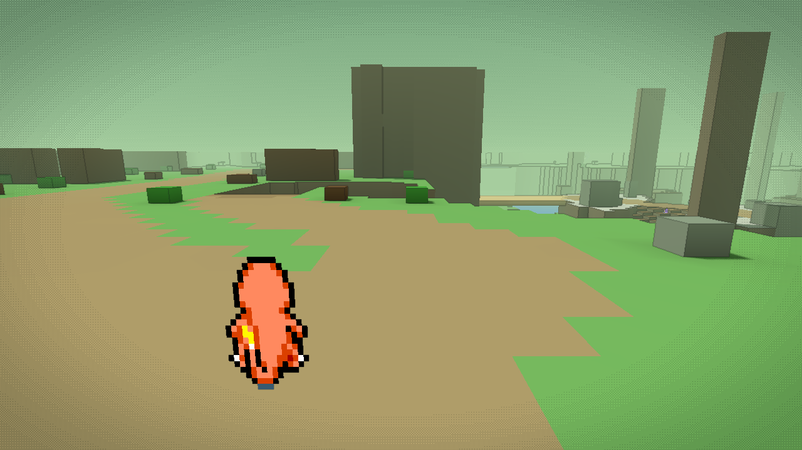
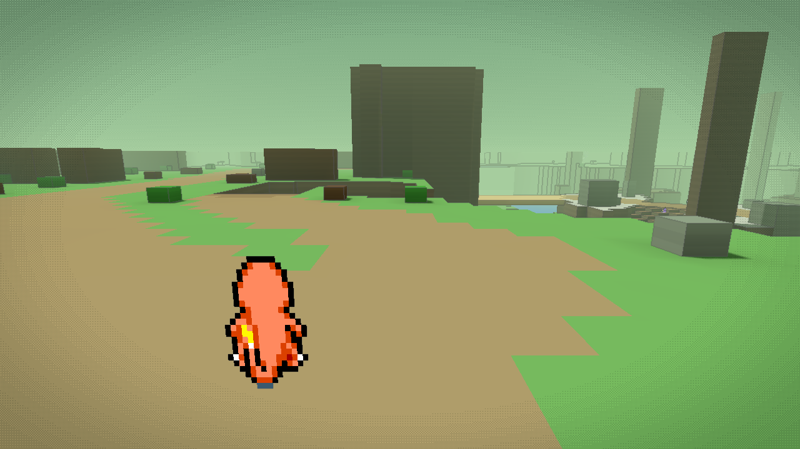
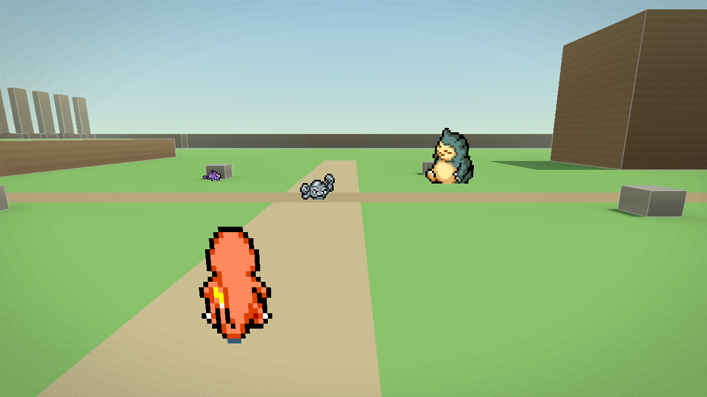
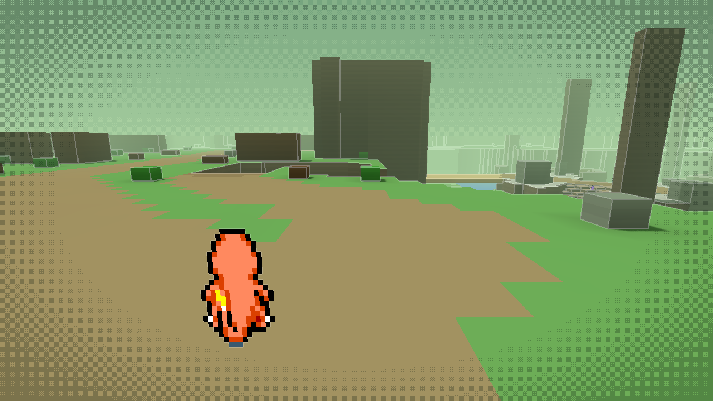
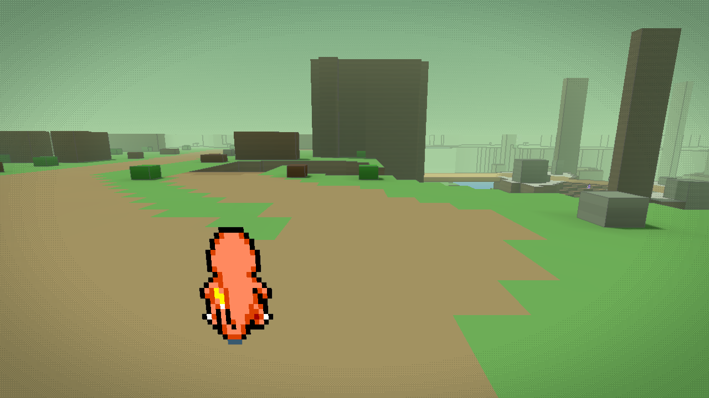

# The `lowpoly` look sheet (ROADMAP F111)

The owner picks the ramp, the paint terms and the ink of the `lowpoly` profile from these frames (owner, 2026-11-27).
Claude builds the sheet and measures it; it does not pick. After the pick, the picks are applied and shown on the
hold-out maps.

## Pass marks

Written 2026-11-27, before any capture of the sheet existed, and committed on their own so the order is on record.

1. **Tops read apart from sides** (WORLDGEN3D Q23.3). For every role the tile maps write (ground, path, soil, rock,
   cliff, floor, cover, foliage, trunk), on the map's binding (the range: `meadow`; River Gorge: `forest`) at its fixed
   hour (10:00), the resolved top tone and the resolved side tone differ by **ΔL\* ≥ 12** (CIE L\*, the camouflage
   line of `src/render/metrics.ts`).
   - Top: an open-sky face looking up, with the facet tone at its darkest (−facet tone), at the local top (no
     vertical gradient).
   - Side: the **brightest** of the four vertical faces (±x, ±z; the one facing the sun at 10:00), open sky, with the
     facet tone at its brightest (+facet tone), at its top edge (no vertical gradient), between strata bands.
   - So the mark is the worst case the shader can produce, computed from the same maths as the shader
     (`scripts/toplint.ts`). Ink and edge light draw lines, not tones, and do not enter it.
   - A variant passes when every role passes on both maps; the table lists the smallest gap and its role.
2. **Signals keep their colour.** `tools/three-signal.mjs` with the variant's parameters reads (255, 102, 32) within ±2
   at all four signal points, in all five of its variants, on both backends.
3. **The frame stays within budget.** GPU time ≤ 4.0 ms p95 (`src/rules/styles/budgets.ts`) by `tools/s2perf.mjs` at
   1920 × 1080 on the WebGL 2 backend (the budget's baseline), S2's scene (240 actors frozen, the camera orbiting), on
   the range and on River Gorge. WebGPU is measured too and listed for information.

A variant that fails any mark is still shown, marked fail.

## The grid

At 10:00 (the fixed hour), 2 × 2 × 2 = 8 variants per map, all from one camera pose per map with a creature in frame
(the spawn pose in capture mode, after 1 s; the player is in frame, and on the range the dummies too).

| | 0 | 1 |
|---|---|---|
| r: ramp | smooth (continuous, today's) | 3 bands with soft edges (`bands=3&soft=0.3`) |
| p: paint | all 0 (today's) | moderate: facet tone 0.06, vertical gradient 0.25, edge light 0.12, strata 0.08 on steep faces only (`facet=0.06&vgrad=0.25&edge=0.12&strata=0.08`) |
| i: ink | off (today's) | thin (1 px) and dark (sRGB 0.08, 0.07, 0.10) with a low world share: weight 1, every world role's share 0.35 (`ink=1&inkshare=0.35`) |

The moderate paint values and the ink share are the sheet's sample points, not picks.

**Maps.** Tuned on the range and River Gorge (seed 1). **Hold-outs: Chargestone Cave and the dusk lagoon** (Cascade
Lagoon, its `dusk` variant): no frame of either is taken or looked at until the variants are picked.

## Results (2026-11-27)

Build: `feat/i2a-look-sheet`, three 0.187.0, Apple M3 Max, headed Chrome for Testing, real GPU. Frames 1280 × 720 on
WebGPU, the 3D canvas alone (HUD hidden). Marks: `npx tsx tools/looksheet.ts <build>/index.html docs/looksheet/2026-11-27`
(`results.json` holds every number and the signal check's full output per variant).

**No variant passes: all eight fail mark 1.** Marks 2 and 3 pass everywhere: the signals read (255, 102, 32) in all
80 runs, and the heaviest variant costs 1.51 ms p95 against 4.0.

| Variant | Ramp | Paint | Ink | 1. Top/side min ΔL* (≥ 12) | info: mean-side min ΔL* | 2. Signals | 3. GPU p95 WebGL 2, range / gorge (≤ 4.0) | WebGPU p50 / p95, range; gorge | Result |
|---|---|---|---|---|---|---|---|---|---|
| r0p0i0 | smooth | 0 | off | **fail** 5.6 (range trunk) | 13.8 | pass | pass 1.08 / 1.15 | 0.87 / 0.99; 0.94 / 1.1 | **fail** (mark 1) |
| r0p0i1 | smooth | 0 | thin, share 0.35 | **fail** 5.6 (range trunk) | 13.8 | pass | pass 1.22 / 1.51 | 0.94 / 1.17; 1.12 / 1.28 | **fail** (mark 1) |
| r0p1i0 | smooth | moderate | off | **fail** 3.4 (range trunk) | 14.7 | pass | pass 1.2 / 1.25 | 1 / 1.19; 1.06 / 1.3 | **fail** (mark 1) |
| r0p1i1 | smooth | moderate | thin, share 0.35 | **fail** 3.4 (range trunk) | 14.7 | pass | pass 1.32 / 1.32 | 1.03 / 1.22; 1.12 / 1.31 | **fail** (mark 1) |
| r1p0i0 | 3 soft bands | 0 | off | **fail** 5.7 (range trunk) | 11.6 | pass | pass 1.1 / 1.2 | 0.85 / 1.01; 0.91 / 1.1 | **fail** (mark 1) |
| r1p0i1 | 3 soft bands | 0 | thin, share 0.35 | **fail** 5.7 (range trunk) | 11.6 | pass | pass 1.3 / 1.33 | 0.94 / 1.16; 1.04 / 1.23 | **fail** (mark 1) |
| r1p1i0 | 3 soft bands | moderate | off | **fail** 3.7 (range trunk) | 12.4 | pass | pass 1.29 / 1.27 | 1.01 / 1.22; 1.08 / 1.31 | **fail** (mark 1) |
| r1p1i1 | 3 soft bands | moderate | thin, share 0.35 | **fail** 3.7 (range trunk) | 12.4 | pass | pass 1.29 / 1.4 | 1.08 / 1.23; 1.1 / 1.32 | **fail** (mark 1) |

### Mark 1 per role (ΔL\*, darkest top against brightest side; `npx tsx scripts/toplint.ts`)

```
r0p0i0   FAIL  min ΔL* 5.6 (range trunk)   info: min mean-side ΔL* 13.8
         range  ground 9.3  path 9.7  soil 8.8  rock 10.2  cliff 8.0  floor 9.8  cover 8.9  foliage 7.9  trunk 5.6
         gorge  ground 8.7  path 8.2  soil 7.6  rock 10.2  cliff 6.9  floor 9.9  cover 8.1  foliage 8.0  trunk 5.6
r0p0i1   FAIL  min ΔL* 5.6 (range trunk)   info: min mean-side ΔL* 13.8
         range  ground 9.3  path 9.7  soil 8.8  rock 10.2  cliff 8.0  floor 9.8  cover 8.9  foliage 7.9  trunk 5.6
         gorge  ground 8.7  path 8.2  soil 7.6  rock 10.2  cliff 6.9  floor 9.9  cover 8.1  foliage 8.0  trunk 5.6
r0p1i0   FAIL  min ΔL* 3.4 (range trunk)   info: min mean-side ΔL* 14.7
         range  ground 5.8  path 6.0  soil 5.5  rock 6.4  cliff 4.9  floor 6.1  cover 5.5  foliage 5.0  trunk 3.4
         gorge  ground 5.4  path 5.1  soil 4.7  rock 6.4  cliff 4.3  floor 6.2  cover 5.1  foliage 5.0  trunk 3.5
r0p1i1   FAIL  min ΔL* 3.4 (range trunk)   info: min mean-side ΔL* 14.7
         range  ground 5.8  path 6.0  soil 5.5  rock 6.4  cliff 4.9  floor 6.1  cover 5.5  foliage 5.0  trunk 3.4
         gorge  ground 5.4  path 5.1  soil 4.7  rock 6.4  cliff 4.3  floor 6.2  cover 5.1  foliage 5.0  trunk 3.5
r1p0i0   FAIL  min ΔL* 5.7 (range trunk)   info: min mean-side ΔL* 11.6
         range  ground 9.5  path 9.9  soil 9.0  rock 10.5  cliff 8.2  floor 10.0  cover 9.1  foliage 8.1  trunk 5.7
         gorge  ground 8.9  path 8.4  soil 7.7  rock 10.5  cliff 7.0  floor 10.1  cover 8.3  foliage 8.2  trunk 5.7
r1p0i1   FAIL  min ΔL* 5.7 (range trunk)   info: min mean-side ΔL* 11.6
         range  ground 9.5  path 9.9  soil 9.0  rock 10.5  cliff 8.2  floor 10.0  cover 9.1  foliage 8.1  trunk 5.7
         gorge  ground 8.9  path 8.4  soil 7.7  rock 10.5  cliff 7.0  floor 10.1  cover 8.3  foliage 8.2  trunk 5.7
r1p1i0   FAIL  min ΔL* 3.7 (range trunk)   info: min mean-side ΔL* 12.4
         range  ground 6.2  path 6.4  soil 5.9  rock 6.8  cliff 5.3  floor 6.5  cover 5.9  foliage 5.3  trunk 3.7
         gorge  ground 5.8  path 5.4  soil 5.0  rock 6.8  cliff 4.6  floor 6.6  cover 5.4  foliage 5.4  trunk 3.7
r1p1i1   FAIL  min ΔL* 3.7 (range trunk)   info: min mean-side ΔL* 12.4
         range  ground 6.2  path 6.4  soil 5.9  rock 6.8  cliff 5.3  floor 6.5  cover 5.9  foliage 5.3  trunk 3.7
         gorge  ground 5.8  path 5.4  soil 5.0  rock 6.8  cliff 4.6  floor 6.6  cover 5.4  foliage 5.4  trunk 3.7
```

### Why mark 1 fails, and what the grid does not reach

Measured, not a pick:

- **The gap comes from the light split, which the grid holds fixed.** At 10:00 the key light stands 60° up on the flank
  side. The sun-facing side gets 0.75 × cos 60° of key plus the side ambient (0.35), about 0.72 of what an open top
  gets. That is 8–10 ΔL\* on mid-tone roles and 5.6 on the darkest (trunk), against 12. That split is the key-to-ambient
  share (0.65 day) and the fixed hour, both kept provisional or accepted on 2026-11-27.
- **The sides away from the sun are darker.** The mean of the four sides (information column) is 11.6–14.7 below the
  top, around the line; the sun-facing side is the one that sits close to its top.
- **The paint set narrows the worst case.** Facet tone ±0.06 brightens a side and darkens a top by up to 6 % each:
  about −2.4 ΔL\*. The vertical gradient only acts below the top edge, where the mark does not look; it widens the
  mean (+0.9).
- **Three bands barely move it** (+0.1 to +0.3). At 10:00 they quantise the top's n·l from 0.87 to 0.67 and the sun
  side's from 0.5 to 0.33: both lose about the same share of key light, so their ratio hardly changes (the mean gap
  narrows, 13.8 → 11.6, because the top loses most).
- **Ink and edge light** draw lines, not tones, so they cannot change mark 1. On screen they are what separates a
  top from a side at its edge.
- The levers outside this grid are each a look call: a higher key share against the ambient (more of the top's
  light then comes from overhead) or a higher sun (an earlier or later hour lowers it and narrows the gap); a top
  treatment from Q23.3's closed list (caps, lips,
  bands, bevels, deposits: G1b's builders); a per-role side tint; or a mark measured differently (the mean side, or a
  ΔE instead of ΔL\*).

### Frames

Hold-outs (Chargestone Cave, the dusk lagoon): not loaded or captured.

| Variant | Range | River Gorge |
|---|---|---|
| r0p0i0 |  |  |
| r0p0i1 |  |  |
| r0p1i0 |  |  |
| r0p1i1 |  |  |
| r1p0i0 |  |  |
| r1p0i1 |  |  |
| r1p1i0 |  |  |
| r1p1i1 |  |  |
