# The `lowpoly` look sheet (ROADMAP F111)

The owner picks the ramp, the paint terms and the ink of the `lowpoly` profile from these frames (owner, 2026-11-27).
Claude builds the sheet and measures it; it does not pick. After the pick, the picks are applied and shown on the
hold-out maps.

## Pass marks

Written 2026-11-27, before any capture of the sheet existed, and committed on their own so the order is on record.

1. **Tops read apart from sides** (WORLDGEN3D Q23.3). For every role the tile maps write (ground, path, soil, rock,
   cliff, floor, cover, foliage, trunk), on the map's binding (the range: `meadow`; River Gorge: `forest`) at its fixed
   hour (10:00), the resolved top tone and the resolved side tone differ by **ΔL\* ≥ 12** (CIE L\*, the camouflage
   line of `src/render/metrics.ts`).
   - Top: an open-sky face looking up, with the facet tone at its darkest (−facet tone), at the local top (no
     vertical gradient).
   - Side: the **brightest** of the four vertical faces (±x, ±z; the one facing the sun at 10:00), open sky, with the
     facet tone at its brightest (+facet tone), at its top edge (no vertical gradient), between strata bands.
   - So the mark is the worst case the shader can produce, computed from the same maths as the shader
     (`scripts/toplint.ts`). Ink and edge light draw lines, not tones, and do not enter it.
   - A variant passes when every role passes on both maps; the table lists the smallest gap and its role.
2. **Signals keep their colour.** `tools/three-signal.mjs` with the variant's parameters reads (255, 102, 32) within ±2
   at all four signal points, in all five of its variants, on both backends.
3. **The frame stays within budget.** GPU time ≤ 4.0 ms p95 (`src/rules/styles/budgets.ts`) by `tools/s2perf.mjs` at
   1920 × 1080 on the WebGL 2 backend (the budget's baseline), S2's scene (240 actors frozen, the camera orbiting), on
   the range and on River Gorge. WebGPU is measured too and listed for information.

A variant that fails any mark is still shown, marked fail.

## The grid

At 10:00 (the fixed hour), 2 × 2 × 2 = 8 variants per map, all from one camera pose per map with a creature in frame
(the spawn pose in capture mode, after 1 s; the player is in frame, and on the range the dummies too).

| | 0 | 1 |
|---|---|---|
| r: ramp | smooth (continuous, today's) | 3 bands with soft edges (`bands=3&soft=0.3`) |
| p: paint | all 0 (today's) | moderate: facet tone 0.06, vertical gradient 0.25, edge light 0.12, strata 0.08 on steep faces only (`facet=0.06&vgrad=0.25&edge=0.12&strata=0.08`) |
| i: ink | off (today's) | thin (1 px) and dark (sRGB 0.08, 0.07, 0.10) with a low world share: weight 1, every world role's share 0.35 (`ink=1&inkshare=0.35`) |

The moderate paint values and the ink share are the sheet's sample points, not picks.

**Maps.** Tuned on the range and River Gorge (seed 1). **Hold-outs: Chargestone Cave and the dusk lagoon** (Cascade
Lagoon, its `dusk` variant): no frame of either is taken or looked at until the variants are picked.

## Results (2026-11-27)

Build: `feat/i2a-look-sheet`, three 0.187.0, Apple M3 Max, headed Chrome for Testing, real GPU. Frames 1280 × 720 on
WebGPU, the 3D canvas alone (HUD hidden). Marks: `npx tsx tools/looksheet.ts <build>/index.html docs/looksheet/2026-11-27`
(`results.json` holds every number and the signal check's full output per variant).

**No variant passes: all eight fail mark 1.** Marks 2 and 3 pass everywhere: the signals read (255, 102, 32) in all
80 runs, and the heaviest variant costs 1.51 ms p95 against 4.0.

| Variant | Ramp | Paint | Ink | 1. Top/side min ΔL* (≥ 12) | info: mean-side min ΔL* | 2. Signals | 3. GPU p95 WebGL 2, range / gorge (≤ 4.0) | WebGPU p50 / p95, range; gorge | Result |
|---|---|---|---|---|---|---|---|---|---|
| r0p0i0 | smooth | 0 | off | **fail** 5.6 (range trunk) | 13.8 | pass | pass 1.08 / 1.15 | 0.87 / 0.99; 0.94 / 1.1 | **fail** (mark 1) |
| r0p0i1 | smooth | 0 | thin, share 0.35 | **fail** 5.6 (range trunk) | 13.8 | pass | pass 1.22 / 1.51 | 0.94 / 1.17; 1.12 / 1.28 | **fail** (mark 1) |
| r0p1i0 | smooth | moderate | off | **fail** 3.4 (range trunk) | 14.7 | pass | pass 1.2 / 1.25 | 1 / 1.19; 1.06 / 1.3 | **fail** (mark 1) |
| r0p1i1 | smooth | moderate | thin, share 0.35 | **fail** 3.4 (range trunk) | 14.7 | pass | pass 1.32 / 1.32 | 1.03 / 1.22; 1.12 / 1.31 | **fail** (mark 1) |
| r1p0i0 | 3 soft bands | 0 | off | **fail** 5.7 (range trunk) | 11.6 | pass | pass 1.1 / 1.2 | 0.85 / 1.01; 0.91 / 1.1 | **fail** (mark 1) |
| r1p0i1 | 3 soft bands | 0 | thin, share 0.35 | **fail** 5.7 (range trunk) | 11.6 | pass | pass 1.3 / 1.33 | 0.94 / 1.16; 1.04 / 1.23 | **fail** (mark 1) |
| r1p1i0 | 3 soft bands | moderate | off | **fail** 3.7 (range trunk) | 12.4 | pass | pass 1.29 / 1.27 | 1.01 / 1.22; 1.08 / 1.31 | **fail** (mark 1) |
| r1p1i1 | 3 soft bands | moderate | thin, share 0.35 | **fail** 3.7 (range trunk) | 12.4 | pass | pass 1.29 / 1.4 | 1.08 / 1.23; 1.1 / 1.32 | **fail** (mark 1) |

### Mark 1 per role (ΔL\*, darkest top against brightest side; `npx tsx scripts/toplint.ts`)

```
r0p0i0   FAIL  min ΔL* 5.6 (range trunk)   info: min mean-side ΔL* 13.8
         range  ground 9.3  path 9.7  soil 8.8  rock 10.2  cliff 8.0  floor 9.8  cover 8.9  foliage 7.9  trunk 5.6
         gorge  ground 8.7  path 8.2  soil 7.6  rock 10.2  cliff 6.9  floor 9.9  cover 8.1  foliage 8.0  trunk 5.6
r0p0i1   FAIL  min ΔL* 5.6 (range trunk)   info: min mean-side ΔL* 13.8
         range  ground 9.3  path 9.7  soil 8.8  rock 10.2  cliff 8.0  floor 9.8  cover 8.9  foliage 7.9  trunk 5.6
         gorge  ground 8.7  path 8.2  soil 7.6  rock 10.2  cliff 6.9  floor 9.9  cover 8.1  foliage 8.0  trunk 5.6
r0p1i0   FAIL  min ΔL* 3.4 (range trunk)   info: min mean-side ΔL* 14.7
         range  ground 5.8  path 6.0  soil 5.5  rock 6.4  cliff 4.9  floor 6.1  cover 5.5  foliage 5.0  trunk 3.4
         gorge  ground 5.4  path 5.1  soil 4.7  rock 6.4  cliff 4.3  floor 6.2  cover 5.1  foliage 5.0  trunk 3.5
r0p1i1   FAIL  min ΔL* 3.4 (range trunk)   info: min mean-side ΔL* 14.7
         range  ground 5.8  path 6.0  soil 5.5  rock 6.4  cliff 4.9  floor 6.1  cover 5.5  foliage 5.0  trunk 3.4
         gorge  ground 5.4  path 5.1  soil 4.7  rock 6.4  cliff 4.3  floor 6.2  cover 5.1  foliage 5.0  trunk 3.5
r1p0i0   FAIL  min ΔL* 5.7 (range trunk)   info: min mean-side ΔL* 11.6
         range  ground 9.5  path 9.9  soil 9.0  rock 10.5  cliff 8.2  floor 10.0  cover 9.1  foliage 8.1  trunk 5.7
         gorge  ground 8.9  path 8.4  soil 7.7  rock 10.5  cliff 7.0  floor 10.1  cover 8.3  foliage 8.2  trunk 5.7
r1p0i1   FAIL  min ΔL* 5.7 (range trunk)   info: min mean-side ΔL* 11.6
         range  ground 9.5  path 9.9  soil 9.0  rock 10.5  cliff 8.2  floor 10.0  cover 9.1  foliage 8.1  trunk 5.7
         gorge  ground 8.9  path 8.4  soil 7.7  rock 10.5  cliff 7.0  floor 10.1  cover 8.3  foliage 8.2  trunk 5.7
r1p1i0   FAIL  min ΔL* 3.7 (range trunk)   info: min mean-side ΔL* 12.4
         range  ground 6.2  path 6.4  soil 5.9  rock 6.8  cliff 5.3  floor 6.5  cover 5.9  foliage 5.3  trunk 3.7
         gorge  ground 5.8  path 5.4  soil 5.0  rock 6.8  cliff 4.6  floor 6.6  cover 5.4  foliage 5.4  trunk 3.7
r1p1i1   FAIL  min ΔL* 3.7 (range trunk)   info: min mean-side ΔL* 12.4
         range  ground 6.2  path 6.4  soil 5.9  rock 6.8  cliff 5.3  floor 6.5  cover 5.9  foliage 5.3  trunk 3.7
         gorge  ground 5.8  path 5.4  soil 5.0  rock 6.8  cliff 4.6  floor 6.6  cover 5.4  foliage 5.4  trunk 3.7
```

### Why mark 1 fails, and what the grid does not reach

Measured, not a pick:

- **The gap comes from the light split, which the grid holds fixed.** At 10:00 the key light stands 60° up on the flank
  side. The sun-facing side gets 0.75 × cos 60° of key plus the side ambient (0.35), about 0.72 of what an open top
  gets. That is 8–10 ΔL\* on mid-tone roles and 5.6 on the darkest (trunk), against 12. That split is the key-to-ambient
  share (0.65 day) and the fixed hour, both kept provisional or accepted on 2026-11-27.
- **The sides away from the sun are darker.** The mean of the four sides (information column) is 11.6–14.7 below the
  top, around the line; the sun-facing side is the one that sits close to its top.
- **The paint set narrows the worst case.** Facet tone ±0.06 brightens a side and darkens a top by up to 6 % each:
  about −2.4 ΔL\*. The vertical gradient only acts below the top edge, where the mark does not look; it widens the
  mean (+0.9).
- **Three bands barely move it** (+0.1 to +0.3). At 10:00 they quantise the top's n·l from 0.87 to 0.67 and the sun
  side's from 0.5 to 0.33: both lose about the same share of key light, so their ratio hardly changes (the mean gap
  narrows, 13.8 → 11.6, because the top loses most).
- **Ink and edge light** draw lines, not tones, so they cannot change mark 1. On screen they are what separates a
  top from a side at its edge.
- The levers outside this grid are each a look call: a higher key share against the ambient (more of the top's
  light then comes from overhead) or a higher sun (an earlier or later hour lowers it and narrows the gap); a top
  treatment from Q23.3's closed list (caps, lips,
  bands, bevels, deposits: G1b's builders); a per-role side tint; or a mark measured differently (the mean side, or a
  ΔE instead of ΔL\*).

### Frames

Hold-outs (Chargestone Cave, the dusk lagoon): not loaded or captured.

| Variant | Range | River Gorge |
|---|---|---|
| r0p0i0 |  |  |
| r0p0i1 |  |  |
| r0p1i0 |  |  |
| r0p1i1 |  |  |
| r1p0i0 |  |  |
| r1p0i1 |  | 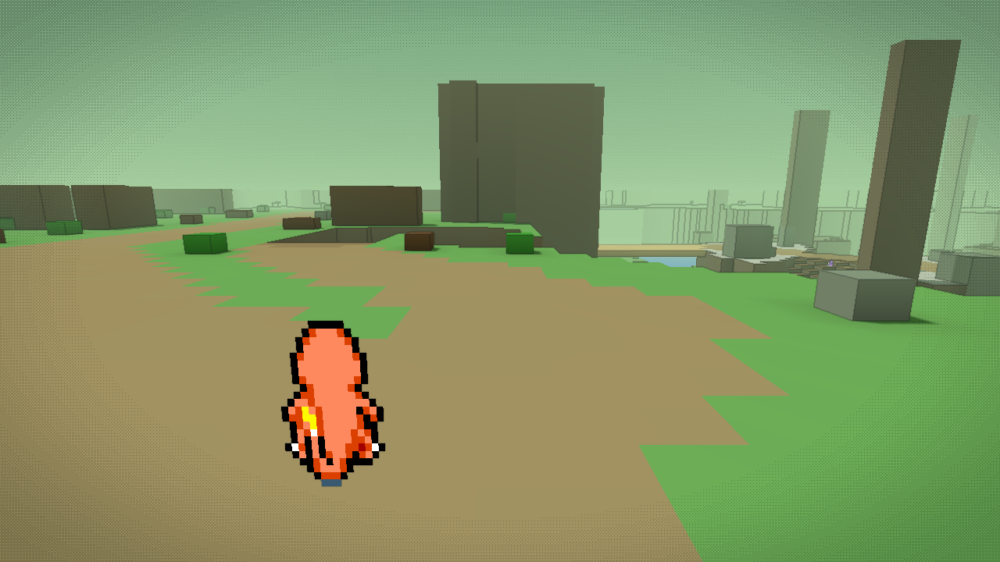 |
| r1p1i0 |  |  |
| r1p1i1 |  |  |

## Round 2 (owner, 2026-11-27): the plan

The owner's changes after round 1: no pick yet; mark 1 unchanged; the bands axis dropped (it moves mark 1 by under 0.3
ΔL\* and does not show in frames; it returns later as a feel question); a toplint-only sweep before any capture; a
second pose per map; the ink checked against fog. Hold-outs stay closed. Written and committed before the sweep runs.

### The sweep (no frames)

`npx tsx scripts/toplint.ts --sweep`: mark 1 exactly as written above (darkest top against brightest side, ΔL\* ≥ 12,
every written role, both bindings), over:

- **key share** at the fixed hour (the key light's part of an open top's light, the rest ambient): 0.65 (today),
  0.75, 0.85;
- **the fixed hour:** 10:00 (the sun 60° up) and 11:00 (75° up: a higher sun). The keyframes are anchored at the
  hour swept, so an open top still shows its base colour there;
- **facet tone**, at the moderate set's 0.06: ± by plane (today: the mark takes the darkest top, −0.06, against the
  brightest side, +0.06), and locked to orientation (tops +0.06, sides −0.06); and 0 for reference.

The other paint terms do not enter mark 1 (the vertical gradient acts below the top edge, strata between bands,
edge light and ink draw lines). The report lists min ΔL\* per role for every cell.

**Crushing the ambient**, declared now: a light split crushes the ambient when the darkest written role's open top,
in full shadow (ambient only), falls below **L\* 20** on either binding. The report lists that L\* per cell. A split
that gets trunk and cliff to 12 only by crushing does not count.

If no cell gets trunk and cliff to 12 without crushing, mark 1 for the dark roles goes to G1b's top builders (Q23.3's
treatments, F111), and the owner picks ink and paint on feel.

### The re-capture

Paint (0 or moderate) × ink (off or thin, share 0.35): four variants, at 10:00 and today's key share (the sweep
changes nothing in the frames until the owner says so), on two poses per map: the spawn pose of round 1, and one
looking down onto a ledge or cliff top so tops are in frame. Marks 2 and 3 per variant as before.

## Round 2: the sweep's result

`npx tsx scripts/toplint.ts --sweep` (min ΔL\* per role over both bindings; the last column is the darkest role's open
top in full shadow, crushed below L\* 20):

```
share hour facet            ground    path    soil    rock   cliff   floor   cover foliage   trunk   min  shadowTop L*min
0.65  10   0                   8.7     8.2     7.6    10.2     6.9     9.8     8.1     7.9     5.6   5.6    23.1
0.65  10   ±0.06 by plane      5.4     5.1     4.7     6.4     4.3     6.1     5.1       5     3.4   3.4    23.1
0.65  10   oriented 0.06      11.9    11.3    10.4      14     9.4    13.5    11.2    10.9     7.7   7.7    23.1
0.65  11   0                  16.4    15.7    14.5    19.5    13.1    18.9    15.5      15    10.8  10.8    23.1
0.65  11   ±0.06 by plane     13.3    12.7    11.8    15.9    10.7    15.3    12.6    12.2     8.7   8.7    23.1
0.65  11   oriented 0.06      19.5    18.6    17.2    23.2    15.6    22.4    18.4    17.8    12.8  12.8    23.1
0.75  10   0                  10.1     9.6     8.9      12     8.1    11.6     9.6     9.3     6.6   6.6    19 crushed
0.75  10   ±0.06 by plane      6.9     6.6     6.1     8.2     5.5     7.9     6.5     6.4     4.5   4.5    19 crushed
0.75  10   oriented 0.06      13.3    12.7    11.8    15.8    10.6    15.3    12.6    12.2     8.7   8.7    19 crushed
0.75  11   0                  19.7    18.9    17.5    23.5    15.8    22.8    18.6    18.1      13    13    19 crushed
0.75  11   ±0.06 by plane     16.7      16    14.8    19.9    13.4    19.3    15.8    15.3      11    11    19 crushed
0.75  11   oriented 0.06      22.7    21.8    20.2    27.1    18.2    26.2    21.5    20.8      15    15    19 crushed
0.85  10   0                  11.7    11.2    10.3    13.9     9.4    13.5      11    10.7     7.7   7.7    13.5 crushed
0.85  10   ±0.06 by plane      8.5     8.1     7.5    10.1     6.8     9.8       8     7.8     5.6   5.6    13.5 crushed
0.85  10   oriented 0.06      14.9    14.2    13.1    17.7    11.9    17.1      14    13.6     9.8   9.8    13.5 crushed
0.85  11   0                  23.4    22.5    20.8      28    18.8    27.1    22.2    21.5    15.5  15.5    13.5 crushed
0.85  11   ±0.06 by plane     20.5    19.7    18.2    24.5    16.5    23.7    19.4    18.8    13.6  13.6    13.5 crushed
0.85  11   oriented 0.06      26.4    25.3    23.4    31.4    21.2    30.5    24.9    24.2    17.5  17.5    13.5 crushed
```

- **One cell passes mark 1 for every role without crushing:** key share 0.65 (today's), fixed hour **11:00**, facet
  tone **locked to orientation** (tops +0.06, sides −0.06): trunk 12.8, cliff 15.6, every other role 15.6 or more;
  the shadowed top keeps L\* 23.1.
- **At 10:00 no cell passes**, crushed or not: the best is 9.8 on trunk (0.85, oriented), which crushes (L\* 13.5).
- **0.75 and 0.85 crush the ambient** by the line declared before the run (L\* 19.0 and 13.5 < 20). At 11:00, 0.75
  with facet 0 or oriented would pass mark 1, but crushed.
- **The facet tone by plane (today's shader) always hurts the worst case** (about −2 to −3 ΔL\*); locked to
  orientation it adds about +2 to +4, acting as a top/side tone term.
- So: mark 1 for the dark roles can be met by a light split, but only with **two changes that are the owner's**: the
  fixed hour 11:00 instead of the accepted 10:00, and facet tone locked to orientation (the shader has only the
  per-plane hash today; the lock is in the lint, not yet built). Otherwise it goes to G1b's top builders (F111).
  Nothing in the frames changes until the owner says.

## Round 2: the re-capture

Build: `feat/i2a-look-sheet` with the ink fog fix (below), same machine and method as round 1; the grid without the
bands axis, at 10:00 and today's key share; two poses per map. The ledge pose stands on the range's 2 m terrace,
5 m back from its edge, turned across it toward the field. The cliff pose stands on River Gorge's 6 m bluff, 4 m back
from its edge, looking down over the river. `results.json` holds every number.

| Variant | Paint | Ink | 1. Top/side min ΔL* (≥ 12) | 2. Signals | 3. GPU p95 WebGL 2, range / gorge (≤ 4.0) | WebGPU p50 / p95, range; gorge | Result |
|---|---|---|---|---|---|---|---|
| p0i0 | 0 | off | **fail** 5.6 (range trunk) | pass | pass 1.24 / 1.29 | 0.89 / 1.01; 0.93 / 1.1 | **fail** (mark 1) |
| p0i1 | 0 | thin, share 0.35 | **fail** 5.6 (range trunk) | pass | pass 1.37 / 1.42 | 1.12 / 1.22; 1.15 / 1.32 | **fail** (mark 1) |
| p1i0 | moderate | off | **fail** 3.4 (range trunk) | pass | pass 1.38 / 1.44 | 1.14 / 1.26; 1.19 / 1.38 | **fail** (mark 1) |
| p1i1 | moderate | thin, share 0.35 | **fail** 3.4 (range trunk) | pass | pass 1.41 / 1.44 | 1.14 / 1.27; 1.2 / 1.38 | **fail** (mark 1) |

Mark 1 is the round-1 number for each variant, unchanged (the frames are at 10:00 and the key share 0.65; the sweep
above lists what other splits would do). Marks 2 and 3 pass for all four: signals 40 of 40, at most 1.44 ms p95.

### The ink and the fog

The owner's report holds: in round 1 the ink and edge-light lines showed through the fog on far blocks (gorge,
r1p1i1). Two faults:

- The ink pass runs after the scene's fog, so its lines were never fogged.
- The pass computed depth with the `camera*` nodes, which inside the pipeline's quad pass are the quad's camera: the
  view distance came out near 0. S2's depth edge, ported unchanged, had the same fault.

Fixed (`src/render/three/passes.ts`): the pass reads the scene camera's projection and near/far explicitly. The ink
colour is fogged with the scene's own curve and colour at each pixel's view distance, and edge light fades by the
same amount. A line now loses contrast exactly as its surface does. The first try faded only the line's opacity,
which still left dark lines over fogged fill; it was replaced before the round-2 frames were taken.

### Frames

Hold-outs (Chargestone Cave, the dusk lagoon): not loaded or captured.

| Variant | Range, spawn | Range, ledge | River Gorge, spawn | River Gorge, cliff |
|---|---|---|---|---|
| p0i0 |  | 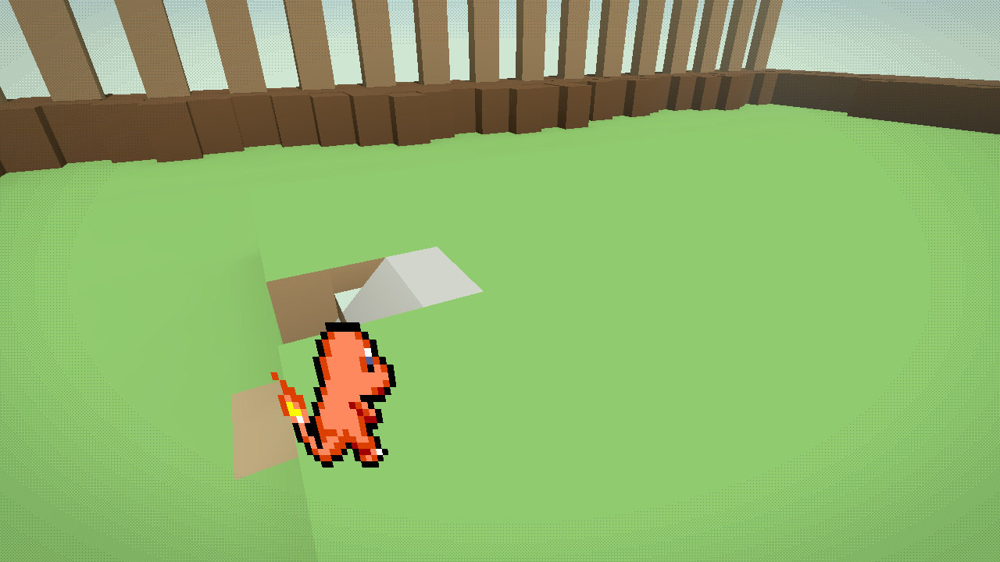 |  | 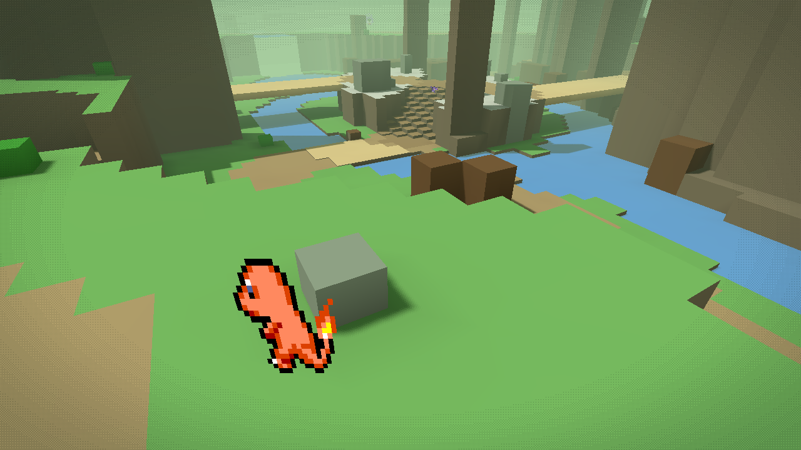 |
| p0i1 |  |  | 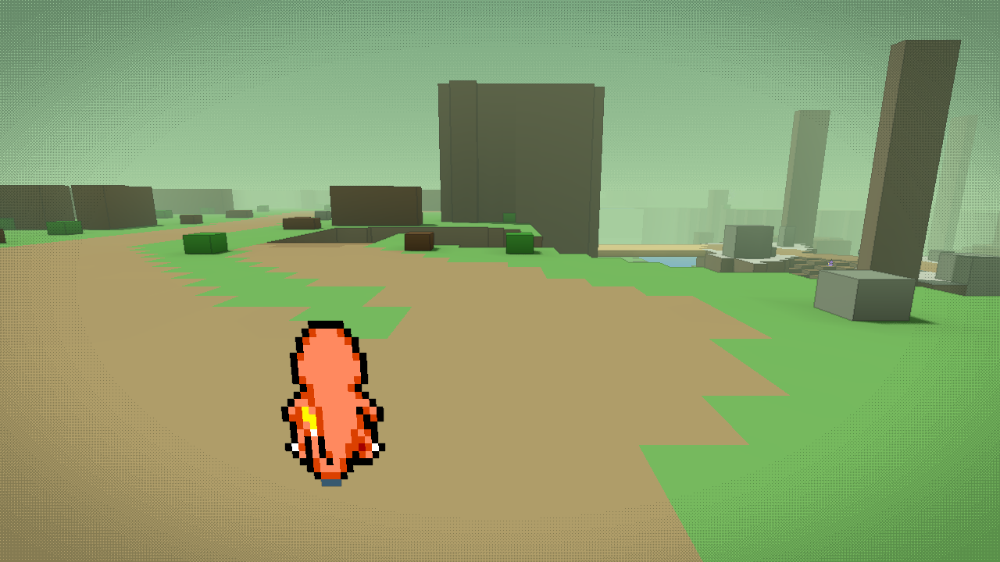 | 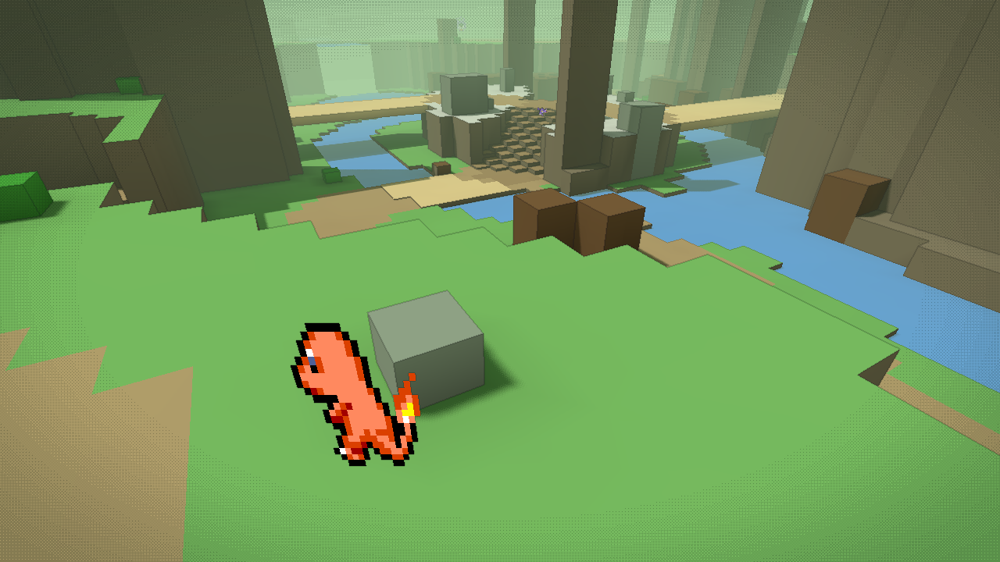 |
| p1i0 | 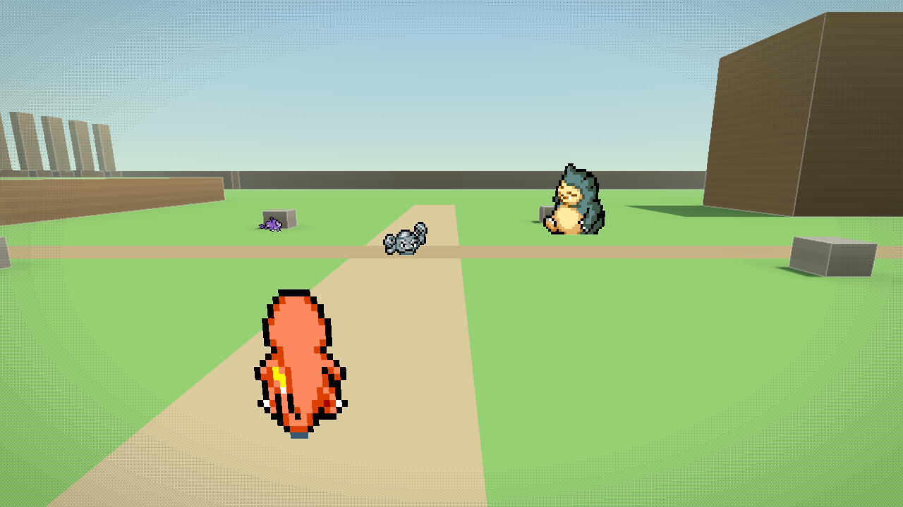 | 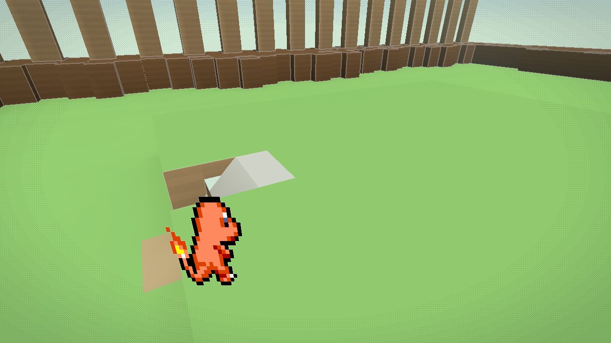 | 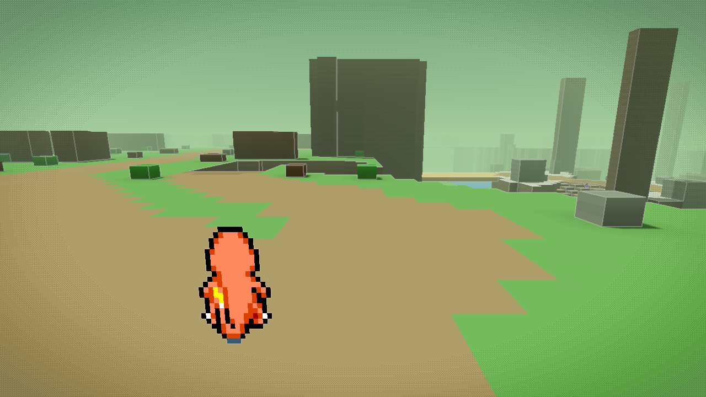 | 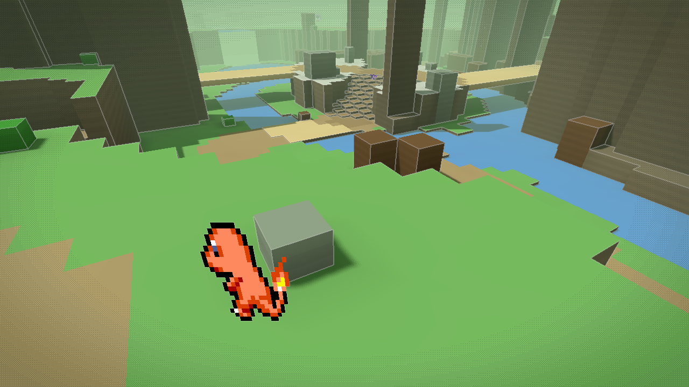 |
| p1i1 |  | 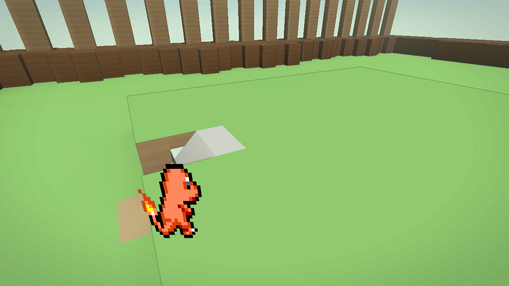 | 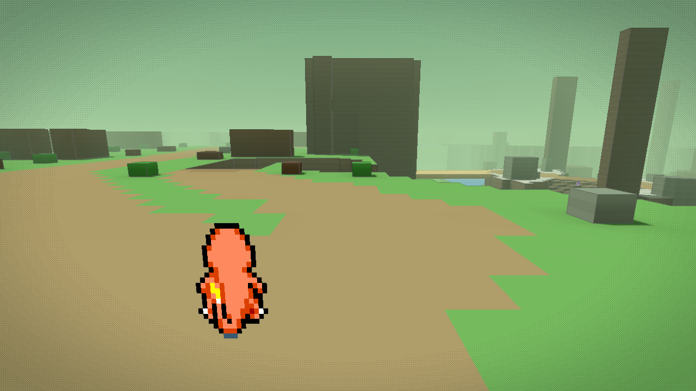 | 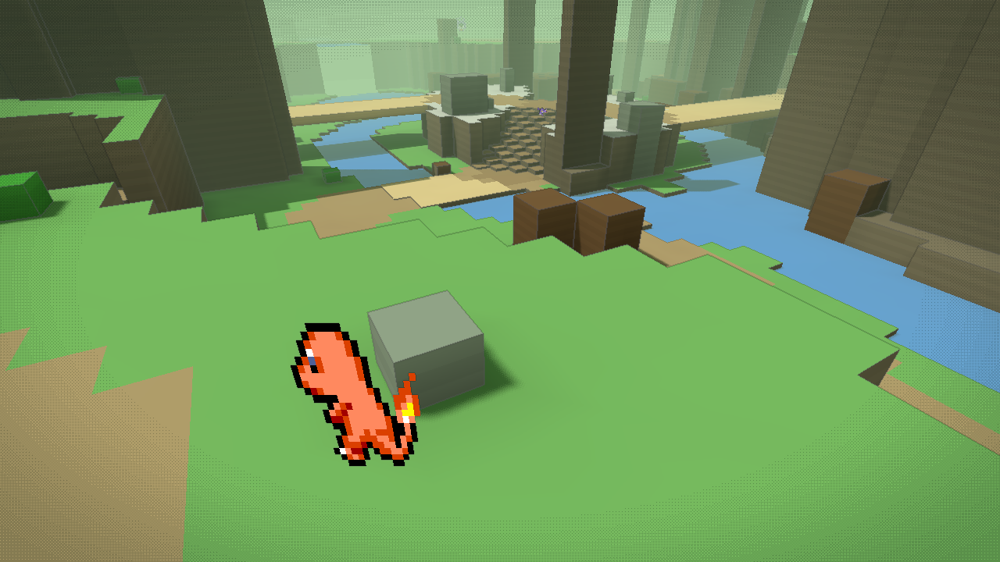 |

## Round 3 (owner, 2026-11-27): the plan

The owner's decisions after round 2: the fixed hour moves to 11:00 (day maps and caves; Duskwood Hollow keeps 22:00);
the facet tone is locked to orientation (+0.06 tops, −0.06 sides), built in the shader and the profile; toplint stays
the gate (`tests/looksheet.test.ts`); no ink or paint pick until the 11:00 frames exist; hold-outs stay closed.
Written and committed before the re-shoot.

- The grid: paint (0 | the moderate set's vertical gradient 0.25, edge light 0.12, strata 0.08) × ink (off | thin,
  share 0.35), all four carrying the profile's locked facet tone; 11:00; the same two poses per map as round 2.
- Mark 1 before the frames (`npx tsx scripts/toplint.ts`): all four pass, the smallest gap 12.8 (trunk on the range),
  every shadowed top L\* ≥ 23.
- Marks 2 and 3 by `tools/looksheet.ts`, as before.
